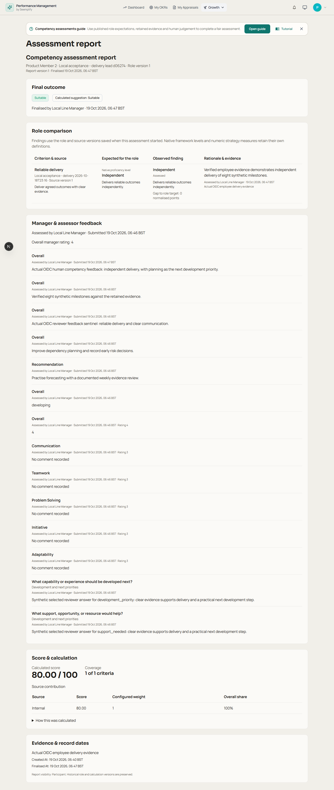
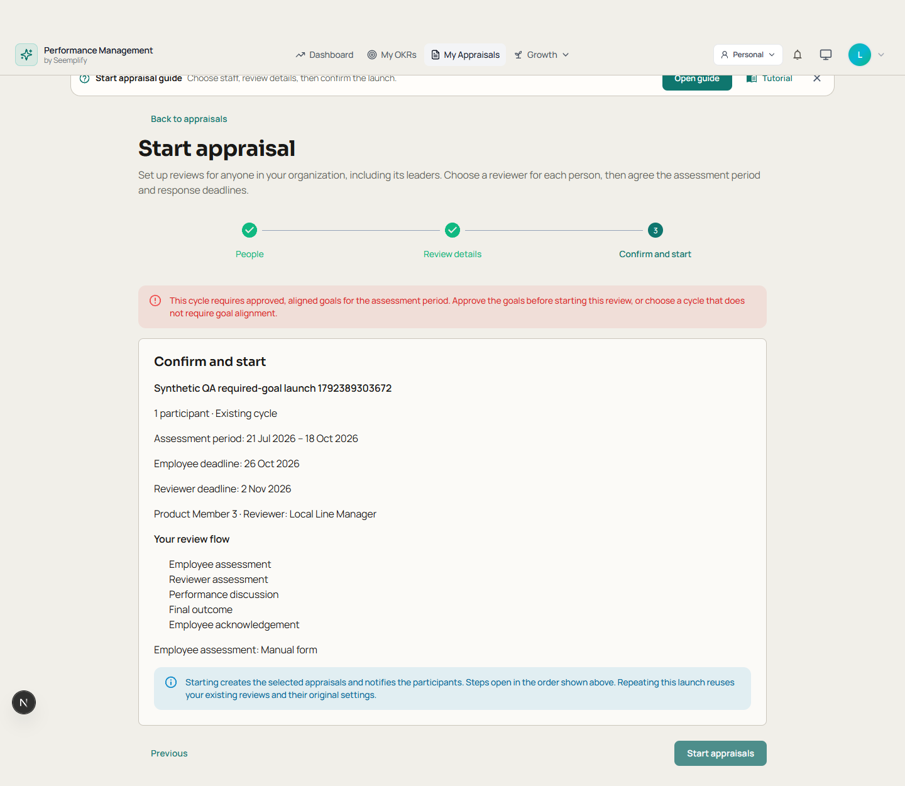

# Admin → manager → employee verification

19 October 2026. Follow-up acceptance for the competency-assessment programme.

The earlier owner-led walkthrough did not prove the complete handoff between three distinct signed-in roles. This follow-up adds that coverage and fixes the defects it exposed. All new test people, feedback, employment outcomes and documents are synthetic.

## What was exercised

| Step | Actual behaviour verified | Evidence layer |
| --- | --- | --- |
| 1. Administrator | Publish a framework, native level, occupational role and scoring cycle; select an eligible line manager and launch one ordinary appraisal with its frozen competency role | Automated browser using real product routes, canonical IdP grants/directory and disposable transactional Mongo; a separate real local IdP sign-in exercised the normal Start appraisal wizard |
| 2. Employee | Sign in separately, answer all seven required custom questions and submit the manual self-assessment; provide own competency evidence | Actual local Seemplify OIDC, browser forms, persistent local API/database; no token injection or intercepted product responses |
| 3. Selected manager | Sign in separately; submit both required custom reviewer questions, ratings and full feedback; assess evidence against the frozen native role level and publish a human decision | Actual local OIDC/browser; native score80, full submitted feedback and actual author/date verified |
| 4. Final handoff | Finalise the ordinary review, acknowledge as the employee, discover the competency report from the employee's own list | Discussion/finalisation through real REST; employee acknowledgement and report discovery through the browser. Published competency report hash remains unchanged |
| 5. Permission boundaries | Deny the unselected same-team manager, another team's manager, another employee and another tenant; hide assessor-only evidence and drafts | Actual local IdP sign-ins for both manager denials; disposable real-route tests for all boundaries |
| 6. Reports/PDF | Selected reviewer can download the two-page report. Default employees can read their own report but cannot export. An explicit central export grant allows only their own participant-scoped PDF | Browser download, strict PDF parsing and real authorization/receipt/download/revocation tests |
| 7. Goal-required launch | Reject absent, draft or unapproved goals before creating an appraisal or sending its events; approved aligned goals still launch; a mixed batch reports each outcome; retries reuse successful records | Actual goal create → submit → approve APIs, disposable real Mongo, and normal local administrator OIDC → Start appraisal browser rejection |

## Defects fixed

| Defect | Resulting behaviour | Regression coverage |
| --- | --- | --- |
| A second team manager could reach assessor-private content in a linked review | Linked competency reviews follow the explicitly selected, currently eligible reviewer. HR/admin scope and existing standalone managed-team behaviour are preserved | Same-team alternate manager denied ordinary and linked reads, edits, finalisation and export; lost directory eligibility also denied |
| An employee with an explicit PDF export grant was still refused their own report | The action grant is checked first, then own-assessment scope. No default employee grant was added | Default403, explicitly permitted own PDF, other-person denial, manager-owned receipt isolation and grant revocation |
| Employees entered an empty assessor workspace and could mistake redacted findings for unstarted work | Published report links open directly. Read-only users see their report or evidence/role expectations. Previous published reports remain discoverable after reopening; reviewer workspace and reopen access remain available | Distinct employee/redacted DTO fixtures, published/reopened/history, management CTA denial and positive reviewer access |
| Visible custom questions did not name their inputs | Text, numeric, checkbox and selection controls use their question's accessible name; text required state is exposed; question-label clicks focus the appropriate control | Real local required-question forms plus focused label-name, label-click/focus, autosave and rating tests |
| Goal-required reviews could be launched without goals, then strand the employee at submission | Launch rejects that person before appraisal/event creation, explaining that goals must be approved/aligned or a goal-optional cycle selected. The submission guard stays in place | Real approved-goal lifecycle, zero-write rejection, mixed batch, replay, and actual browser error/recovery state |

## Verification ledger

| Check | Result |
| --- | --- |
| Full clean backend suite after the final goal guard | **208/208 integration across19 suites,83/83 legacy and38/38 unit tests passed**; all nine new role/preflight cases included |
| Full application HTTP journeys with final permission and launch guards | **709 requests, zero expected-status mismatches**, including six complete ordinary-review lifecycles |
| New real-API browser role journey | **1/1 passed, no retry**; real app/routes/indexes, disposable replica set, fixture identity bridge |
| Focused interface regression suites | **58/58 passed, no retry**:23 competency +35 ordinary Performance cases |
| Final accessibility follow-up | **2/2 passed, no retry** after the final label/focus adjustment; these are additional executions of existing cases, not two new distinct cases |
| Genuine local IdP acceptance | **Five separate accounts**: administrator, selected line manager, employee, unselected team lead and another team's manager |
| Production frontend build / type check | **Passed** from a clean tracked-source snapshot plus owned overlays. Snapshot-only documented Turbopack common-root configuration accommodates local dependency junctions; product build configuration is unchanged |
| Independent review | Architect reviewed UI/permissions/harness; coordinator reviewed architect-authored authorization and fixture changes; architect reviewed the new browser journey |
| New release | Local acceptance complete; exact source promotion and live smoke recorded separately. Earlier production3095926a is a separate evidence layer |

Receipts: [browser/HTTP and local identity proof](evidence/admin-manager-employee-acceptance.json). Raw traces and authentication-bearing local operational logs remain ignored and are not published.

## Scope and preservation

- This is multi-role local acceptance, not a claim that real employee accounts were impersonated in production. Live revision/authenticated smoke is recorded separately after deployment.
- Optional external AI inference, new recorded meetings, a real customer pilot and full backup restoration are not certified by these role-journey runs. Existing provider-specific evidence remains separate.
- The manual local happy path uses an explicitly goal-optional synthetic cycle. Its seven employee and two reviewer custom questions remain required and were completed through browser forms. Goal-required positive/negative paths are separate tests; the requirement was not weakened.
- Legacy scope/call/load fixtures now explicitly declare goal-optional intent. Existing assertions, production defaults and goal-required policy remain unchanged; the1,000-person test still checks captured goal evidence and duplicate-free replay.
- Pre-existing appraisal lifecycle work is preserved. Only the nine-line launch guard is staged from the already-dirty appraisal router; unrelated router bytes and other dirty files remain outside this change.
