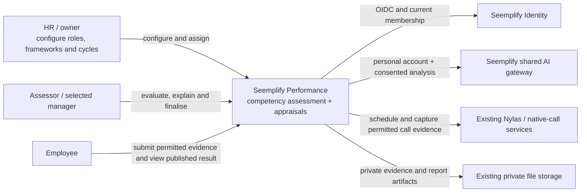
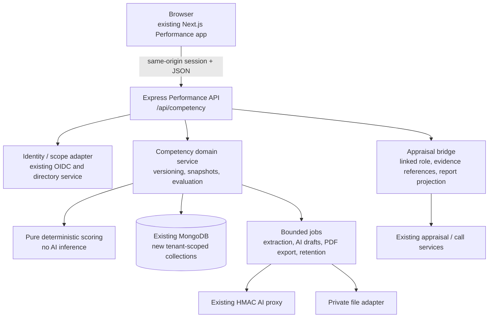
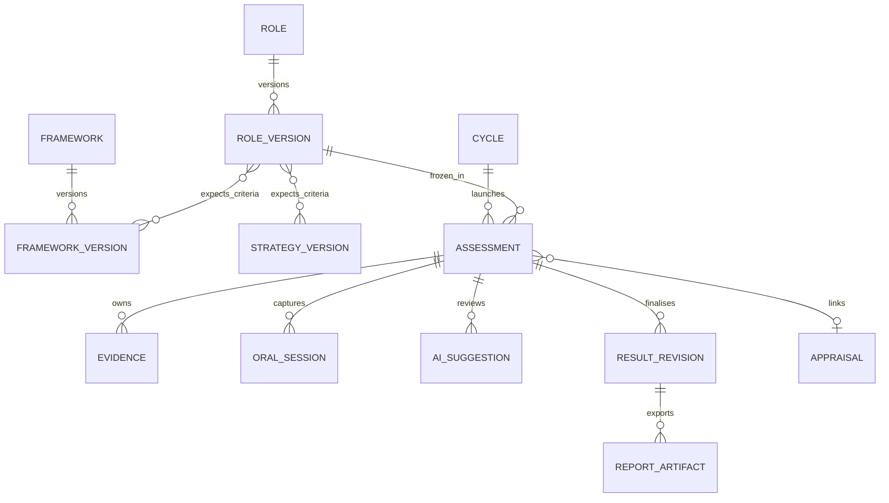

# Competency assessment — domain and API architecture

Status: proposed implementation contract, not an implemented-feature claim. Reviewed against `main` `b401f1b1583be5875cc02462122c83ec9e7311d2` on 18 October 2026. Owner: Solution Architect A. Product stories: `../stories/01-role-framework-stories.md` and `../stories/02-evaluation-reporting-stories.md`. PRD: original three-page *Seemplify Competency Assessment PRD.pdf*, plus the user's role-upload and complete manager-feedback clarifications.

## 1. Decision and boundaries

Add a competency domain inside the existing Performance backend/frontend. Do not create a second identity authority, replace working calls, or overload current Appraisal workflow state. A competency assessment may stand alone for a dedicated competency cycle or link to an existing appraisal. In an appraisal, role selection is part of setup, human/AI analysis sees the same frozen role, and the final appraisal report includes the competency result and complete submitted manager feedback.

An **assessment role** is an occupational profile (for example Technology Director), never an access-control role. It does not grant HR/admin powers. A job title from IdP is descriptive identity data; it is not a validated competency profile.

No production feature is considered complete from this document alone. Delivery requires story acceptance, automated tests, human-readable UX evidence, deployed revision proof and authenticated acceptance. The active dirty Appraisal lifecycle files in this checkout are a separate workstream. This architecture's implementation owners must not stage, overwrite or silently ship that work.

### Existing code to reuse

| Existing capability | Current source | Reuse boundary |
|---|---|---|
| Verified identity, organization selection, OIDC | `performance/backend/middleware/rbac.js`, `services/performanceOrganizationAccess.js` | Require authenticated principal and selected active organization; no local production passwords |
| People, teams, eligible reviewer authority | `services/performanceDirectoryService.js`, IdP `src/utils/performanceDirectory.js` | Obtain current directory using the verified delegated token; fail closed if authority unavailable |
| Shared personal ChatGPT service | `services/sharedAIAccountService.js`, `aiGatewayService.js` | Resolve stable OIDC subject and org server-side; service HMAC and allowed activity; no account tokens in browser or competency records |
| Document upload/extraction/storage | existing appraisal document services | Extract storage adapter; new tenant/assessment ownership metadata; do not forge a parent Appraisal merely to upload |
| Nylas and native calls | existing meeting service and `OneOnOne` | New authorized resource adapter, same provider credentials and consent rules; no provider duplication |
| Existing manager result data | `services/appraisalResultReport.js` | Extend report projection in a separately owned integration patch, including goal-review comments currently omitted |
| Current appraisals and quarterly defaults | existing Appraisal/AppraisalCycle | Keep existing contracts and lifecycle; bridge links competency result without changing legacy statuses |

## 2. System views

The context and container levels follow the [official C4 guidance](https://c4model.com/diagrams). Each arrow is labelled with its purpose; the diagrams describe the target design.

### Context



### Containers and logical components



No new externally exposed database or inference service is required. Job claiming uses database leases so a second web process cannot duplicate work. The deployment may initially run bounded workers in the existing backend, following existing operational patterns; a queue extraction can come later without changing public contracts.

## 3. Collections, identifiers and relationships

All entities include `organizationId: string`, `_id: ObjectId`, `createdAt`, `updatedAt`, `createdBy: {userId,name}`, and integer `revision`. API identifiers are opaque strings; OIDC person identifiers are `userId`, never Performance-local Mongo user IDs. All reads, writes, aggregates, jobs and export lookups include the verified organization predicate. A reference is valid only if both ends belong to that organization.

| Collection / model | Required domain fields | Mutability |
|---|---|---|
| `CompetencyRole` | name, slug, description, currentVersionId, archivedAt | Metadata and head pointer can change with revision check |
| `CompetencyRoleVersion` | roleId, version, responsibilities[], requirements[], criteria[], sourceDocumentId, contentHash | Published content immutable; draft can be revised before publish |
| `CompetencyFramework` | name, sourceType=`sfia` or `internal`, currentVersionId, licenseProvenance, archivedAt | Head metadata mutable |
| `CompetencyFrameworkVersion` | frameworkId, version, criteria[], levels[], source, licenseProvenance, contentHash | Published immutable; no automatic SFIA dataset scraping or unlicensed distribution |
| `CompetencyStrategyVersion` | objectiveId, title, description, sourceRef?, criteria[], levels[], contentHash | Same immutable version semantics; optional explicit link to authorized OKR/objective |
| `CompetencyImport` | purpose=`role`/`framework`, file metadata, extractionStatus, extractedDraft, warnings[], confirmedBy, targetVersionId | Temporary draft until human confirms; never auto-publishes |
| `CompetencyCycle` | name, period, status, selectedInputTypes[], frameworkVersionIds[], strategyVersionIds[], roleVersionIds[], scoringConfig, rankingConfig, permissionsPolicy, version | Draft edits allowed; launched configuration immutable; changes produce new version |
| `CompetencyAssessment` | cycleId, participant snapshot, assessorIds[], optional appraisalId, status, definitionSnapshot, items[], managerFeedback[], finalResult?, publishedResultVersion, audit pointers | Draft items mutable under compare-and-swap; finalized result immutable |
| `CompetencyEvidence` | assessmentId or importId, participantId?, criterionIds[], type, sourceRef/storageKey, ownerId, occurredAt, uploadedAt, consent, visibility, retention, contentHash | Active metadata versioned; deletion tombstones retained without raw evidence |
| `CompetencyOralSession` | assessmentId, participantId, criterionIds[], mode, prompts/answers/notes, callRef?, consent, recording/transcript evidenceIds | Manual and integrated paths share ownership policy |
| `CompetencyAISuggestion` | assessmentId, requestedBy, activity, evidenceRefs[], snapshotHash, draft[], model, reviewState, reviewedBy/At | AI output is draft; human decisions append provenance |
| `CompetencyResultRevision` | assessmentId, number, frozen report payload, definitionHash, scoreHash, finalizedBy/At, classification, supersededBy? | Append-only; reopening creates a new editable assessment revision |
| `CompetencyAuditEvent` | resourceType/id, action, actor, org, timestamp, old/new hashes, reason?, requestId | Append-only; redact content and tokens |
| `CompetencyOperation` | key, actor, operation, requestHash, status, resultIds[], expiresAt, leaseUntil | Idempotency/async task metadata only; bounded retention |

Store required finalization state inside the assessment aggregate to permit single-document atomic CAS. Use a transaction for related result/audit/outbox inserts if the existing Mongo deployment supports transactions. If not, persist an outbox record within the same assessment update, then process append-only projections idempotently; the finalization response must not claim completion before durable result state exists.



### Indexes

- Roles/frameworks: unique `(organizationId, slug)`; list `(organizationId, archivedAt, updatedAt desc)`.
- Version rows: unique `(organizationId, roleId/frameworkId, version)`; `(organizationId, _id)`; no mutation of published content.
- Cycles: `(organizationId, status, createdAt desc)`.
- Assessments: unique `(organizationId, cycleId, cycleVersion, participant.userId)`; `(organizationId, assessorIds, status, createdAt desc)`; `(organizationId, participant.userId, createdAt desc)`; partial unique `(organizationId, appraisalId, assessmentPurpose)` where appraisalId exists. Multiple separate competency purposes require distinct purpose IDs rather than accidental duplicates.
- Evidence: `(organizationId, assessmentId, status, createdAt)`; retention `(status, retention.deleteAfter)` for bounded deletion batches; private bytes are not Mongo TTL documents.
- Result versions: unique `(organizationId, assessmentId, number)`; `(organizationId, definitionHash, status)` for compatible cohort reads.
- Operations: unique `(organizationId, actorId, operation, key)`; TTL `expiresAt` for metadata only. Audit events do not inherit that TTL.
- Audit: `(organizationId, resourceType, resourceId, createdAt)` and `(organizationId, actor.userId, createdAt)`.

## 4. Shared JSON contract v1

All dates are UTC ISO8601. UI formats dates in the chosen organization/user timezone and displays the timezone for time-sensitive deadlines. Server derives org/actor and rejects forged protected fields. Strict object validation rejects unknown mutable fields. Text renders as escaped text; no raw uploaded HTML. Name matches return a duplicate warning and choice; role identity uses generated unique slug/ID, so an intentional distinct same-named profile is allowed. POST create uses Idempotency-Key too.

Success: `{ "data": ..., "meta": { "schemaVersion": "1", "requestId": "...", "revision": 3 } }`.
List: `{ "data": [], "meta": { "schemaVersion": "1", "nextCursor": null, "requestId": "..." } }`.
Error: `{ "error": { "code": "REVISION_CONFLICT", "message": "This assessment changed. Reload before saving.", "fields": [{ "path": "items.0.rationale", "code": "REQUIRED", "message": "Add a rationale." }], "requestId": "..." } }`.

HTTP: 400 malformed/invalid identifiers; 401 expired session; 403 denied known action in same tenant; 404 absent or foreign resource; 409 revision/status/compatibility conflict; 413 file limit; 422 completion/configuration violations; 429 bounded workload; 503 authoritative directory/provider unavailable. Do not fall back to stale access or another user's account.

### Bootstrap

`GET /api/competency/bootstrap`

```json
{
  "data": {
    "capabilities": {
      "roleManage": true, "cycleManage": true, "assessmentEdit": true,
      "assessmentFinalise": true, "assessmentReopen": false,
      "reportView": true, "reportExport": true
    },
    "people": [{"userId":"oidc-sub","name":"Example Person","departmentId":"dept-id","teamIds":["team-id"]}],
    "roles": [{"id":"role-id","versionId":"role-version-id","name":"Technology Director","version":1,"status":"published"}],
    "frameworks": [{"id":"framework-id","versionId":"framework-version-id","sourceType":"internal","name":"Leadership","version":1,"criteria":[],"levels":[]}],
    "strategies": []
  },
  "meta": {"schemaVersion":"1"}
}
```

Bootstrap directory is already scoped to the user. Never send all organization people then hide them client-side. Per-record responses include `allowedActions` because bootstrap capabilities alone do not establish resource scope.

### Role version, criteria and levels

```json
{
  "name":"Technology Director",
  "description":"Occupational assessment profile",
  "responsibilities":[{"id":"resp-1","text":"Lead technology delivery."}],
  "requirements":[{"id":"req-1","text":"Demonstrate strategic leadership.","required":true}],
  "criteria":[{
    "id":"role-criterion-1", "sourceType":"internal",
    "frameworkVersionId":"framework-version-id", "criterionId":"leadership",
    "expectedLevelId":"advanced", "weight":1, "required":true,
    "evidenceRequired":true, "rationaleRequired":true,
    "responsibilityIds":["resp-1"], "requirementIds":["req-1"]
  }]
}
```

Every source uses its native `levelId`, label and description. Framework version example: `{id, frameworkId, sourceType, name, version, criteria:[{id,code,name,description,levelIds:["l1","l2"]}], levels:[{id:"l1",label:"Foundation",description:"...",order:1}], status, contentHash}`. `order` controls display only; it is not automatically a numeric score. Strategy criteria use `strategyVersionId` instead of `frameworkVersionId` and sourceType `strategy`. Exactly one source reference is required.

### Launch and frozen definition

`POST /api/competency/assessments/launch`, header `Idempotency-Key` (body alias allowed for UI clients; conflict rejected):

```json
{
  "cycleId":"cycle-id", "cycleRevision":3,
  "assignments":[{
    "participantId":"oidc-sub", "roleVersionId":"role-version-id",
    "assessorIds":["assessor-sub"], "appraisalId":null
  }]
}
```

Each returned assessment includes `id, revision, status, cycleId, appraisalId, participant, assessors, definitionSnapshot, items, managerFeedback, allowedActions, createdAt, updatedAt`. Definition snapshot contains exact roleVersion, selected sources and their versions/levels, flattened criteria with stable snapshot criterion IDs, scoring/ranking configuration, deadlines, permission-policy version, and SHA256 of canonical domain JSON. Exclude generated timestamps from deterministic compatibility hashes. Keep full readable content, not just pointers/hashes; archived libraries remain reportable.

### Draft finding and manager feedback

`PATCH /api/competency/assessments/:id`, `If-Match: "7"`:

```json
{
  "items":[{
    "criterionId":"snapshot-criterion-id", "status":"assessed",
    "observedLevelId":"advanced", "rating":4,
    "rationale":"Evidence-backed human finding.",
    "evidenceIds":["evidence-id"], "reviewedSuggestionIds":[]
  }],
  "managerFeedback":[{
    "section":"overall", "criterionId":null, "goalId":null,
    "text":"Strengths, gaps and next development actions.", "submitted":true
  }]
}
```

Item status is `not_started`, `assessed` or `insufficient_evidence`. Insufficient evidence needs rationale, does not silently become zero or disappear from the denominator. `assessorId`, attribution and submittedAt are server assigned. Role responsibilities without quantitative criteria can receive qualitative findings, but are not silently scored. Reports contain qualitative outcomes too.

For concurrent assessors the MVP single-aggregate revision prevents lost updates; UI offers reload/compare before retry. Later item-level revisions can improve collaboration without changing scoring semantics.

## 5. Endpoints and ownership

Base `/api/competency`. UI routes proposed under `/competency`, and appraisals expose linked tabs/sections. API namespace is additive; canonical appraisal endpoints keep working.

| Endpoint | Contract / result | Permission |
|---|---|---|
| GET `/bootstrap` | Scoped directories, libraries, allowed capabilities | authenticated app member |
| GET/POST `/roles` | Search/list or create draft role | read / role.manage |
| GET/PATCH `/roles/:id` | Details; PATCH draft metadata with If-Match | read / role.manage |
| POST `/roles/:id/versions` | New editable version copied from published version | role.manage |
| PATCH `/roles/:id/versions/:versionId` | Edit draft contents only with If-Match; published content rejects mutation | role.manage |
| POST `/roles/:id/versions/:versionId/publish` | Validate expectations; immutable publish and head CAS | role.manage |
| POST `/roles/:id/archive` | Disable new assignments; historical versions retained | role.manage |
| POST `/imports` | Multipart file + purpose; 202 job id | role.manage or framework.manage |
| GET `/imports/:id` | Extraction state, human-reviewable draft, warnings | own importer or org config authority |
| GET `/imports/:id/source` | Reauthorised clean original download, attachment/nosniff; bounded escaped extracted text is the in-app preview | matching import/source access |
| POST `/imports/:id/confirm` | Explicit edited draft -> role/framework draft version; idempotent | matching config permission |
| GET/POST `/frameworks` | List or create source-aware draft | framework.read/manage |
| GET/PATCH `/frameworks/:id` | Head metadata only | framework.read/manage |
| POST `/frameworks/:id/versions` | Draft criteria/levels with source provenance | framework.manage |
| PATCH `/frameworks/:id/versions/:versionId` | Edit draft source-native contents only with If-Match | framework.manage |
| POST `/frameworks/:id/versions/:versionId/publish` | Immutable validated version | framework.manage |
| GET/POST `/strategies` | Create/link objective and define criterion draft | cycle.manage |
| POST `/strategies/:id/versions` | Snapshot title/criteria/authorized source reference | cycle.manage |
| GET/POST `/cycles` | List or save draft; strict selected inputs | cycle.read/manage |
| GET/PATCH `/cycles/:id` | Edit draft using If-Match | cycle.manage |
| POST `/cycles/:id/validate` | All field and policy issues, preview formula | cycle.manage |
| POST `/assessments/launch` | Atomic per-participant snapshot, idempotent cohort | assessment.launch scoped |
| GET `/assessments` | Scoped list, team/cycle/status filters, newest first | assessment.view scoped |
| GET/PATCH `/assessments/:id` | Scoped detail / draft findings | assessment.view/edit scoped |
| POST `/assessments/:id/evidence` | Upload/manual/link with criterion bindings | evidence.create scoped |
| GET/DELETE `/assessments/:id/evidence/:evidenceId` | Authorized stream or tombstone/deletion request | evidence.view/delete scoped |
| GET/POST `/assessments/:id/oral-sessions` | Manual oral evidence or consented existing call reference | assessment.edit + evidence scope |
| POST `/assessments/:id/ai-suggestions` | Optional job, refs + criteria, no automatic rating | ai.use + source read + consent |
| PATCH `/assessments/:id/ai-suggestions/:suggestionId` | accept/edit/dismiss draft with reviewer attribution | assessment.edit scoped |
| POST `/assessments/:id/calculate` | Pure deterministic score preview, coverage/issues | assessment.edit/finalise scoped |
| POST `/assessments/:id/completion-check` | Missing findings/evidence/notes/consent plus exception eligibility | assessment.edit/finalise scoped |
| POST `/assessments/:id/finalise` | CAS result + human classification/reason/exceptions, idempotent | assessment.finalise scoped |
| POST `/assessments/:id/reopen` | Reason required, new editable revision, old result preserved | assessment.reopen scoped |
| GET `/assessments/:id/report` | Permission-filtered frozen participant report | report.view scoped |
| POST `/assessments/:id/exports` | Queue PDF of specified result revision + visibility scope | report.export scoped |
| GET `/exports/:id` | Job status; authorized private download when ready | report.export scoped |
| GET `/cycles/:id/report` | Scoped aggregates, compatible rankings and exclusions | report.cohort scoped |
| GET `/appraisal-links/:appraisalId` | Selected frozen role, assessment progress/result, allowed actions | appraisal access AND competency access |
| POST `/appraisal-links` | Bind valid existing appraisal to matching participant assessment | assessment.launch + appraisal.manage |
| GET `/audit` | Scope-filtered resource events, no raw evidence/token content | audit.view scoped |

All endpoints require authentication and a selected active organization. Feature gate `competencyAssessments` defaults off until additive backend/indexes/UI and acceptance gates pass. Feature-off returns explicit unavailable state; existing appraisals remain usable. Do not expose unfinished UI via a merely cosmetic hidden link.

## 6. Scoring, completeness and ranking semantics

Configuration `scoringConfig` has `version`, `method:"weighted_mean"`, `inputWeights`, per-criterion weights, `normalization`, `thresholds` and `missingPolicy`. MVP supports the explicitly implemented weighted mean only; reject unsupported formula names. Do not accept arbitrary JavaScript/expression execution.

```json
{
  "version":1, "method":"weighted_mean", "weightMode":"fraction",
  "inputWeights":{"sfia":0.4,"internal":0.4,"strategy":0.2},
  "ratingScales":[{"id":"five-point","label":"Five-point assessment","min":1,"max":5}],
  "normalization":[{"sourceVersionId":"framework-version-id","criterionId":"leadership","method":"level_map","levelScores":{"foundation":0,"advanced":75,"expert":100}}],
  "thresholds":[{"id":"developing","label":"Development needed","minInclusive":0,"maxExclusive":60},{"id":"suitable","label":"Suitable","minInclusive":60,"maxInclusive":100}],
  "missingPolicy":"block_unless_authorised_exception"
}
```

`weightMode` is explicit: `fraction` groups sum to1, `percentage` groups sum to100 (sum tolerance `1e-6`), or `relative` groups accept finite non-negative weights with positive total and normalize by that total. Each selected source has at least one positive-weight criterion. Apply the declared mode independently to input and per-source criterion groups, recording normalized effective weights in the breakdown. Unselected sources cannot carry hidden weight. Explicit mappings define each framework level's 0–100 score; level order/number is never guessed. Direct rating scales require declared min/max and transform `(rating-min)/(max-min)*100`, with max greater than min. A criterion chooses one scored measure; observed level and rating must not both count independently. Golden relative-weight example: `(80×3 + 60×1) / (3+1) = 75`; equivalent percentage weights75/25 produce75 too.

For source s, `sourceScore = sum(normalizedCriterionScore * effectiveCriterionWeight)`. Overall `sum(sourceScore * effectiveInputWeight)`. Coverage = assessed required/selected required plus separate weighted coverage; show both. A missing required criterion blocks finalization unless authorized explicit exception. Exception choices are configured `exclude_and_renormalize` or `retain_as_unscored`; the latter produces no comparable numeric total. Never silently treat missing evidence as poor performance. Every denominator and exception appears in the breakdown. Require decimal inputs with at most6 decimal places and deterministic decimal arithmetic; retain calculations to12 decimals with half-up rounding only at the final aggregate. Thresholds evaluate that stored calculation value, never a two-decimal display string. Display uses half-up to2 decimals and shows precision in formula help. The same pure service powers API, preview and report; browser must not invent a second arithmetic implementation.

Suggested classification uses complete non-overlapping threshold bands covering 0–100. Human final classification is stored separately; any change from suggested requires a reason, confirmation records assessor attribution. No classification is an automatic employment decision.

PM readiness clarification: direct numeric scales are declared in `ratingScales:[{id,label,min,max}]`. Scale IDs are unique; bounds are finite and max>min, with at most6 decimal places. Each normalization entry is a strict discriminator: `method:level_map` with native `levelScores`, or `method:rating_scale` with `ratingScaleId`, never both. Findings and role evaluation targets must reference the declared valid scale and remain within bounds. Unknown/duplicate scale IDs and ambiguous measure selection block configuration/launch. Scales are included in historical snapshots and comparability hashes.

Ranking config: `{enabled,scope:"role"|"department"|"organization",direction:"desc",tieRule:"competition"|"dense",decimalPlaces:2,measure:"overallScore",compatibilityKey}`. Tie comparison uses half-up rounding of the stored calculation to configured `decimalPlaces` (default2, permitted0–6), independently of display precision; the UI labels the chosen comparison precision. Equal display values may differ in rank only when a more precise tie measure is explicitly configured and shown. Compatibility key hashes selected input types, source versions/criterion sets, role expectation/measure definitions, normalization, weights, thresholds and exception policy. Role names/participant identity do not establish comparability. Default strict equality of measurement configuration; a deliberate shared comparison scale requires a new approved config version and QA, not an unchecked cross-framework average. Rank only finalized latest non-superseded comparable results within authorized scope; insufficient/incomplete results display excluded reason. Competition ties `1,1,3`; dense `1,1,2`. Do not break ties with name/userId and imply a performance difference. Participant report ranking is frozen with result revision/ranking cohort timestamp, not silently recalculated after export.

## 7. Appraisal integration and feedback completeness

This feature must be reachable **during existing appraisal setup**, not only through a separate competency area. A small integration patch owned by the release coordinator adds a role selector and optional competency cycle selection in existing launch setup, invokes the existing appraisal launch contract, then calls an idempotent competency bridge with the resulting appraisal IDs. The bridge validates participant equality, org, existing appraisal access and existing role/cycle version. No client-generated Appraisal IDs and no widening of reviewer access. If bridge fails, the receipt shows appraisal created / role assessment pending, offers safe retry and does not duplicate appraisals. Reconciliation job can finish only the same authorized launch intent.

Persist links in competency records so initial release avoids adding fields to actively edited `Appraisal.js`. Later a read-only linked ID projection can be added in a separately reviewed patch. Removing/archiving a competency profile cannot erase existing appraisal content. Reopening the competency result does not automatically reopen/finalize legacy appraisals, and vice versa; UI shows each status distinctly.

Human and AI analysis read `definitionSnapshot.role`, never current mutable job title/profile. The report projection includes:

- Actual role name, version, responsibilities/requirements and criterion expectations.
- Each observed finding, source levels, rationale, source evidence and human assessor.
- Existing submitted manager overall feedback, every competency comment, **individual goal-review comments from `managerReview.okrAssessment[].managerComments`**, submitted custom manager answers, strengths, improvement/development recommendations when captured, and relevant agreed discussion notes.
- Author/submission date per feedback entry; do not mislabel AI summary as manager feedback or unpublished employee-only notes as report content.
- Calculated breakdown, suggested and final human classification, override/exception reasons and versioned result.

Use shared report DTO projection for on-screen report and PDF. Internal-only evidence must not leak through the combined appraisal report; permission is the intersection of appraisal/report access and source visibility. If a chart is based on redacted inputs, do not expose excluded values via tooltips, downloads, aria labels or API totals.

Manager feedback is frozen at competency finalise with the linked appraisal's submitted payload hash, actual recorded reviewer and submittedAt. If that appraisal has an enabled reviewer step without a submission, finalise is blocked with a link to finish that step; draft text is not published. An explicitly disabled reviewer step is reported as not configured. Later authorised changes preserve old result/PDF versions and require an explicit reopen/re-finalise to refresh the current combined result; show a source-changed notice rather than silently mixing versions. Existing appraisal final outcome checks the linked published result against its current submitted reviewer payload. Missing historical attribution remains Not recorded. This resolves PM-R4 without imposing another approval queue.

## 8. Authorization and security invariants

Canonical permission IDs use the `competency.` prefix for every action: `competency.role.manage`, `competency.framework.manage`, `competency.cycle.manage`, `competency.assessment.launch`, `competency.assessment.view`, `competency.assessment.edit`, `competency.assessment.finalise`, `competency.assessment.reopen`, `competency.assessment.exception`, `competency.evidence.view`, `competency.evidence.create`, `competency.evidence.delete`, `competency.report.view`, `competency.report.export`, `competency.report.cohort`, `competency.audit.view`, `competency.ai.use`, `competency.retention.manage`. Endpoint table abbreviations mean these exact IDs. Add them to the existing IdP permission catalog and delegated app grants; they are not product-local powers. Actions carry resource scope (own/assigned/team/organization), not just boolean role labels. Configuration read comes from view/manage scope; no hidden independent superuser fallback. The coordinator owns catalog/app mapping and role-default contract tests. Until separate grants exist, those actions are incomplete and cannot be marked CA-109 done.

1. Resolve active org and stable subject from verified session; current directory establishes membership/hierarchy. No trust in body org, email, team IDs, assessor display names or raw unverified tokens.
2. Default deny every action; validate permission AND relationship AND tenant AND resource state. Being an occupational role owner grants no access. Assigned assessor must still be an active authorized organization member.
   IdP's existing `allExcept` member-grant expansion requires adding privileged new actions to `MEMBER_RESTRICTED_PERMISSION_EXCLUSIONS` atomically with catalog registration. Explicit manager grants carry current managed/assigned scope; default staff/recruiter/interviewer must not inherit new organization powers. Bootstrap intersects claims and current directory relationship.
3. Staff see own permitted drafts/evidence/published results; managers only managed/assigned scope; HR/owners all only within selected org. Explicit report/export permissions remain independent. A team selector cannot widen API scope.
4. Same-tenant resource links are necessary but not sufficient: source visibility and participant ownership must also permit this assessment. Recheck stream/download and background execution, not only upload time.
5. Call recording/transcription/AI processing each require separate notice/consent provenance; manual notes must work with calls/AI disabled. Consent withdrawal cancels unstarted processing and prompts retention policy action; it does not fabricate deletion success.
6. Treat files/transcripts/prompts as untrusted data. Allowlist PDF/DOCX/TXT initially, inspect MIME/signature, 10 MiB file cap, bounded extraction pages/text/time, random storage keys, malware quarantine and ZIP decompression caps. Reject unsupported encrypted/corrupt files with recoverable UX. No external URL fetch import or public bucket URL.
7. AI uses the requesting assessor's stable personal account through current HMAC proxy and explicit `performance.competency.analysis` activity allowlist/consent. No owner's account reused for tenant members; no silent Standard fallback. Uploaded text cannot change instructions, request secrets, finalize decisions or invoke tools.
8. AI citations must point to authorized evidence and extracted spans in the current snapshot. Reject unknown evidence IDs, mismatched participant references and unsupported claims; flag uncertain observations. Accepted AI text remains a human-reviewed observation, not independent evidence.
9. Audit denials and sensitive state changes using opaque IDs/action codes, not document contents, tokens, medical details or provider secrets. Escaped text only in reports; signed URLs short lived and reauthorized before delivery.

These constraints apply [OWASP authorization guidance](https://cheatsheetseries.owasp.org/cheatsheets/Authorization_Cheat_Sheet.html), [tenant isolation guidance](https://cheatsheetseries.owasp.org/cheatsheets/Multi_Tenant_Security_Cheat_Sheet.html) and [upload guidance](https://cheatsheetseries.owasp.org/cheatsheets/File_Upload_Cheat_Sheet.html) to the existing Mongo/Express stack. OWASP's SQL examples are conceptual references, not instructions to introduce PostgreSQL here.

## 9. Lifecycle, concurrency and asynchronous work

```mermaid
stateDiagram-v2
  [*] --> DraftConfiguration
  DraftConfiguration --> PublishedConfiguration: validate + publish
  PublishedConfiguration --> AssessmentDraft: authorized idempotent launch + frozen definition
  AssessmentDraft --> InProgress: first saved evidence/finding
  InProgress --> Ready: completion check passes or permitted exception
  Ready --> Finalised: authorized human classification + CAS
  Finalised --> Published: report permission/publishing policy
  Finalised --> Reopened: authorized reopen with reason
  Published --> Reopened: authorized reopen with reason
  Reopened --> InProgress: new result revision; prior version preserved
```



`Ready` is a computed readiness flag, not a second approval queue. Finalise reruns validation under the same CAS; passing a prior checklist does not bypass later changed evidence/consent. No `awaiting_approval` state.

Publication is part of that same successful finalise operation: atomically store the immutable result and set new assessments to `published`, making the report immediately available under existing explicit report-view permissions. There is no separate approval or publish endpoint and no automatic access expansion. `finalised` remains a historical/internal compatibility state only. Failed persistence never returns a successful publication receipt. Reopen preserves the old published result and starts a new draft revision.

- ETag/If-Match on mutable drafts; Mongo update filter includes org, `_id`, status and `revision`, increments revision once. Conflict returns latest revision without overwriting user content.
- Launch/finalise/reopen/import-confirm/export use Idempotency-Key bound to actor/org/operation plus SHA256 request. Same key/same payload returns original outcome; changed payload returns409. Unique indexes close races.
- Cohort launch records per-assignment outcome and retries pending only. No all-or-nothing promise if the backing Mongo transaction capacity is not verified; receipt explicitly distinguishes created/existing/failed.
- Extraction/AI/export/retention use org-aware leased operations, bounded global and per-tenant concurrency, exponential retry capped at3 for retryable failures, dead-letter/error state and explicit retry. Provider denial/consent failure is not automatically retried indefinitely.
- Recheck current membership, source access and consent at execution, before publishing artifact, and at download. Deleted/tombstoned evidence invalidates queued AI inputs; preserve only lawful finalized provenance/hash, not raw deleted content.
- Do not launch emails, provider calls or real recordings in QA accidentally. Synthetic org/users and test destinations are the default; live provider tests need clearly labelled isolated invitations and actual returned recording/transcript proof.

## 10. Per-story solution requirements and verification

Every story must retain its PM acceptance criteria; this table adds implementation traceability. UI team consumes these contracts without changing identifiers independently. The CA-001–009 rows cover all named clauses in PM A's corresponding story (001-A onward, not just a happy-path sample); the CA-101–116 rows cover every numbered clause of PM B's corresponding story. Test case IDs must cite the precise clause when implementation begins.

| Story | Requirements / data | API and authorization | UI contract | Required verification |
|---|---|---|---|---|
| CA-001 Create/upload reusable role | Role draft with responsibilities and requirements; import extraction is reviewable and human-confirmed; unsupported/failed files leave recoverable draft | `/roles`, `/imports`, `/imports/:id/confirm`; role.manage; tenant-owned import | Manual/upload choice; progress, extracted draft, warnings; explicit Save role, no automatic publish | Manual and PDF/DOCX/TXT paths; corrupt/encrypted/oversized/malicious files; prompt injection; foreign import denial; repeated confirm one role |
| CA-002 Version/archive role | Published immutable versions; archive blocks new assignments but retains historical reports | versions/publish/archive; revision CAS; role.manage | Version badge, used-in-assessments notice, create-new-version and archive confirmation | Edit after launch leaves old role/result hash unchanged; stale save409; concurrent publish; archive assigned role |
| CA-003 Framework versions/levels | Distinct sfia/internal sources, criterion-specific level IDs, provenance/license metadata; no inferred equivalent levels | framework versions/publish; framework.manage | Source/version labels and native level editor; internal-only fully usable | Same label different source not merged; invalid level/reference; duplicate code; non-monotonic normalization rejected separately |
| CA-004 Seven selected input combinations | Nonempty source set; selected source must contain valid criteria; unselected sources no residual weights | cycles save/validate/launch; cycle.manage | Three independent toggles and selected-source summaries; inline empty error | Save, launch, assess, report all7; reject0; reload preserves set; irrelevant hidden source cannot affect score |
| CA-005 Strategy criteria | Versioned objective text/criteria; optional authorized OKR source reference, immutable launch snapshot | strategies and versions; cycle.manage + source read | Create or link objective; optional strategy card; source denied/unavailable state | Strategy-only and mixed; deleted/edited linked OKR leaves historical snapshot; foreign objective denied |
| CA-006 Role expectations | Role criterion binds exact source/version/criterion/expectedLevel, required evidence/rationale; qualitative requirements remain visible | role draft/publish + cycle validate; role.manage | Source-aware expected-level picker; mapping completeness and weight preview | Invalid/mismatched level rejected; selected source no mapping blocks launch; reordered UI does not alter IDs; no hidden conversion |
| CA-007 Assign people/role/assessors | Existing active IdP people; exactly one assessment role/version per participant and explicit eligible assessor(s); optional valid appraisal link | bootstrap + launch + appraisal-links; launch scope + existing appraisal.manage | Search/team filter, role per person, explicit assessor, launch receipt and safe retry | Unlogged active staff; owner review by other authorized HR; staff cannot expand scope; forged participant/assessor/org; retry and two-click duplicate prevention |
| CA-008 Expected vs observed role | Same frozen role in reviewer/AI/report; findings per requirement/criterion with missing status and human attribution | assessment read/PATCH; view/edit scoped | Side-by-side expected/observed, gaps, evidence drawer, draft-save/conflict state | Reload/resume, insufficient evidence, level mismatch, role edited during review, self/foreign access, two assessors stale-save |
| CA-009 Optional AI role compare | Personal account and explicit consent; authorized source spans; role-version/snapshot reference; accept/edit/dismiss never finalises | ai-suggestions POST/PATCH; ai.use + edit + evidence read | AI optional/off state, source citations, draft badge, human review actions; manual path complete | No ChatGPT/consent/provider -> manual works; owner account not reused; fabricated cite rejected; injection neutralized; accepted suggestion not evidence/rating |

| Story | Requirements / data | API and authorization | UI contract | Required verification |
|---|---|---|---|---|
| CA-101 Evidence intake | Assessment/participant/criterion ownership, provenance/time, private source/storage ref, checksum and status; visibility explicitly captured | evidence POST/GET/DELETE; evidence.create/view/delete AND source access; foreign IDs404 | Evidence drawer with source, date, linked criterion and missing coverage; upload retry preserves draft | MIME/signature/limit/quarantine; same-tenant wrong participant denied; metadata forgery; restricted file hidden from report; deletion tombstone |
| CA-102 Manual oral | Typed prompts, participant answers, assessor notes, occurredAt and criterion bindings; independent of provider | oral-sessions POST/PATCH with assessment.edit; server author | Manual conversation form available with integrations off; source-labelled notes vs transcript | Complete entire internal-only path without call/AI; required prompt/answer validation; save/resume and foreign access |
| CA-103 Recorded oral | Call reference to existing authorized Nylas/native OneOnOne, separate recording/transcription consent, state and source evidence | oral-sessions mode/calendar/native adapter; existing call access plus assessment scope | Optional schedule/join/record state; consent, waiting/failed/captured labels; manual fallback | Actual authorized test call creates returned recording + transcript; inaccessible media denied; no completion claim from webhook alone; browser consent |
| CA-104 Cited AI drafts | Suggestion stores requester subject, role snapshot hash, evidence spans, model and human review outcome; never independent evidence | ai-suggestions POST/PATCH; requester personal account consent/activity + authorized sources | Draft badge, citations open permitted span, edit/accept/dismiss; disabled/error/manual | Invented/cross-person cite rejected; source removed after enqueue; prompt injection; two users never share account; acceptance doesn't finalize |
| CA-105 Assessor workspace | Items preserve native expected/observed level, rating, rationale, evidence IDs, assessor; explicit not-started/insufficient status | assessments GET/PATCH If-Match; assignment+scope+edit | Criteria source groups, expected/observed comparison, rationale and evidence, autosave feedback/conflict recovery | All source types, draft resume, missing evidence, stale concurrent write and wrong level mapping; keyboard/mobile |
| CA-106 Versioned scoring | Pure normalized measure, explicit source conversions, validated weights/formula, configuration snapshot/hash and coverage | cycle validate + calculate; cycle.manage/edit scoped | Formula/weight preview and criterion/source breakdown; never hidden renormalization | Golden arithmetic, 0/100 boundaries, NaN/infinity, zero/negative/invalid sums, missing policy, exact reproducibility after edits |
| CA-107 Suitability | Non-overlapping complete thresholds, calculated suggestion separate from human classification, override reason, human finalizer/time | finalise CAS + idempotency; finalise permission and completion result | Proposed outcome vs final decision; reason when changed; direct finalise, no approval queue | Boundary classifications, override missing reason, double click, stale result, denied role; no automatic employment mutation |
| CA-108 Comparable ranking | Enabled flag, scope/tie rule and compatibility fingerprint; frozen context/exclusions | cycle config + cohort report; report.cohort + current scope | Optional rank column/chart, tie label, excluded reason; disabled means absent | competition/dense ties, role/dept/org, incompatible framework/weights/exception, reopened excluded, no leaked unauthorized totals |
| CA-109 Action permissions | Distinct edit/finalise/reopen/exception/report/export scopes in central IdP; denial audit identifiers | Every route + worker/stream/export recheck; default deny | Allowed actions from server; explicit own/assigned/team/org scope; no misleading enabled button | Full allow/deny matrix, direct forged API, expired/revoked identity, scope filters/counts, no stale directory fallback |
| CA-110 Completion/exception | Typed missing items, findings/insufficient status, rationale/evidence policies; allowed exception bound to revision/criterion and reason | completion-check/finalise; exception permission; structural/tenant guards unwaivable | Jump-to-field checklist; explicit incomplete coverage and exception warning | Missing each field independently, no waiver of tenant/role/source invariants, stale check, reason, denominator and final report |
| CA-111 Complete manager feedback | Submitted-only overall/competency/goal/custom narrative, recommendations, actual assessor/time, role/criterion binding; frozen final copy | appraisal bridge + canonical report projection; source visibility intersection | Separate manager feedback, oral discussion, employee reflection and reviewed AI sections | Sentinel every field/goal comment; actual assessor != creator; drafts/private notes excluded; unknown legacy values Not recorded |
| CA-112 Participant/PDF | Immutable source-complete result DTO, report revision/hash, selected role/source findings, score, classification, evidence and ranking context | report GET + exports POST/GET; view and independent export permission | Outcome summary, accessible comparison charts/tables, source/evidence detail, paginated PDF | JSON/web/PDF text/number parity; long text page rendering; no clipped charts; export denied despite view; historical reproduction |
| CA-113 Cohort report | Scope before aggregation; completion counts/denominator, gaps per comparable source/role, separate missing evidence, authorized filters | cycles/:id/report; current report.cohort scope; private export | Scope banner, filters, status counts, gap chart/table; empty/error states | Reconcile10 participant records; subset totals, incompatible ranks, no foreign counts/filter suggestions, revoked member |
| CA-114 Audit/reopen | Immutable result revisions, actor/time/reason and safe old/new references; reopen derives draft and preserves old report | audit GET + reopen POST CAS; audit.view/reopen separate | Timeline, version selector, current/superseded labels and reason dialog | v1/v2 replay, forbidden direct result PATCH, stale reopen, permission audit, no raw secrets/documents in events |
| CA-115 Consent/retention | Versioned per-purpose consent/policy, hold status and deletion lifecycle across source/provider/cache/index/AI queue | evidence deletion/policy adapter; admin retention and owned evidence rules; jobs recheck | Purpose notice and retention duration, deletion pending/failed/complete; source no longer retained | Time-accelerated expiry, revoke-vs-worker race, provider deletion retries, signed URL expiry, tombstones and legal hold; backup limits disclosed |
| CA-116 Pilot/release | Isolated approximately10-person configured cohort, all7 combinations, manual baseline and separate provider proofs, exact tested revision | QA fixtures/services and release coordinator gates; no production mutation merely for proof | Numbered completion evidence PDF with actual screenshots; no planned mockup labelled implemented | Matrix traceability, scoring golden files, permission negative cases, rendered PDFs, CI/deploy/image/OIDC/authenticated live proofs and rollback |

### Acceptance clause coverage checklist

Before a story enters a developer queue, copy its PM clauses into the test manifest using stable IDs (`CA-001/001-A`, `CA-101/1`, and so on). The architect must attach each to a route/service predicate and a visible state; QA must attach command/test name and evidence file. The tables are requirements-to-solution coverage, not a substitute for executing those clauses. Changes to this contract require SA/PM cross-review and UI notification before either lane implements them.

## 11. Delivery boundaries and readiness

Recommended nonconflicting developer lanes after PM/SA/UI verification (aligned with `02-delivery-security-qa.md`):

- Pair A owns `performance/backend/models/CompetencyRole*.js`, `CompetencyFramework*.js`, `CompetencyStrategy*.js`, `CompetencyImport.js`, `CompetencyCycle.js`; new `routes/competency/library.js`, `services/competency/libraryService.js`, `tests/competencyLibrary.integration.test.js`; frontend `components/competency/library/**`, `components/competency/setup/**`, `app/competency/roles/**`, `app/competency/frameworks/**`, `app/competency/cycles/**`.
- Pair B owns `performance/backend/models/CompetencyAssessment.js`, `CompetencyEvidence.js`, `CompetencyOralSession.js`, `CompetencyAISuggestion.js`, `CompetencyResultRevision.js`; new `routes/competency/assessments.js`, `services/competency/assessmentService.js`, `scoringService.js`, `reportService.js`, evidence/media adapters, and focused `tests/competencyAssessment*.test.js`; frontend `components/competency/assessment/**`, `components/competency/reports/**`, `app/competency/assessments/**`, `app/competency/reports/**`.
- One remaining SA acts QA/release coordinator; one PM validates story acceptance and terminology. Max six workers means 4 developers + SA/QA + PM. Do not start a third UI/design worker while this exceeds cap. Current runtime may support fewer agents; queue work rather than claiming unavailable capacity.
- The coordinator alone integrates shared `app.js`, root `routes/competency/index.js`, audit/operation cross-cutting models, shared DTO validators and `frontend/lib/competency-api.ts`, navigation, existing appraisal setup/report hooks, IdP catalog, CI and deployment edits after both lanes hand off. Appraisal dirty work is separately rebased/reconciled by its owner; never blindly stage it. Shared contracts are frozen before the lane starts; changing one requires both lanes' acknowledgement.

Additive rollout: collections/index dry-run -> hidden backend -> library/setup UI -> linked assessment/evidence -> scoring/finalization/reports -> staging pilot -> narrowly enabled organization -> production rollout. No deletion of existing cycles/assessment history is part of this feature. Default organization data is not synthetic pilot data. Import existing records only through explicit mapping preview and idempotent migration ledger; unmapped legacy records remain valid appraisals labelled no competency profile.

Release rollback disables feature and serves previous exact tested image; new collections remain to preserve assessments, evidence and audit. Read-only access/export of already finalized records requires a supported previous schema reader or an explicit maintenance state. Never drop collections/files as rollback. Version DTOs and keep schemaVersion1 backward-compatible through additive fields; incompatible changes require new version and migration plan.

### QA contract

Unit: normalization, weights, source combinations, canonical hashes, thresholds/boundaries, ties, compatibility, immutable versions, completion gate, role comparison and report projection. API integration with real Mongo and IdP fixtures: every permission action across own/assigned/team/org/foreign tenants, stale revision, duplicate launch, revoked membership, unavailable directory, upload ownership, job execution and private download. Browser: all7 complete paths, internal-only manual path, role upload review, role change history, draft conflict, manager feedback including goal comments, AI enabled/disabled/consent denied, keyboard/mobile/empty/error states, no horizontal overflow. PDF: compare frozen JSON fields and scores with on-screen report, render pages and inspect clipping, charts, labels, evidence restrictions. Pilot: approximately10 participants with assigned roles, isolated staging organization, completion/cohort filter/ranking/export. Providers: actual test call recording/transcript returned separately from manual notes; actual consenting personal AI identity separately from mocked suggestions.

Before push: both lanes integrated; required tests pass on the exact commit; PM accepts all story criteria; SA reviews access/concurrency; no unrelated staged files/secrets. After authorized admin merge: CI and deployment exact revision, public health/OIDC start, authenticated scope and live role/appraisal/report acceptance. Admin bypass is release authorization, not permission to skip failing QA or mutate tenant scope.

## 12. Research and evidence

Read on 18 October 2026. Recommendations above adapt the cited practices to inspected source; sources do not establish that Seemplify already implements them.

- [C4 context diagrams](https://c4model.com/diagrams/system-context): actor/system boundary and purpose-labelled relationships.
- [C4 diagram levels](https://c4model.com/diagrams): context/container views selected because they explain this feature's boundaries without code-level noise.
- [OWASP authorization](https://cheatsheetseries.owasp.org/cheatsheets/Authorization_Cheat_Sheet.html): least privilege, default deny, per-request/resource checks and relationship-aware policies.
- [OWASP multi-tenant security](https://cheatsheetseries.owasp.org/cheatsheets/Multi_Tenant_Security_Cheat_Sheet.html): verified tenant context, scoped storage/jobs/cache/exports and negative isolation tests.
- [OWASP file upload](https://cheatsheetseries.owasp.org/cheatsheets/File_Upload_Cheat_Sheet.html): allowlisted formats, server validation, limits, private storage and scanning.
- Current-source audit: `.local-runtime/prd-audit/competency-prd-gap-analysis.md`; full extracted PRD `.local-runtime/prd-audit/prd.txt`, checked against original PDF scope.

Configuration prerequisites, not silent defaults: tenant supplies lawful framework content/provenance; no bundled SFIA catalogue is promised. Recording/transcription/AI retention durations and purpose notices must be configured before those processing paths can be enabled; manual nonrecorded assessment remains available. Required evidence is declared per cycle/criterion. Default exception policy is `retain_as_unscored`, so an exceptional incomplete result has a human decision and coverage notice but no comparable numeric total; `exclude_and_renormalize` requires deliberate administrator configuration, an authorized exception and clear report disclosure. No numeric exception is permitted by an omitted setting. Separate IdP action grants must be delivered and tested before claiming permission completeness. Legal/retention configuration is organization data and cannot be invented by the implementation team.
