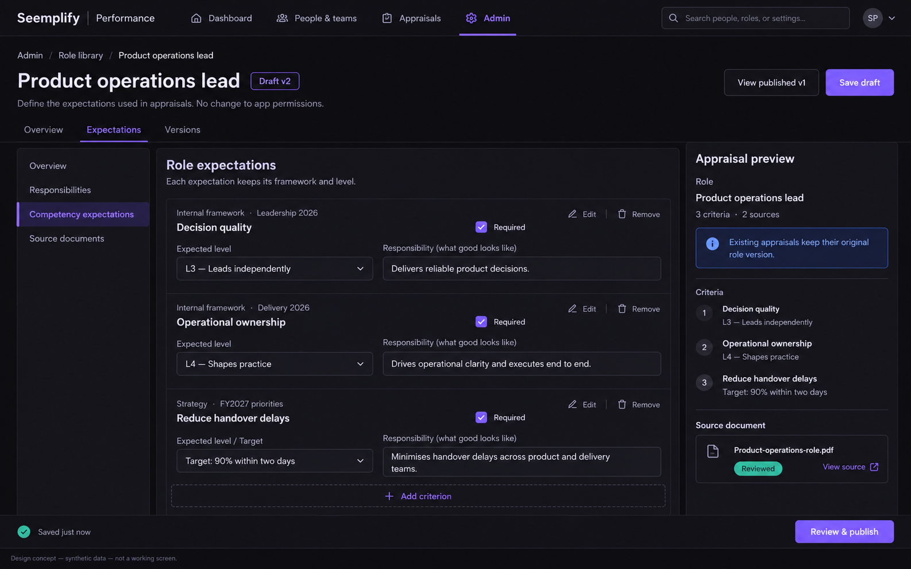

# Roles, frameworks and appraisal setup — UX contract

Status: **proposed design; not an implemented feature**. Owner: UX Designer A. Read against `main` `b401f1b1583be5875cc02462122c83ec9e7311d2`, 18 October 2026. Inputs: [PM stories CA-001–009](../stories/01-role-framework-stories.md), [domain/API architecture](../architecture/01-domain-and-api.md), [programme plan](../IMPLEMENTATION-PLAN.md). This contract owns configuration/setup; [assessor and reporting design](02-assessor-and-reports.md) owns the working assessment and reports. Route names below are proposed and require integration-owner review.

## 1. Product cognition and decisions

| Question | Decision |
|---|---|
| Project in ordinary words | HR and managers assess existing employees against defined occupational expectations and retain an explainable result. |
| Users | Configuration-authorised HR/owners/admins; scoped launch coordinators/managers; assigned assessors; employees reading permitted role expectations. |
| Main objects | Assessment role, role version, competency framework/version, strategy criterion, cycle, participant assignment, appraisal. |
| Primary journey | Define/review a role → choose sources and expectations → configure cycle → select people/role/assessor → check answers → start → assess against the frozen role. |
| First decision | Create a role manually or upload an existing role description. Do not start with an unexplained blank scoring form. |
| Success | Every selected participant has an explicit published role version, authorised assessor and valid criterion mapping; launch receipt points to the resulting appraisal. |
| Recovery | Draft/save status, retained unsaved text after errors, retry-safe actions, row-specific validation and comparison on stale updates. |
| Vocabulary | Role, responsibilities, requirements, expectations, framework, source, expected level, participant, reviewer, draft, published, archived. “Assessment role” in explanatory text distinguishes occupational expectations from access roles. |
| Keep out of primary UI | ObjectIds, API names, hashes, schemaVersion, CAS/ETag terms, provider stack traces, raw JSON, implementation architecture. |
| Temperament | Calm enterprise workbench; direct forms, source labels and audit clarity. No decorative hero, card wall or AI spectacle. |
| Main risks | Confusing job titles with validated roles; granting access by assigning a role; source-level false equivalence; uploaded text auto-publishing; unversioned historical comparison; inaccessible data in selectors. |

**Thinking gate:** existing product, additive setup wizard and versioned object editor. Keep MUI form behaviour and current navigation/typography; unify with suite neutral surfaces and semantic colours. Information priority is current role/version → editable requirement → exact source/expected level → readiness → next action. On mobile the primary action is Save draft, followed by Review and publish only when ready. Verification uses synthetic fixtures, keyboard paths, both themes and rendered screenshots, not the generated concept alone.

## 2. Inspected baseline and provenance

| Evidence | Observation | Limits |
|---|---|---|
| Current appraisal list, privately retained baseline | Existing appraisals, metadata and employee journey provide the surrounding product. | Actual-account captures remain local; published implementation evidence uses synthetic people. |
| Create-cycle dark baseline, privately retained | Read-only browser inspection at `https://performance.seemplifyai.com/admin/appraisal-cycles/new`, 18 October 2026. Four stages: Review period, Review design, People, Confirm. | Employee session could reach form shell but directory failed; no fields submitted, employee records edited or cycles created. This is an access/error baseline, not an authorised admin success. |
| `performance/frontend/app/admin/appraisal-cycles/[id]/edit/page.tsx` | Existing MUI stepper, cycle period, configurable workflow and participant selection. | Keep legacy reviews intact; competency settings appear only when competency assessment is chosen. |
| `performance/frontend/app/appraisals/start/page.tsx` | Existing three-stage People → Review details → Confirm and start; explicit per-person reviewer and team filtering. | Extend this flow; do not build a library that cannot be selected here. |
| `performance/frontend/app/globals.css`, `app/theme.ts` | Current neutral suite tokens coexist with legacy MUI teal controls. | Use existing suite tokens for new surfaces and theme-aware MUI overrides; do not introduce a third palette or change the whole suite. |

The staff-facing direct-route case needs clear capability denial in the new flow: **“You do not have permission to configure assessment cycles.”** with **Back to my appraisals**. Do not mislabel denied authority as an Identity outage. Directory-unavailable503 is a different state with **Try again**; never use stale people to launch.

## 3. Navigation and reusable screen structure

Proposed Admin entries: **Role library**, **Competency frameworks**, **Assessment settings**. Within Appraisals, keep **Start appraisal** as the primary launch path. Suggested application routes: `/competency/roles`, `/competency/roles/new`, `/competency/roles/:id`, `/competency/frameworks`, `/competency/frameworks/:id`. A competency-specific cycle configuration can render through `/competency/cycles/:id` but is entered from the existing review-cycle/appraisal journey. Direct URLs apply the same capability/resource checks as navigation. Keep the existing suite shell and navigation structure; the concept's illustrative top navigation does not authorise a broad shell redesign.

| Screen | Purpose / primary action | Exit |
|---|---|---|
| R1 Role library | Find published/draft/archived roles; **New role** | Role detail, or return to setup with exact chosen version |
| R2 New role | Choose **Create manually** or **Upload role description** | Draft editor or reviewed import |
| R3 Import review | Verify extracted fields against source; **Save reviewed draft** | Draft role; never auto-publish |
| R4 Role detail/editor | Overview, Expectations, Versions; **Save draft** / **Review and publish** | Published role or prior setup return location |
| F1 Framework library/editor | Define native criteria and level descriptors; **Save draft** / **Publish version** | Source-aware role expectation picker |
| S1 Strategy criterion editor | Create criterion or link authorised objective; **Save criterion draft** | Role mapping/cycle inputs |
| C1 Cycle Review design | Choose assessment type and inputs; validate mappings | People & roles |
| P1 People & roles | Assign role/version and eligible reviewer per participant | Check answers |
| P2 Check answers | Review versioned definitions, dates and assignments; **Start N appraisals** | Receipt with created/existing/failed outcomes |

Library list columns: **Role**, **Published version**, **Status**, **Last updated**, **Actions**. Default sort recently updated; search name/description; status filter Active/Draft/Archived. Dates use local formatting and timezone on precise times. Row click opens detail; overflow offers Versions, Create new version, Archive only when allowed. A text label accompanies status colour. Do not show employment ranking/counts on this administrative list.

## 4. Role creation and upload — CA-001

R2 uses two equally discoverable choices, not an upload-only AI funnel. Help: **“Define a role here, or upload a role description to create a draft you can review.”** Supporting copy: **“Assessment roles describe work expectations. They do not change app permissions.”**

| Field/control | Rule and exact help/error |
|---|---|
| Role name | Required trimmed text. Error **“Enter a role name.”** |
| Summary | Optional plain multiline text; explains the role in a few sentences. Draft may be incomplete. |
| Responsibilities | Repeatable plain-text rows, **Add responsibility**, accessible **Remove responsibility 2**; stable row IDs survive ordering. |
| Requirements | Repeatable plain-text rows and Required checkbox. Label **“Knowledge, experience or outcomes expected in this role.”** |
| Source document | PDF, DOCX or TXT, maximum10MiB per architecture. Visible picker **Choose role description**; drop area is optional alternative, never the sole control. No external-URL import. |
| Save draft | Saves reviewed human entries only. Does not publish, assign an employee, create a recruitment vacancy or trigger a notification. |

Upload states: **Uploading 45% → Checking file → Reading document → Review draft**. Use actual available progress; indeterminate for extraction. Filename and size remain visible. State text is aria-live polite; field errors assertive only on user action. If cancelled before completion, explain whether a private draft attachment remains and allow removal under normal retention policy. Existing upload policy controls quarantine; do not offer Open source until scan/access permits it.

R3 desktop: source preview on left and extracted editable role fields on right; 50/50 columns with independently labelled headings. Each extracted block can carry **Source: page2, Responsibilities** when extraction actually supplies a location. If no span exists use **“Source location unavailable — check the document.”** Never invent citations. Mobile: fields first, **View source** opens full-screen accessible dialog, return focus to the source link.

Banner: **“Review the draft before saving. Extracted text may be incomplete.”** Warnings appear beside affected fields. Human checkbox **“I have reviewed these role details.”** gates **Save reviewed draft**, not publication. Submission uses import confirm; idempotent retry returns the original draft. If user selects Create manually after failed extraction, retain safe filename metadata and any edits; do not imply that a failed extraction validated the source.

| Problem | Message / recovery |
|---|---|
| Unsupported or disguised type | **“Choose a PDF, DOCX or TXT file.”** Do not expose scanner internals. |
| Too large413 | **“This file is larger than10MiB. Choose a smaller document.”** Keep other fields. |
| Encrypted/unreadable | **“We could not read this document. Upload an unlocked copy or enter the role manually.”** |
| Unsafe file/quarantine | **“This file cannot be used. Choose another document.”** Retain only permitted metadata. |
| AI off/unavailable | **“You can continue manually. AI suggestions are optional.”** Manual fields remain usable; no hidden gateway call. |
| Duplicate name | **“A role named ‘Product operations lead’ already exists.”** **Open existing role** / **Create a separate role**; deliberate distinct identity allowed. |
| Import processing503/429 | Show retryable message and retry policy; **Try again** / **Continue manually**. Same operation reused, no duplicate role. |

Document contents are rendered as escaped data. No inline active HTML, script execution, automatic outbound links or prompt-following actions. Upload is never interpreted as permission or publication intent.

## 5. Role versions, expectations and archive — CA-002/006

R4 header: Role name, **Draft v2** or **Published v1**, last saved state, **View published v1** (when applicable), **Save draft**. Tabs: Overview, Expectations, Versions. Prefer one within-page section menu on large screens only; do not duplicate all navigation on narrow screens.

**Overview:** reviewed summary, responsibilities, requirements, source filename/status and **View source**. **Expectations:** grouped by source; row contains criterion and exact framework/version, expected native level/target, linked responsibility/requirement, required finding/evidence/rationale flags and weight reference. Show full expected-level descriptor on selection, not just “3”. Level dropdown is constrained to that criterion's native source/version. Strategy target can be an outcome and declared scale, not a fabricated competency ladder. Qualitative requirements remain available in the assessment but say **Not scored** if no scoring rule exists.

**Add criterion** opens a side panel: select Source → Framework/version or Strategy/version → Criterion → Expected level/target → related responsibilities/requirements → evidence/rationale/required settings. Only published/authorised source versions are offered for publication. Same-named criteria show source and version. Exact source identity survives search, reordering and reload.

Readiness panel: **“2 expectations need attention.”** Each issue links to its exact field, for example **“Choose an expected level for Decision quality.”** No automatic conversion or silent removal. **Review and publish** opens check-answers: role name, responsibilities/requirements, source versions, criterion count/levels, evidence rules. Final action **Publish v2**. Success **“Version2 is available for new appraisals. Existing appraisals keep their original version.”**

Published content is read-only; action **Create new version** duplicates to draft. Versions tab shows version/status/published actor/time, changed-field summary and **Compare with v1**. Show descriptors as readable text; no raw JSON diff. Legacy appraisal with only jobTitle: **“Role expectations were not recorded for this appraisal.”** No retrospective mapping by name.

Archive confirmation: **“Archive Product operations lead?”** / **“It will no longer be available for new appraisals. Existing appraisals and reports keep their role version.”** Primary destructive **Archive role**, secondary **Cancel**. Do not promise Undo or restore until API supports it. Archived historical role remains read-only to permitted users; hidden from normal new-assignment dropdowns.

Stale revision409: keep unsaved edits in memory, block repeated blind save, show **“This draft changed while you were editing. Compare the latest version before saving.”** Actions **Compare changes**, **Copy my changes**, **Reload latest** with unsaved-change confirmation. No automatic merge/publish. Version changed before launch is surfaced again in P2.

## 6. Framework and strategy editors — CA-003/005

F1 uses the same library/detail/version scaffolding as R1/R4. Framework fields: **Name**, **Source** (Internal/SFIA), **Version label**, **Source/provenance**, licence/provenance metadata, criteria and ordered native levels. Each criterion has stable code, name, description and available level IDs. Each level has stable key, label and description; order changes display order only. **Add level** and keyboard **Move up/Move down** controls avoid drag-only reordering. Reject duplicate keys, unknown level refs and missing descriptors with linked row errors.

Empty state **“Create your first internal framework.”** Action **Create internal framework**. SFIA unavailable state **“No SFIA framework is configured.”** Action only for authorised configuration users. Never show or import a full licensed SFIA catalogue without supplied rights. Internal-only setup remains usable, even when SFIA is absent. Labels **Internal · Leadership v1 · L3 — Leads independently** and **SFIA · [configured version] · [native level]** remain visibly distinct. A statement near mixed-source preview: **“Levels belong to their own framework. Scoring conversions are configured separately.”**

S1 choices **Create strategy criterion** / **Link existing objective**. Fields: title, description, expected outcome, source-specific evaluation scale/target, required evidence/rationale. Objective picker searches only authorised OKRs and shows context/period. Select is an explicit copy/snapshot, not an implicit claim of edit authority. Display **“Captured18 Oct2026”** and source reference. If changed later: **“The source objective has changed since this assessment was started.”** Current source link is offered only after fresh access check. Removed/restricted source does not remove lawful frozen assessment text or reveal inaccessible current content.

## 7. Cycle inputs integrated into Review design — CA-004

Retain existing cycle stages Review period → Review design → People → Confirm. Review design begins with **Assessment type**: **Standard appraisal** / **Competency assessment**. Standard keeps today's workflow. Competency reveals Assessment inputs and role mapping. Do not force every legacy appraisal into this new engine.

**Assessment inputs** help: **“Choose the sources you want to assess. You can use any one or combine them.”** Three independent labelled checkboxes: **SFIA**, **Internal competencies**, **Organisational strategy**. No source is silently selected. Selected source displays exact published version picker and criterion count; unavailable source explains setup action. At least one required to publish/launch; incomplete draft allowed and labelled **Draft — setup incomplete**. Error **“Choose at least one assessment input.”**

| Combination | Expected UI |
|---|---|
| SFIA | Only SFIA version/mapping/evaluation controls |
| Internal | Only internal framework; SFIA not required |
| Strategy | Only strategy outcomes/scales; no fabricated competency level |
| SFIA + Internal | Both source groups; explicit scoring conversion section |
| SFIA + Strategy | Two independent source groups |
| Internal + Strategy | Two source groups, no SFIA dependency |
| SFIA + Internal + Strategy | All three groups with distinct labels and version references |

Removing source from unlaunched draft opens impact panel: **“Removing Internal competencies affects3 expectations and2 scoring weights.”** List the affected role/criteria and resolve/remove deliberately. Final **Remove source and mappings** is explicit and available only to permitted editors; no hidden dangling criteria. Other unsaved settings remain. Launched cycles are read-only; new configuration creates a new version/cycle under architecture policy.

Readiness summary shows included/excluded expectations per selected role and source. Every selected source needs valid applicable criteria. Scoring configuration follows the separate scoring UX contract; levels are not numbers merely because labels contain digits.

**Rating scales and conversion editor:** Cycle Review design → Scoring contains **Rating scales** with repeatable **Scale name**, **Minimum**, **Maximum** fields and **Add scale** / labelled remove actions. Scales have stable IDs and require finite ordered bounds; error **“Enter a maximum greater than the minimum.”** Show min/max labels alongside endpoints in preview. Each criterion's **Scoring method** chooses exactly one: **Map native levels** (each native level label/descriptor gets an explicit score) or **Use rating scale** (choose one configured scale). A role/strategy expected target must bind the selected valid scale where this method applies. Empty/missing/foreign scale references, unconfigured levels and out-of-range targets block launch with linked errors. Never submit both level-map and rating-scale methods for the same measure, and never evaluate an arbitrary typed formula. This is the latest freeze clarification from the PM/SA; [development contract](../architecture/DEVELOPMENT-CONTRACT.md) is authoritative for serialized field names and scoring validation.

## 8. People & roles and check answers — CA-007

Extend existing Start appraisal People step to **People & roles**. For custom-cycle setup, apply the same assignment component in People. Header states actual scope: **“People in your organisation”** for authorised org scope, or **“People in teams you manage”** for scoped managers. All directory data/counts/filters come from authorised bootstrap/directory response. Never fetch unrestricted organisation people and hide rows in browser.

Controls: Search people, Team filter, selection count, **Select visible results** with explicit count; selection persists when filtered with **N selected outside this filter**. A bulk **Assign role** action previews affected selected rows and does not overwrite deliberate exceptions without confirmation.

Each selected row: person name/team → **Assessment role** required published-version picker → read-only **v2**, preview expectations → **Reviewer for [person]** required eligible-person picker. Default both unselected; IdP jobTitle shown as secondary context, never automatic role match. Display role name/source version so same-name profiles remain distinguishable. Reviewer selection stays explicit; current SA API accepts assessorIds array, MVP UI selects one primary reviewer unless multi-assessor capability is specifically enabled. Employee cannot be their own reviewer. Changing role never changes app permissions.

Role-picker empty state: **“No published roles are available.”** Authorised users get **Create role**; others **Ask an assessment administrator to publish a role.** Return from role creation preserves setup draft and opens picker with new published version only after review. Drafts/archived roles cannot be selected for launch.

Missing values show row-local errors after Continue: **“Choose an assessment role for Alex Morgan.”** / **“Choose an eligible reviewer for Alex Morgan.”** Summary at top links to unresolved rows. Disable launch while directory stale/unavailable; retain choices but revalidate them after refresh. Membership/reviewer revocation gives **“Review Alex Morgan's assignment. This person or reviewer is no longer available.”** No stale fallback authority.

P2 check-answers includes cycle name/period, deadlines with timezone, selected source versions, scoring/outcome/ranking summary, and participant table **Person | Role/version | Reviewer | Ready**. Each group has **Change** link returning to precise preserved state. Banner **“These role and framework versions will be used throughout the appraisal and its report.”** Final button **Start10 appraisals** uses actual intended count, then **Starting…** and disabled repeated submit. If version changed since review, show conflict with old/new version names and **Review latest definitions**; never silently repin.

Receipt: **Created8 · Already existed1 · Needs attention1**, individual links and exact original creation dates. **Retry failed assignment** submits pending only with same intended idempotency semantics; do not resend successful invitations. **View appraisals** opens existing appraisal list. No result based only on a toast; created assessment/appraisal IDs must be returned and linkable.

## 9. Role comparison/AI continuity — CA-008/009

Setup hands exact definitionSnapshot through the appraisal bridge. Appraisal header/detail/report shows **Assessing against Product operations lead · v2** and **View role expectations**. Role-source changes never replace frozen data. Assessment workspace shows native expected/observed/rationale/evidence with insufficient-evidence status; detailed UI belongs to Designer B contract. AI optional action uses that same snapshot and authorised evidence, displays drafts/citations and human review controls; accepting a suggestion cannot alter rating or final outcome. Legacy appraisals display **Not recorded** for role provenance and keep ordinary review usable. Configuration UI must not require AI/account connection to create, map, launch or manually finish an assessment. Assessment **Finalise** durably freezes the human result and atomically makes the restricted report available under current report permissions; there is no separate assessment Publish button, second approval action or queue. Publishing role/framework configuration is a distinct earlier library action.

## 10. Shared states and interaction quality

| State | Visible behaviour and recovery | Applies |
|---|---|---|
| Loading | Preserve shell/title; skeleton rows or labelled progress; actions unavailable until authority/source ready; no fake empty state | All libraries/pickers/setup |
| Loaded | Exact saved version, count and source; one clear primary action; field errors tied to current revision | All |
| Empty | Explain absence and offer permitted next action; distinguish empty library from search with no matches | R1/F1/P1 |
| Validation422 | Error summary links to fields; inline human message, value retained; focus first invalid field on submit | All editors/setup |
| Network503/429 | Retain edits; explain impact and retry; no stale-directory launch, no automatic duplicate create | All |
| Denied403 | Hide mutation controls, route-level scope explanation and return link; no private resource metadata | All |
| Expired401 | **“Your session expired. Sign in to continue.”** Preserve non-sensitive local draft only under app policy; no confidential persistent cache | All |
| Missing/foreign404 | **“This item is unavailable.”** Return to permitted list; do not confirm another tenant's existence | Detail/source |
| Stale409 | Preserve edits; compare/reload rather than overwrite; pending launch requires review | Mutable drafts and launch |
| Draft incomplete | Save allowed where schema allows; explicit readiness issues; publish/launch blocked | R4/F1/C1 |
| Published | Immutable content, version and attribution; Create new version instead of Edit | R4/F1 |
| Archived | Readable historical context; unavailable for new assignment; no delete-history action | R1/R4/P1 |
| Long text | Wrap names/source labels; show full value on focus/detail; no tooltip-only essential data; no layout overflow | All |

Keyboard: semantic headings, fieldset/legend for source choices, explicit labels and required text; logical DOM order follows visual order. Focus rings visible in both themes; dialogs trap and restore focus; Escape closes non-destructive overlays; source previews do not create a keyboard trap. Add/remove row controls carry criterion names. File picker is a real keyboard-operable button/input. Drag sorting has move buttons. Errors reference field IDs via aria-describedby; save/progress messages use polite live region without repeated announcements. After new row added focus its first input; after removal focus nearest remaining row/action. Do not rely on colour for status or numeric gaps. Minimum44px touch target where practical, WCAG2.2 focus/contrast checks, reduced-motion preference respected.

Responsive: >=1100px editor uses content plus320px preview; 768–1099px preview becomes collapsible below header; <768px single-column fields, source view in dialog, participant row becomes labelled person/role/reviewer block. Sticky mobile footer includes Save draft and primary next action without covering fields; safe-area padding and scroll-to-error. All seven inputs remain labelled checkboxes, never tiny icon toggles. Test320px and390px widths plus200% zoom; no horizontal page scroll.

## 11. Visual/component contract and generated concept

Reuse MUI TextField, Select/Autocomplete, Checkbox, Button, Stepper, Alert, Tabs, Dialog/Drawer, Table and existing api/context/hooks; do not add a second component library. Shared proposed components: RoleVersionLabel, SourceVersionLabel, RoleExpectationEditor, NativeLevelPicker, ImportReviewPanel, DefinitionReadiness, ParticipantRoleAssignments and CheckAnswersSection. Shared component ownership belongs to integration owner; downstream report uses the same labels.

Use `--suite-*` tokens rather than hardcoded new palette. Light: canvas#efede7, surface#fffdfa, ink#191816, muted#6d675f, border#d7d2c8, accent#7047eb. Dark: canvas#0f0e13, surface#19171f, ink#f7f5fa, muted#aaa3b2, border#302d38, accent#8b6cff. Primary action uses suite-action/ink; accent selects tabs/controls; positive/warning/danger are semantic. Token integration with MUI must be verified for contrast rather than assuming nominal colours pass. Keep existing body/display font tokens, 8px spacing rhythm, 8–12px panel radius, restrained borders and no tinted glow cards. Typography: existing heading scale; body14–16px, line-height1.5, readable line length. Reuse primary/secondary/destructive action hierarchy across all screens.

Generated with built-in imagegen, 18 October2026, synthetic Product operations lead content only. No live screenshot, employee assessment or private document was submitted. The image illustrates hierarchy/spacing, not authoritative interactive behaviour. **Implementation corrections:** use suite neutral primary-action treatment instead of the image's saturated purple button, avoid duplicate section navigation at narrower widths, match published/allowedActions behaviour, and retain the full requirement/criterion IDs in application data. UI text/fields in sections4–8 override any image inconsistency. Light equivalent follows same layout with light tokens; still requires actual rendered verification.

Generation prompt summary: ui-mockup of a Seemplify dark enterprise role editor; neutral suite surfaces, restrained purple selection; fictional Product operations lead draftv2; source-native expectations, version notice, reviewable source document, Save draft and Review/publish; labelled synthetic concept; no real names, private contents or decorative hero. Exact image-generation call is held in this task's tool trace; concept was copied from Codex generated_images into the project.

## 12. Story/screen/acceptance handoff

| Story / acceptance coverage | Screens | Required UI evidence before acceptance |
|---|---|---|
| CA-001 / A–F | R1–R3 | Manual create; PDF/DOCX/TXT review/edit/confirm; optional AI off; malformed/oversize/quarantine; duplicate warning; failed extraction manual recovery; no auto-publish |
| CA-002 / A–E | R4 + P2 + appraisal link | Immutable v1 after v2 publish; version comparison; archive future selection; stale409 retained edits; old appraisal Not recorded |
| CA-003 / A–E | F1 + level picker | Internal-only publish; identical level labels remain source-distinct; invalid keys/refs; historical descriptors; SFIA-unavailable usable path |
| CA-004 / A–E | C1 + P2 | All7 combinations after reload/launch; zero-source error; no residual source weight; impact-resolution removal; unavailable source validation |
| CA-005 / A–E | S1 + C1 | Manual and authorised OKR criterion; snapshot/change label; denied source; strategy-only native evaluation |
| CA-006 / A–E | R4 Expectations + C1 | Correct native level controls; mixed-source distinction; required/missing issue links; two roles different targets; strategy qualitative mapping |
| CA-007 / A–F | P1/P2/receipt | Org/manager/staff scopes;10 synthetic people including never signed in; role+reviewer each; no access-role change; stale/revoked choices; safe partial retry |
| CA-008 / A–F | Role badge/preview + Designer B workspace/report | Same frozen role in setup/review/report; no fabricated legacy mapping; expected/observed and insufficient evidence; authored feedback and source restrictions |
| CA-009 / A–F | AI availability notice + Designer B AI panel | Manual path without AI; source citations, stale/draft controls; no automatic rating; personal-account/consent/source check |

QA screenshot set: Role library empty/loaded; manual role draft; import progress/review/failure; expectations light/dark; source-native level menu; stale-edit comparison; archived detail; all-source cycle and internal-only cycle; assignment desktop/mobile, blocked row, check-answers and partial receipt. Use only synthetic participants/content for implementation screenshots. Actual implementation must be compared to this specification at desktop, mobile and200% zoom. A concept image or document existence cannot satisfy any implementation AC.

Review state: **ready for PM/SA review; not yet approved for development**. Review requests: confirm exact new route placement; framework.manage/source capabilities in bootstrap; draft version patch contract; import preview's secure source-view endpoint; archive recovery scope; selected role/appraisal bridge transaction semantics; explicit final button/receipt API data. These are concrete contract checks, not user permission blockers. No product code, live records, Git commits or pushes were changed by this UX handoff.
