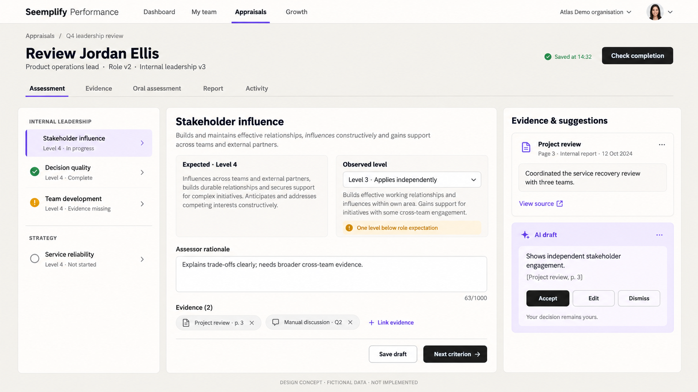
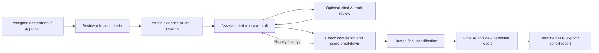

# Assessor, evidence and reports — UX handoff

Owner: UX Designer B. Date: 18 October 2026. Baseline source: `b401f1b1583be5875cc02462122c83ec9e7311d2`. Status: **design specification for PM/SA review; not implemented or released**. This document consumes CA-008/009 and CA-101–116, `architecture/01-domain-and-api.md`, `02-delivery-security-qa.md` and the frozen `DEVELOPMENT-CONTRACT.md`. Setup/library interactions belong to `01-roles-and-setup.md`.

## 1. Product cognition and design decision

Performance helps employees and selected assessors explain performance against a known occupational role, supported by evidence. The primary users here are assigned assessors, scoped managers/HR, and employees viewing their permitted final results. Core objects are assessment, participant, occupational role version, source criterion, evidence, finding, submitted feedback and final report revision.

This is an extension of a working enterprise product: an **assessment workbench and result detail**, not a marketing dashboard. Entry is an assigned assessment or linked appraisal; the first decision is which criterion needs attention. Success is a saved, evidence-supported human judgement and a readable final report. Recovery preserves edits and points to the exact missing field/source. On mobile the primary task is assess one criterion and save it.

Keep the existing shell, navigation, context switcher, suite tokens, accessible controls and appraisal metadata. Add criterion navigation, source-aware expected/observed comparison, a focused evidence drawer and optional AI review. Avoid a wall of settings, undifferentiated stars, an AI chat prerequisite, raw JSON, colourful unrelated tiles or a single giant review form. API schema, hashes, lease states and provider credentials stay out of primary UI.

Vocabulary: **assessment role** means occupational expectations. **Access role** means authority such as HR/admin. Use “Assessed by” for the actual submitting reviewer; “Created by”, “Call participants” and “Finalised by” remain distinct. An uploaded role description attached as evidence does not change the selected role.

## 2. Baseline audit and evidence boundaries

Read-only browser audit: 18 October 2026, existing Edge Performance session. URLs below are surface references, not promises that every record is accessible to every viewer. No employee review was edited, submitted or finalised. No AI request, call or export was initiated for this audit.

| Surface observed/inspected | Current foundation | Design implication |
|---|---|---|
| Live `/appraisals?view=personal` | Current/history tabs, newest-first metadata, reviewer, period and due dates | Keep chronology and dates; add selected assessment role and criterion progress without replacing current lifecycle |
| Live `/appraisals/:id` personal overview | Actual reviewer/employee separation, progress, self-assessment and manager tabs; manager tab denied before availability | Honour source visibility and stage; never reveal manager drafts through the competency tab |
| Source `app/appraisals/[appraisalId]/manager-review/page.tsx` | Existing generic manager review form | Extend via owned linked competency panel; do not silently mutate existing lifecycle |
| Source `app/appraisals/[appraisalId]/report/page.tsx` and `services/appraisalResultReport.js` | Existing summary, generic ratings, report/print base; individual manager goal comments absent from current report | Complete explicit report DTO; verify field parity in web/PDF |
| Source `components/appraisals/AppraisalMeetings.tsx`, native-call and media adapters | Calendar/native call foundations | Reuse call UI; add criterion/source linkage, not a second call product |

Live reviewer editing was intentionally not opened as the signed-in employee. Report/call live acceptance is **not claimed** from source inspection. The current overview's **No calls scheduled yet** state was observed and captured; no call was started. New concepts use fictional data only.

The actual-account baseline is retained only in the ignored local evidence folder. Public examples use synthetic people. The observed overview showed identity/context, dates, workflow and an empty call state; it is baseline evidence, not new-feature proof. Live revision was not independently extracted during this design audit; the inspected source baseline above is separate. No actual-account screenshot was sent to image generation; the concept was generated from a synthetic written brief.

## 3. Visual system and concept

Use actual `performance/frontend/app/globals.css` suite tokens. Light canvas/surface: `#efede7` / `#fffdfa`; ink `#191816`; muted `#6d675f`; borders `#d7d2c8`; accent `#7047eb`; primary action `#171613`. Dark equivalents: `#0f0e13` / `#19171f`, ink `#f7f5fa`, muted `#aaa3b2`, border `#302d38`, accent `#8b6cff`, primary action `#faf9fb`. Semantic green/amber/red accompany text/icons. Do not hardcode blue input surfaces from older legacy cards into new suite panels.

Inherit the running body/display font stack; do not introduce another remote font. Proposed hierarchy: page title 28–32px, section 18–20px, body 14–16px with 1.5 line height, metadata 12–13px; never shrink chart labels to fit. Existing suite panel/button radii and spacing rhythm (8/12/16/24/32px) apply. Content width may expand for the workbench but retains shell gutters. Neutral action buttons, one purple selection cue, calm dense rows, no decorative gradients.

Generated using the built-in image tool. Fictional Jordan Ellis, Atlas Demo, Product operations lead. Concept is visual inspiration, not a screenshot of delivered functionality. It illustrates the three-column workbench only; exact labels, sources, dates, counts and validation below take precedence. The generated “63/1000” counter is illustrative, **not a frozen backend length limit**. Strategy uses a configured target/scale, not automatically a native level because the image happens to show “Level 4”. Only comparable ordered source levels may display a numeric level gap.

Generation brief: high-fidelity wide Seemplify light workbench; horizontal existing navigation, frozen role/version; criterion/source navigation; expected/observed and rationale; linked fictional evidence; optional cited AI draft with accept/edit/dismiss; neutral primary actions; footer `DESIGN CONCEPT · FICTIONAL DATA · NOT IMPLEMENTED`. No real CV, rating or transcript was supplied to generation.

## 4. Journey and information architecture

One assessment has tabs **Assessment**, **Evidence**, **Oral assessment**, **Report**, **Activity**. Deep-link criterion and tab in URL using opaque IDs; preserve filters/scroll when returning from evidence. A linked appraisal displays the same competency section and pinned role, with “Open assessment workspace” as a secondary link. Standalone cycle entries use the same workspace, not a parallel data copy. Without a competency link, ordinary appraisals continue unchanged and do not invent role information.

Header context: participant, cycle/period, assessment role/version, selected source/version badges, status, actual assigned assessor, reviewer due date and timezone when known. “View role expectations” opens the **frozen** role, never the latest library head. Save state and one primary next action remain visible. Historical unknown values say “Not recorded”; absence by choice says “Not selected” or omit the irrelevant section.

## 5. Screen specification A — criterion workbench

Desktop ≥1200px: source-grouped criterion list 240–280px, finding panel flexible ≥440px, evidence/AI contextual pane 300–360px. At medium widths use two columns and evidence drawer. Selection highlights one criterion; filters **All**, **Needs attention**, **Assessed** include accessible counts. “Needs attention” distinguishes not started, missing qualifying evidence, missing rationale and insufficient evidence; it is not a low-score filter.

Criterion pane reading order:

1. Criterion name, source and version; concise definition and linked role responsibility.
2. Expected native level and definition, or explicit numeric target and named scale for rating-based criteria. Qualitative responsibilities have no fabricated numeric target.
3. **Finding**: radio options “Assess this criterion” / “Insufficient evidence”. No observed level default. Assessed mode offers the criterion's native level select or configured numeric rating with min/max and scale description. Never equate SFIA level 4 with internal level 4.
4. Rationale textarea, required indicator from pinned policy, linked evidence picker; visible characters remaining only if server limit exists. Show missing criterion references at field level.
5. Qualitative role observations and criterion-linked manager feedback where configured. **Save draft**, **Previous criterion**, **Save and next**. Moving with unsaved edits attempts an explicit save or asks to keep editing/discard; never implies navigation saved automatically.

Help: “Choose the level supported by the evidence. Expected level describes the role; observed level describes what you assessed.” Insufficient evidence copy: “Explain what is missing. This is not a score of zero.” Selecting it clears active rating in the submitted payload after clear on-screen notice, retains previous user choice in the unsaved local editing session until saved, and shows scoring impact from the configured policy.

Read-only final records replace editable controls with labelled findings and **View final report**. “Reopen” appears only when allowed. Assessment role does not confer access; record `allowedActions` controls actions and backend remains authoritative. If no edit right: “You can view this assessment. Contact an authorised assessor to request a change.” Foreign/missing records use a neutral unavailable page without names.

Save contract: GET/PATCH assessment with current revision; accept canonical validated fields from response, not optimistic fake success. In-flight save shows **Saving…**, success **Saved at 14:32 BST**, failure **Changes not saved — Retry** with retained text. Explicit save can work without autosave; optional debounce must not introduce out-of-order writes. Any revision conflict offers **Compare changes**, **Reload saved version**, **Keep my text**; show mine/current per changed field, ask reviewer to reapply, never blindly overwrite latest revision. Sensitive unsaved text stays only in current session memory by default, not unencrypted durable browser storage. Session expiry uses **Sign in again**, preserving recoverable in-memory edits without resubmitting automatically after authority changes.

## 6. Screen B — evidence intake and coverage (CA-101)

Entry: Evidence tab or **Link evidence** in a criterion. Table/list columns: source name/category, linked criteria, status, occurred/uploaded date, uploaded by, visibility, actions. Compact view presents source cards with the same reading order. Categories use CV, role description, strategy reference, supporting document, manual oral answer, transcript or recording. No storage key/provider token is rendered. A single source linked to multiple criteria remains one source with multiple links; counts do not imply independent corroboration.

Upload flow: choose file → category/criterion(s)/visibility → upload → safety scan → ready/needs attention. Frozen allowlist: PDF/DOCX/TXT, maximum 10MiB, server MIME/signature/parser checks; show helper before choice. Criterion multi-select is searchable and keyboard usable; current criterion preselected, selection visible before saving. Uploading a role description has a notice: “Evidence only. Your selected role remains Product operations lead v2.” Library updates require the separate authorised role workflow.

States: progress/cancel before completion; queued scanning (not usable by AI); quarantined “This file cannot be used. Upload a safe replacement”; extraction unavailable with safe metadata/manual assessment; preview unsupported with authorised download if allowed; retry preserves metadata and uses the same operation identity; wrong file type/size error beside file input. Evidence from another participant never appears in picker or source search. Expired/deleted sources say **Source no longer retained**; superseded sources retain version labels and cannot silently switch to a replacement.

Coverage bar: e.g. “6 of 8 required criteria have qualifying evidence.” The denominator is required evidence policy, not a quality score. Actions jump to individual missing criteria or **Record insufficient evidence**. A missing source, an upload failure and a deliberate insufficient-evidence finding are separate states. Remove link is reversible before save; deletion uses existing authorised retention workflow with consequences and server permission, never a public destructive link.

## 7. Screen C — oral assessment and call sources (CA-102/103/115)

First decision is session mode: **Manual assessment** (always first-class), **Calendar meeting**, **In-app call**. Providers are optional; unavailable modes show reason and manual alternative. Do not require accounts, recording, transcript or AI for manual completion.

Manual session fields: occurred date, local time/timezone, participant(s), assessor, session title, criterion links; repeatable question groups contain **Prompt**, **Participant answer**, **Assessor notes**, linked criteria. Authors are server-attributed; participant answer typed by assessor is labelled “Recorded by [assessor]”, not participant-authored/verbatim transcript. Save draft works with incomplete prompts. Submit validates configured required answers and highlights exact questions. Submitted sessions show author/time/version; amendment creates a version with reason where policy requires it. Repeatable reorder/remove controls have accessible names; draft removal supports undo.

Calendar/native modes embed existing authorised meeting controls. Show separate states **Scheduled**, **Ready to join**, **In progress**, **Recording**, **Processing transcript**, **Available**, **Capture failed**, **No recording**, **Source no longer retained**. “Call ended” does not mean “Transcript available”. Display purpose-specific recording/transcription/AI notices and retention, with consent status/action for each. No checkbox pre-authorises unrelated purposes. Recorded evidence requires source access and consent; opening the play button requests a fresh authorised stream rather than exposing durable provider URLs.

Transcript source drawer: speaker labels when supplied, timestamped passages, search, **Link passage to criterion**; clicking a citation seeks to the corresponding available segment. Preserve original transcript version; corrected notes are separate. Absent speaker identity says “Speaker not identified”. Transcript failure offers retry (if permitted) and manual answer capture. Provider deletion pending is visibly pending; never say deleted while retries remain.

## 8. Screen D — optional AI draft review (CA-009/104)

AI is a secondary tool, never the first required step. **Generate observations** opens a compact check screen showing selected frozen role/version, criteria and explicitly permitted source count, personal connection state and per-purpose processing notice. No source content or credentials from another person's account. Consent/connect actions use existing shared flows. Missing connection copy: “Connect your AI account to use suggestions, or continue manually.” Disabled policy, unavailable provider and workload limits have separate reasons; manual form stays usable.

Running job: text status and cancel if supported. No fake percentage for an indeterminate provider job. Completed draft card contains criterion/role requirement, observation, **AI draft**, and source chips with page/text span/transcript time. Click opens permitted source in context; unresolved/removed citations are **Source unavailable — verify before using** and cannot satisfy evidence. AI text alone never increases coverage.

Actions: **Accept as draft finding**, **Edit before using**, **Dismiss**. Acceptance copies only reviewed narrative into an editable finding, preserves existing assessor text through explicit append/replace choice, and requires the assessor to choose the level/rating. It never sets final classification or submits the assessment. Editing keeps original draft plus actual review actor/time in provenance; dismissal is recorded and reversible while permitted. Published report shows human judgement and provenance as permitted, not unaccepted suggestions/private drafts. “AI unavailable — continue your assessment manually” is a recovery state, not a blocking validation error.

## 9. Screen E — completion, scoring and final classification (CA-106/107/110)

**Check completion** opens a review page/drawer using the current server revision. Group checklist by missing finding, rationale, evidence and oral requirements. Each issue is a direct link to the exact criterion/field; focus lands at the field on return. Structural faults (missing role, invalid source/scoring, denied finalise permission) cannot be waived. **Allow exception** appears only for permitted waivable issues, lists precisely affected criteria and requires a meaningful reason; authority/actor/time captured server-side. Exception coverage remains visible in report.

Score breakdown shows: native finding → configured normalization (native level map OR named rating scale) → criterion weight → source subtotal → input weight → aggregate. Source scales stay visibly distinct. Expand **How this was calculated** for formula, rounding precision and pinned configuration version; ordinary users never edit formula JSON. Tables contain all plotted values. Insufficient evidence displays **Unscored**, not zero. If exception policy excludes/renormalizes, show excluded weight and new denominator. If retained unscored, show coverage and no invented overall score if policy cannot produce one. No silent rebalancing.

Final outcome page separates **Calculated suggestion** from **Your final classification**. The latter has no automatic selection that implies assent. Require valid configured category; if different from suggestion, show mandatory **Reason for a different classification**. Checklist, proposed score/coverage, selected final category, exceptions and finaliser are visible together. **Finalise assessment** confirmation states this saves a final version and makes its report available only to permitted viewers; no second approval queue or later mandatory publish action. Server finalise atomically reruns readiness, records human decision and durable result, then returns **Assessment finalised** with **View report**. Disable duplicate click while request pending; retry uses same idempotency key. Stale/changed sources return to checklist with edits preserved and current reason. Never show success before durable result exists.

## 10. Screen F — participant report and complete feedback (CA-111/112)

Entry from completed assessment/linked appraisal. Header: report status/version, participant, occupational role/version, cycle/assessment period, source versions, creation, submitted assessor/time and finaliser/time. An employee sees only permitted published contents. Draft preview is explicitly **Draft — not finalised**, excluded from final cohorts and final-export routes. Legacy unknown fields say **Not recorded**.

Report hierarchy:

1. **Outcome**: human final classification, calculated suggestion, score if valid, coverage, override/exception reason and relevant assessor attribution. No automated hiring/promotion decision is asserted.
2. **Role comparison**: responsibilities and expected/observed criteria grouped by source/version, native definitions, evidence availability and concise gap narrative. Qualitative findings remain visible even if unscored. Ordered native-level comparisons use paired labelled bars or aligned level markers; numeric scales label units. No radar chart mixing unrelated native scales. Accessible data table accompanies chart.
3. **Manager / assessor feedback**: overall strengths/improvements/development narrative; EVERY submitted competency rating/comment; EVERY goal review rating/comment under that goal; submitted custom answers and recommendations. Show **Assessed by**, reviewer context and submission date/time. Actual reviewer may differ from creator/line manager. Long comments wrap; show full text by default in final PDF and accessible expand control on web.
4. **Employee reflection**, **Oral assessment findings / discussion**, and **Reviewed AI assistance** are separate source-labelled sections. Manual notes are never labelled transcripts. Private drafts, restricted notes and unaccepted AI are excluded by canonical DTO, not CSS-hidden. Do not assume every final-report viewer can play cited media.
5. **Scoring and evidence appendix**: formula/weights/conversions/coverage, source references, unavailable/deleted source labels, role/config/result versions, optional comparable ranking context and audit summary. Credentials/raw storage links/internal IDs not needed for the decision stay absent.

**Download PDF** is independently permission-gated. Job state **Preparing PDF**, **Ready to download**, **Could not prepare — Retry**, **Access changed — download unavailable**. Download rechecks permission; the screen and PDF use the same versioned report DTO. PDF uses light paper-safe palette, repeated headings/table headers, page numbers/report version, legible charts plus tables, no clipped long goal comments, and no signed media URL that grants unintended access. Browser print is not certified as a complete PDF until parity/render tests pass. No SFIA/AI/call section is shown as a failure when that source/path was deliberately absent.

## 11. Screen G — cohort, ranking and history (CA-108/113/114)

Cohort report entry: Reports → Competency assessments → cycle. Scope notice **Showing the people you are allowed to view**; HR organisation filters and manager hierarchy filters come from scoped server directory. Role/team/department/status filters use labelled controls and **Clear filters**. Scope is applied before counts and options, not client-hidden after loading all people. Selected source/version context appears above results.

Completion counts list not started, draft, evidence incomplete, ready, finalised, reopened with a visible denominator; define mutually exclusive display priority server-side and do not double count an evidence-incomplete draft in total. Gap chart/table distinguishes assessed gaps from missing evidence. Empty results says **No assessments match these filters** with clear filters; no records says **No assessments are available in your scope**. Data failure never renders zero-performance charts.

Rankings only appear when enabled. Table shows rank, participant, assessment role/version, score/measure, coverage and tie context. Same score uses configured dense/competition rule and displayed precision; exclusions have **Not comparable** plus a human reason. Different scale/role/config fingerprints cannot be casually ranked together. Do not calculate global rank or hidden denominator outside viewer scope; if policy requires an org ranking the viewer cannot see, show unavailable rather than leaking global position/counts. No ranking column/chart/export when disabled. Reopened/draft versions are excluded from final rankings with correct status.

History: activity timeline shows actor, action, date/time/timezone, reason and safe field/version labels; no raw transcript/token bodies. Version selector distinguishes **Current final**, **Previous final**, **Reopened draft**; old report remains viewable to permitted users. **Reopen assessment** requires independent capability and reason, explains previous final record is preserved, and creates a new working revision. Reopening is not a general edit bypass and is distinct from concurrent cancellation/removal work. Conflicts reload version state without deleting existing reports.

Retention/source state in final report: **Source no longer retained** preserves lawful finding/calculation provenance without recreating deleted source content. Hold state explains deletion is restricted; provider pending/failed cleanup remains visible to authorised admins, not a universal-deletion promise. Administrators configure durations/holds through a dedicated settings form with per-purpose definitions and current policy version; no invented default retention period is assumed.

## 12. Shared state, accessibility and responsive contract

| State | Required visible behaviour / recovery |
|---|---|
| Loading | Skeleton only for expected content; loading text/aria-busy; no dummy scores/people; keep shell and page title stable |
| Empty | Explain whether no criteria, no evidence, no records or no filter matches; offer only authorised next action |
| Read error | Preserve filters/tab; inline Retry; omit misleading zeros; safe expandable request identifier for support |
| Permission denied | Remove inaccessible content/actions; explain action unavailable for known same-org resource; missing/foreign resource neutral unavailable; return to accessible list |
| Session expired | Sign-in recovery, preserve in-memory edits; recheck authority before reapply; no forced silent save |
| Saving / saved | Exact pending and acknowledged states; human time with timezone; disabled duplicate submit |
| Save/network failure | Changes retained in current editor; inline retry; leaving warns; never says saved optimistically |
| Conflict | Mine/current comparison, reload/reconcile; retain local draft; no force-overwrite button |
| Missing/invalid field | Error summary linked to field and inline error with aria-describedby; focus summary after failed submit; drafts still save where valid |
| Final/completed | Read-only values and version; report access; reopen separately permitted; stale control mutation rejected |
| Long content | Wrap file/role/criterion labels and comments; meaningful expand; no truncation hides differentiating source/version; no horizontal page overflow |
| Unavailable source/provider | Distinguish pending, failed, revoked, deleted, unsupported preview; manual path and retry only where authorised |

Keyboard: semantic landmarks, one H1, source-group headings, native buttons/selects/radios or existing accessible combobox, visible focus ring. Criterion links have current-state semantics; tabs support expected arrow keys. No drag-only interaction. Drawers/dialogs trap focus, close with Escape except during an unavoidable critical action, restore originating control; source citation link announces source/page/time. Save status uses polite live region, errors assertive only on failed deliberate action. Touch targets aim44px (minimum WCAG2.2 target-size rules), no hover-only information, contrast4.5:1 body/3:1 meaningful controls and visible focus, reduced motion. Selection, gap and state always have words/icons, not colour alone.

Mobile ≤767px: header participant/role and Save status first, criterion selector + progress second, expected definition collapsible but visible summary, observed finding/rationale/evidence then Save and next. Evidence/AI open full-height accessible drawer instead of three compressed columns. Keep unsaved form when closing drawer. Sticky action bar above safe-area inset cannot cover final field/error and must remain visible under zoom/keyboard. Report comparison becomes labelled stacked rows; optional table scroll is confined to a labelled region, never entire page. Cohort filters collapse into **Filters (n)** drawer with Apply/Reset, active chips remain visible. Test320px,390px,768px and desktop1440px, 200% zoom, both themes. Do not claim dark-mode acceptance from a light concept alone.

## 13. Per-story screen-to-test handoff

| Story | Screen / key requirement | Required UX test before approval |
|---|---|---|
| CA-008 | A/F same frozen occupational role and source definitions | Edit library after launch; workspace/AI/report retain original role |
| CA-009 | D role-aware cited optional AI | Disabled/absent connection and source denied; manual completion remains usable |
| CA-101 | B scoped uploads/coverage | Valid/malicious/oversize/quarantine, linked wrong participant denied, missing vs insufficient, retry |
| CA-102 | C manual oral answers | Provider-blocked full flow, draft/resume, required prompt, stale save, authorship labels |
| CA-103 | C existing calendar/native media | Consented states, authorised timestamp playback, real provider proof separately labelled, manual fallback |
| CA-104 | D cited draft review | Verified/unverified citation, accept/edit/dismiss, no automatic rating/finalise, revoked queued source |
| CA-105 | A expected/observed finding | Mixed native scales, insufficient not zero, save/reload/conflict, keyboard/mobile |
| CA-106 | E formula/normalization breakdown | Golden values match all displayed components; numeric and native-scale cases; missing denominator |
| CA-107 | E human classification | Suggestion separate; override reason; finalise once and immediate permitted report |
| CA-108 | G optional comparable rank | Off absent, ties match policy, incompatibility explicit, scoped totals do not leak |
| CA-109 | All resource/action authority | Read/edit/finalise/reopen/view/export denied separately incl forged API and second tenant |
| CA-110 | E actionable completion | Each missing field, nonwaivable invariant, scoped reasoned exception, stale readiness |
| CA-111 | A/F submitted manager feedback | Sentinel comments in every goal/competency/custom/overall field, actual reviewer vs creator/date |
| CA-112 | F canonical report/PDF | Text/value/version parity, scoped media, view-not-export, long-text rendered pages |
| CA-113 | G authorised cohort | Ten-record denominator reconciliation, subset filters, empty/error not zeros |
| CA-114 | G version/activity/reopen | v1 preserved, v2 draft/final distinguishable, reason/permission/conflict, no private audit bodies |
| CA-115 | B/C/G consent/retention | Purpose toggles/notice, revoke processing, expiry/deletion-pending/hold/source-unavailable |
| CA-116 | All integrated acceptance | Baseline/concept/local/CI/live/provider labels, both themes, mobile/keyboard and exact revision |

## 14. PM/SA review and developer gate

This is a **review request**, not assumed signoff. PM checks every numbered acceptance clause in the story files against the screen/state above; SA checks fields/allowed actions, error mapping, source version, CAS/idempotency, report visibility and atomic finalise. Any discrepancy in scale IDs, completion policy, ranking scope or publication must be fixed in frozen contract before implementation.

Required reviewers' checklist:

- Role/version and source meaning survive every workbench/AI/report route; no access-role confusion.
- Manual/no-AI/no-call path completes with no integration blockade.
- Manager feedback covers every submitted goal/competency/comment and actual reviewer identity/date; private drafts excluded.
- Completion/exceptions cannot waive security or fabricate absent scores; human outcome is distinct from calculated suggestion.
- Per-action permissions, source streams and exports independently guarded; totals scoped before aggregation.
- Finalise yields durable permission-restricted report directly; reopen retains old final history.
- Keyboard/mobile/light/dark/loading/error/conflict/recovery states represented in implementation tests.
- Concept and baseline remain labelled; screenshots never substitute for executed acceptance.

Review ledger: UX-B authored18Oct2026; PM review **pending**; SA review **pending**; implementation **not started by this designer**; QA/rendered app comparison **pending**. Developers must attach actual route/component names, per-clause tests and screenshots here or in the programme evidence ledger after implementation.

## 15. Sources and artefacts

- [GOV.UK check answers](https://design-system.service.gov.uk/patterns/check-answers/) — reviewed18Oct2026; informs the editable completion review and consequential finalisation summary.
- [WCAG2.2](https://www.w3.org/TR/WCAG22/) — reviewed18Oct2026; keyboard/focus/error/contrast/reflow/target-size acceptance baseline.
- Existing source and current suite tokens inspected18Oct2026; browser baseline is source-observation evidence only, not new-feature acceptance.
- Generated asset: `design/concepts/assessor-workspace-light-concept.png`, built-in image generation, synthetic data only.
