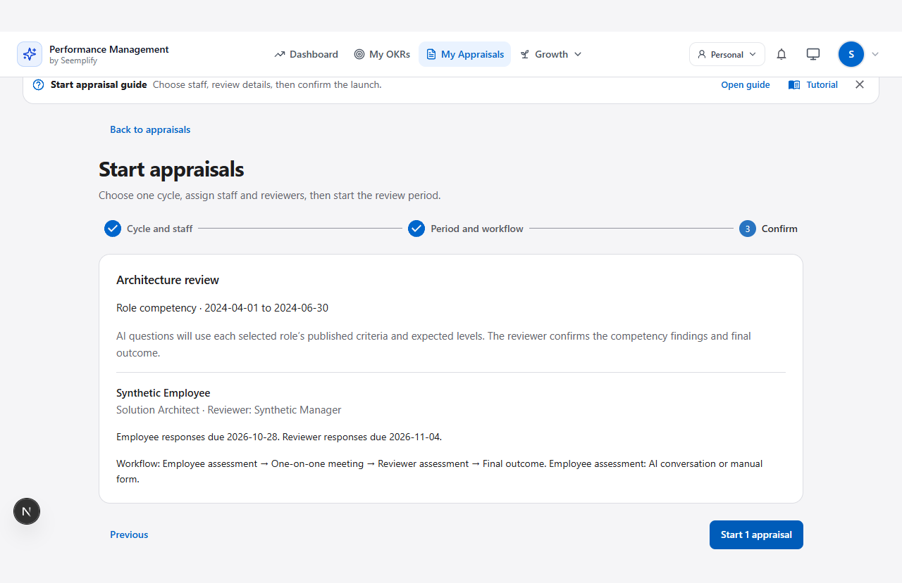
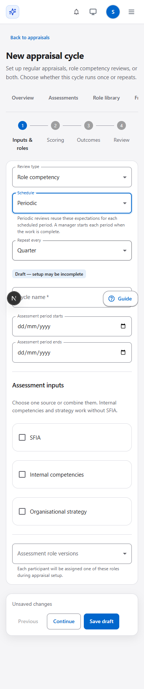

# Release and verification

## Implemented

1. One canonical cycle setup with regular, role competency and combined modes; one-time or periodic schedules; optional approved goals; published questions and source-specific scoring.
2. Atomic launch creates the existing appraisal workflow and linked competency assessment together. Role questions and framework expectations are frozen for the AI conversation and manual form.
3. Period-specific uniqueness, replay protection and separate cohort comparisons/exports. One-time and legacy assessments cannot be duplicated through the new launch.
4. Manager-owned team configuration through the IdP grant; organisation administration retains shared role/framework/strategy governance. Identity policy v6 adds only the manager cycle grant to v5 policies, preserving deliberate permissions/denies.
5. Legacy cycle history retained. Main setup/navigation uses the canonical library. Legacy automatic quarterly catalogue creation is stopped.

## Evidence layers

| Check | Result |
|---|---|
| Ten backend integration suites: unified launch, competency library/assessment/authorization/atomic bridge, ordinary lifecycle/flow/colleague/reporting/AI policy | 198 passed |
| Final unified-cycle suite, including the additional question-capacity guard | 17 passed |
| Identity defaults, narrow v5-to-v6 migration, directory and colleague authorization | 52 passed |
| AI/question/workflow unit contracts | 15 passed |
| Focused competency-library and unified browser contracts | 12 passed together; final mobile refinement 4 passed; final unified flow including CV/deep-link/date cases 5 passed |
| Final production frontend build | Passed |

Replica-set tests cover recurring periods, retries/concurrency, tenant scope, stale references, atomic rollback, native role questions, bounded receipts, legacy bypass prevention, optional flows/reminders, explicit goals, migration and idempotent professional-role configuration. Browser fixtures are synthetic mocked APIs; they do not establish production persistence. Desktop/mobile screenshots were inspected.

Only these focused browser suites were run. Older Start-wizard specs describe the retired two-step setup and were not used as acceptance for the unified flow. External AI execution and authenticated live checks are separate evidence layers. Review was performed without subagents in this side conversation; it is not an independent peer review.

## Production steps

1. Commit only this change's files on main. Preserve the unrelated reliability-review directory and parent report-design evidence. Deploy the exact tested main commit using the existing serialised core deployment.
2. Verify backend, frontend and IdP live image/release revisions plus existing OIDC-start smoke.
3. In the released Performance backend container run `node scripts/migrateCompetencyOccurrences.js` (dry-run), then the same command with `--apply`. It builds/verifies replacement uniqueness before dropping the old index and backfills only missing occurrence keys. Capture counts/index names, not employee content.
4. Refresh IdP policy/claims through normal authenticated use. Verify cycle create controls for administrators and server scope/claims for managers. Never manufacture browser claims or change real users' roles for QA.
5. AIIN and MoMo are confirmed live targets. After the pending SFIA permission answer, run `scripts/configureProfessionalRoleCycle.js` separately per organisation with the actual recorded licence provenance. The script is resumable/idempotent, refuses conflicting existing definitions, enables only the competency feature, publishes one tailored six-skill framework, two roles and one quarterly cycle, and assigns no real employees.
6. Verify published source/role/cycle references and native level ranges in each tenant, then inspect the live setup. Any employee launch or final outcome remains a deliberate subsequent user action.

## Limitations and rollback

- Periodic configuration defines scheduled periods; managers explicitly start a completed period. It does not silently create employment reviews or email staff on a schedule.
- Role pack scope is the six SFIA skills relevant to these two profiles, with original summaries/prompts and links to official skill-specific descriptors. It is not the entire SFIA catalogue and does not imply certification.
- Do not publish SFIA content or record invented licence provenance while permission is pending.
- Keep previous images and all historical records. Before any periodic repeats exist, the old uniqueness index can be rebuilt after validating no duplicates. After repeat occurrences exist, retain the compatible backend/index contract; blindly rolling back to an older backend would not safely distinguish repeated assessments. No data deletion is a rollback step.
- Live status and SHA must be recorded after deployment; a local build or passing mock browser test is not production proof.

## Inspected synthetic UI evidence

These screenshots use synthetic API fixtures and do not establish production persistence.

