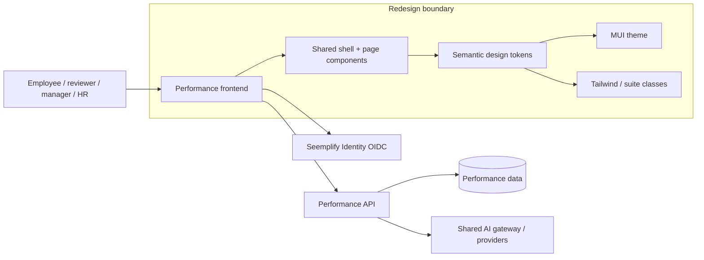

# Performance Management Apple redesign: solution architecture

Owner: retained Solution Architect 1 / QA lead. Date: 21 October 2026. Initial inspection: `main`, `9e8fecc1`. This document specifies the change; it is not a test or release receipt.

## 1. Scope and current system

The existing Performance frontend is a Next.js 16.3 App Router application with React 19, Material UI 7, Tailwind 3, SWR, Recharts and shared Seemplify Identity. Keep these foundations. This programme changes presentation and interaction consistency inside `performance/frontend`; it does not add a second identity authority, new workflow states, API contracts or database migrations.

C4's container view is useful here because it makes application and external-system boundaries explicit; the component-level styling map identifies the implementation seam. [C4 container guidance](https://c4model.com/diagrams/container).

Observed source: `app/layout.tsx` wraps providers and `ConditionalLayout`; `ConditionalLayout` prevents private pages mounting before authentication; `components/Layout.tsx` supplies role/workspace navigation; `context/ThemeContext.tsx` resolves the shared preference through `lib/theme-sync.ts`; `app/theme.ts` defines Material UI; `app/globals.css` and `tailwind.config.js` define suite/Tailwind styling. Competency also has nested navigation, so never style every `nav` element as top-level chrome.

## 2. Architecture decisions

| ID | Decision | Reason / practical consequence |
| --- | --- | --- |
| ADR-01 | Retain Next/MUI/Tailwind and existing components. | Avoid behavior churn while improving all screen families. Read installed Next documentation before framework edits. |
| ADR-02 | One semantic palette drives both systems. | Define canvas, surface, elevated surface, primary/secondary text, separator, accent, accent-soft, focus, success, warning and danger in both themes; existing `--suite-*` names remain supported. MUI consumes matching values and shared intent. |
| ADR-03 | Use system font stack and size-specific tracking. | Remove unused remote font requests; headings tighten, body tracking remains near zero, numeric comparisons use tabular figures. Text and spacing use relative units where practical. |
| ADR-04 | Functional material only on overlapping chrome. | Scope translucent header/menu/sheet treatment; content cards and tables remain readable solid surfaces. Use solid fallbacks for reduced transparency, unsupported blur and high contrast. |
| ADR-05 | Immediate feedback; restrained motion. | `:active` feedback begins on press, action commits through existing click/submit handling. Never block input until an animation finishes. Non-gesture color/opacity transitions remain short; reduced motion removes nonessential spatial/looping motion. |
| ADR-06 | Keep familiar semantic colors and permissions. | Blue identifies action; success/warning/danger retain semantic meaning and text/icon cues. Do not recolor chart series indiscriminately or remove warnings. |
| ADR-07 | Improve shared components, then audit route exceptions. | Shared foundations propagate to every route; explicit hardcoded gradients, fonts, backgrounds, menus and legacy utility controls require separate review. A token change alone is not proof that each page is complete. |
| ADR-08 | Preserve recovery and print/export behavior. | Loading, empty, error, denial, draft, read-only, print and report surfaces stay reachable; `ResultPrintStyles.tsx` keeps legible white-paper output. |
| ADR-09 | Export fixed light/dark palette and typography from `lib/performance-design.ts`. | The root layout emits deterministic CSS variables from the same values MUI imports. This prevents duplicated palette drift, preserves MUI `alpha()` compatibility and avoids reading computed styles during hydration. Generated styles have no request/user input; selectors match the existing theme bootstrap and keep suite/semantic aliases. |

Apple implementation reference: [emilkowalski apple-design](https://github.com/emilkowalski/skills/blob/main/skills/apple-design/SKILL.md). Apply typography, response, spatial consistency, material hierarchy and accessibility to this business workspace. Gesture physics are required only if a real gesture is introduced; do not add carousels or drag interactions to justify springs.

## 3. Frozen development boundaries

The user ceiling is six workers; this session exposes four concurrent agent slots, including the coordinator. Run no more than four. Roles rotate rather than pretending unavailable slots exist. Product and architecture work incrementally; retain one product reviewer and the architect for acceptance. The two developer lanes may run concurrently only with disjoint path ownership and a shared, published token contract.

| Lane | Exclusive paths | Collaboration contract |
| --- | --- | --- |
| A: foundations / shell | `lib/performance-design.ts`, `app/globals.css`, `app/theme.ts`, `tailwind.config.js`, `app/layout.tsx`, `components/Layout.tsx`, `components/ui/*`, `components/PageGuide.tsx` | Publish token/font/motion names before B consumes them. All shared changes go through A; B sends requests instead of editing these files. |
| B: screen adaptation | `app/login/page.tsx`, `app/dashboard/page.tsx`, approved disjoint feature pages/components | Keep data hooks, route destinations, permissions, field names, validation and API calls unchanged. Request shared component changes through A. |
| QA / release architect | New appearance tests, evidence and review documents; release mutations only after gates | Execute after both lanes report ready. Do not run competing Next build/dev jobs in one checkout. Architect owns commit/push/release and records exact scope. |

Before assignment, compare actual dirty paths again. The initial exclusions are: `app/appraisals/[appraisalId]/page.tsx`, `app/one-on-ones/page.tsx`, `components/appraisals/AppraisalMeetings.tsx`, `CalendarAccount.tsx`, `CalendarNotetakerMonitor.tsx`, untracked `CalendarAccountControl.tsx`, `e2e/calendar-direct-connect.spec.ts`, `e2e/one-on-one-calls.fullstack.spec.ts`, and both modified Recruiter notetaker service/test files. Existing untracked `performance/docs/reliability-review` material is source evidence, not automatically part of this release. Do not stage entire `performance` or the entire repository.

## 4. Story-specific architecture handoffs

### AD-01 - Foundation, sign-in and wayfinding

Input: [product handoff 1](product-01.md#ad-01---consistent-app-foundation-sign-in-and-wayfinding), received incrementally before the remaining stories.

**Requirements.** R01.1: consistent adaptive tokens across MUI and Tailwind, including portals. R01.2: preserve `ConditionalLayout` mounting guard and existing OIDC handoff. R01.3: preserve workspace/organization/team options from current claims/context. R01.4: current navigation identified programmatically; visible focus; Escape closes menus and returns focus; navigation works without hover. R01.5: 390px viewport and 200% text/zoom remain usable. R01.6: reduced motion/transparency/increased contrast fallbacks. R01.7: press feedback does not alter click cancellation or disabled behavior. R01.8: retain guide/tutorial/theme/notifications/Hub exit access.

**Solution.** Lane A consolidates globals and MUI overrides, scopes header class, removes competing remote fonts, adds focus/scroll offset/motion/media rules, and preserves light/dark preference persistence. Lane B simplifies login presentation while retaining login error, pending, timeout and retry logic. Use existing MUI dialog/menu behavior where available; custom navigation must add the missing keyboard/focus behavior locally rather than replace domain logic. Tooltips do not replace labels.

**Data/security.** No API or storage changes. Theme preference is the existing shared first-party cookie/localStorage mechanism. No plaintext secrets or production personal information in evidence.

**Verification.** Auth-route recovery, shell navigation/workspace tests, appearance matrix in both modes, menu keyboard/focus return, mobile/zoom, reduced preferences and portal dialog contrast. Capture sign-in error and timeout states with a safe controlled fixture; generated concept images are labeled concepts.

**Risks/rollback.** CSS specificity, MUI portals, inherited legacy colors and wrong API server reuse. Revert only programme commits/paths; leave previous dirty work untouched. Architecture ready for UX handoff; implementation acceptance pending evidence.

### AD-02 - Role-aware dashboard

**Input/requirements:** PM1 AD-02. R02.1: one heading, workspace/context, accurate metrics and permitted next tasks in that order. R02.2: retain Personal/Manager/Admin feature gates. R02.3: preserve link query scope, real notification target and summary meanings. R02.4: team menu keyboard/focus/long-label behavior. R02.5: loading/error/zero/no-team/no-org recovery. R02.6: responsive reading order in both themes.

**Solution/boundary:** Lane B edits only `app/dashboard/page.tsx` composition/copy; Lane A owns `.suite-*` styles. Replace decorative hero/kicker treatment with a concise header; retain hook calls, feature predicates, metric values and existing team-switch handlers. Prominent pending manager work uses the existing notification list. Do not fabricate percentages or infer progress from missing data.

**QA/rollback:** existing dashboard/workspace/team tests plus three role screenshots, attention and empty/error states, menu keyboard and mobile. Revert only dashboard/style changes; no data migration. Ready for UX; implementation acceptance pending.

### AD-03 - Goals and alignment

**Input/requirements:** PM1 AD-03. R03.1: clear current scope/period/tab/status and action hierarchy. R03.2: unchanged organization/team/self and read-only authority. R03.3: faithful objective/target/date/rating, including unrated versus zero. R03.4: preserved draft/retry/cancel and focus restoration. R03.5: unchanged request payloads/submission behavior. R03.6: mobile dialog fit, contained alignment scrolling, empty/error/long-title coverage.

**Solution/boundary:** shared MUI/Tailwind controls inherit Lane A tokens. Lane B may adapt `app/okrs/**` and `components/goals/*` after path reservation. Preserve `GoalWorkspace` scope, lifecycle/approval predicates, parent rules, scoring and current hooks. Alignment stays a meaningful hierarchy; wider content uses an explicitly labeled internal scroll region rather than hiding overflow on the document. No schema/API edits.

**QA/rollback:** goal creation/details/approval/check-in/alignment scenarios in `performance-journeys.spec.ts`, plus mobile detail failure/retry and keyboard focus return. Source styling rollback only. Ready for UX.

### AD-04 - Appraisal lifecycle and retained results

**Input/requirements:** PM1 AD-04. R04.1: list identity/status/next actor/due date/continuation priority. R04.2: preserve three-step launch/reviewer eligibility/partial receipt. R04.3: readable current stage and mobile progress. R04.4: manual/conversation drafts, configured questions and explicit save/submit boundaries. R04.5: unchanged selected-reviewer/employee/HR/final read-only authority. R04.6: retain meeting/upload/consent/competency contracts. R04.7: frozen report/export/white-paper print. R04.8: loading/missing/failed/partial/denied/lifecycle recovery.

**Solution/boundary:** Lane A styles shared controls and typography. Lane B may remove local gradients/shadows/all-property transitions in clean list/workflow/conversational/report files; current dirty appraisal detail and calendar files are excluded. Maintain stage routing, form validation, persistence keys, snapshots and `ResultPrintStyles`. Coordinate embedded competency visual changes with AD-11, one owner per path. Status labels/icons remain even when background colors simplify.

**QA/rollback:** appraisal-navigation/current-task/recovery/calibration-readonly and historical report/print/fullstack suites; stage screenshots include manual and conversation, evidence, final and history states. No print success inferred from screen theme. Revert style-only source; retain historical data and existing dirty work. Ready for UX.

### AD-05 - Administration, cycles, calibration and analytics

**Input/requirements:** PM1 AD-05. R05.1: human heading/scope/filter/action with readable chart values. R05.2: preserve actual admin and analytics resource grants. R05.3: unchanged cycle template/questions/deadline/publish/launch controls. R05.4: explicit calibration current/proposed/rationale/read-only. R05.5: same filter/export meaning and failure recovery. R05.6: mobile/zoom table containers and form fit. R05.7: long names, zero/unrated/small datasets.

**Solution/boundary:** Lane B reserves `app/admin/**` and `app/analytics/page.tsx`; shared MUI table/form defaults come from A. Charts consume theme-aware label/grid/tooltip values while retaining distinct data series, legends and numeric semantics. Tables keep headers and live within bounded labeled scrollers; do not blanket shrink text. Dedicated cycle editors remain separate from ordinary launch. Replace implementation vocabulary only where its user meaning is preserved.

**QA/rollback:** admin/analytics/calibration cases, long department/cycle datasets, row actions, print/export and scoped filters; no permissions inferred from menu absence. Revert approved presentation paths only. Ready for UX.

### AD-06 - People, team views and colleague reviews

**Input/requirements:** PM1 AD-06. R06.1: clear person/team/status/actions. R06.2: retain ID-keyed filtering and scoped directory/profile grants. R06.3: shared goal/appraisal/review/feedback status patterns with unchanged links. R06.4: distinguish colleague reviews from appraisal records. R06.5: empty/denied/search/detail recovery and menu keyboard. R06.6: long names/duplicate teams/zero/unrated/responsive tables.

**Solution/boundary:** Lane B reserves clean `app/team/**`, `app/reviews/**` and `team.module.css`. Prefer existing suite tokens over new local color literals. Keep stable person/team IDs, query strings and review payloads. Preserve team-context loading guard and explicit denial. Contextual menus use current semantics with visible focus and local colors. No renaming of the colleague-review domain into appraisal.

**QA/rollback:** people-and-teams, team-access-loading and colleague-reviews fullstack; populated directory/action and duplicate-team fixtures, not merely empty-page screenshots. Revert presentation paths only. Ready for UX.

### AD-07 - Feedback, recognition and project feedback

**Input/requirements:** PM2 C1 and AD-07.1..5. R07.1: common appearance/state/accessibility contract with compose redirect query preserved. R07.2: retain active tabs and all existing request/response controls. R07.3: adjacent recipient/message/audience, distinct search failure/empty, preserved failed-send draft. R07.4: closed-project request gate and existing participant/reviewer scope. R07.5: readable sent/acknowledgement/request state with unchanged private/anonymous and five-distinct-author privacy behavior.

**Solution/boundary:** Lane B reserves `app/feedback/**`, `app/recognition/page.tsx`, `app/project-feedback/page.tsx`, `components/feedback/*`; AD-06 owns `/team/feedback` path and consumes this same visual contract. All dialogs inherit A theme. Keep recipient identifiers, audience values, anonymization thresholds, query routing and payloads. Do not expose API-only lifecycle controls.

**QA/rollback:** phase2-continuous-performance, feedback-360-recovery and scoped people/colleague suites, plus search-failure/draft/mobile dialog screenshots. Existing domain storage/API unchanged, so rollback is source-only. Ready for UX.

### AD-08 - Check-ins and one-to-one meetings

**Input/requirements:** PM2 C1 and AD-08.1..5. R08.1: clear cadence/period/visibility/pulse association. R08.2: preserve draft/submit/read-only and failed-save content. R08.3: consistent upcoming/history/detail, integrated/manual scheduling recovery. R08.4: distinguish shared/private notes, keep call/device/recording consent reachable. R08.5: explicit calendar/join failure, completed and long-agenda states, separately labeled provider evidence.

**Solution/boundary:** Lane B may reserve clean `app/check-ins/page.tsx`, `app/one-on-ones/new/page.tsx`, `app/one-on-ones/[meetingId]/page.tsx` and `components/OneOnOneSchedule.tsx`. The existing dirty `app/one-on-ones/page.tsx`, calendar controls/monitor and call tests remain excluded. Use shared theme changes to cover those existing surfaces without overwriting them. No media session lifecycle, WebRTC, device consent, notes privacy or calendar integration change.

**QA/rollback:** check-in-scope-recovery, phase2 and existing calendar/native-call fullstack tests; inspect notes/consent/control layouts under mobile and reduced motion. Provider/media proof remains distinct. Revert only approved style changes. Ready for UX, subject to dirty-path exclusion.

### AD-09 - Development, coaching and support

**Input/requirements:** PM2 C1 and AD-09.1..5. R09.1: clear plan identity/state/due/action. R09.2: unchanged learning completion/sync semantics with empty/failed/completed distinctions. R09.3: objectives/targets/commitments/milestones grouped, actor-scoped HR/employee controls. R09.4: mobile coaching filters and action proximity. R09.5: plan/draft/error/pending/closed evidence without adding enrollment or automatic decisions.

**Solution/boundary:** Lane B reserves `app/development/page.tsx`, `app/coaching/page.tsx`, `app/support-plans/page.tsx`. Shared form/dialog/status/table tokens come from A. Preserve current support state machine and employee/manager/HR controls; no LMS enrolment or score automation. Keep saved and synced as different statuses.

**QA/rollback:** development-support-recovery, learning-development-sync, phase2 and real-API support lifecycle; populate detail forms and error drafts. Presentation rollback only. Ready for UX.

### AD-10 - Talent and succession

**Input/requirements:** PM2 C1 and AD-10.1..5. R10.1: role/state/scope and employee denial. R10.2: frozen evidence separate from editable human potential/readiness/rationale. R10.3: contained grid scrolling and distinct empty/error. R10.4: closed review read-only and explicit succession grant. R10.5: review/assessment/nominee/closed/long-label evidence.

**Solution/boundary:** Lane B reserves `app/talent/page.tsx`. Use shared tabs/table/dialog controls. Keep frozen performance evidence, AI advisory text and saved human decisions separate with headings/labels, not only color. Do not add a write path to closed records or rely on hidden buttons for security.

**QA/rollback:** phase3-talent-planning, succession-maintenance, closed-readonly and mobile assessment dialog checks. Source-only rollback; no changes to snapshot/state data. Ready for UX.

### AD-11 - Competency libraries, assessments and reports

**Input/requirements:** PM2 C1 and AD-11.1..6, existing competency contracts. R11.1: all 18 route entries and embedded panels covered; clear scrollable nested navigation. R11.2: consistent library/editor version/publication/import/error/read-only. R11.3: role/version/expected/observed/evidence/next action proximity and manual fallback. R11.4: private drafts and human classification/finalize/reopen authority. R11.5: published/cohort/version/export/print readable without frozen-data mutation. R11.6: per-route evidence status even when shared primitives provide coverage.

**Solution/boundary:** Lane B reserves `components/competency/CompetencyPage.tsx` and clean library/assessment/report components plus route wrappers. Shared header selectors must not restyle nested competency `nav`. Keep published definition versions, evidence/retention/consent controls, occupational role versus IdP role distinction, final report snapshots and privacy guards. A owns common portals and form tokens; B removes conflicting local color overrides only where the semantic intent is matched.

**QA/rollback:** competency library/criteria/assessment/consent/CV/draft/cohort/appraisal-link/recovery suites, local real-API role journey and white-paper report check. Root assigns embedded AD-04 paths explicitly. Source rollback only; no migration or historic version edits. Ready for UX.

### AD-12 - Action centre, AI account and help

**Input/requirements:** PM2 C1 and AD-12.1..5. R12.1: actionable/informational/completed distinctions and honest empty/error. R12.2: legible account state/next action/return without tokens. R12.3: unchanged account/policy/org controls; reads are not generation proof. R12.4: keyboard/mobile tutorial and secondary contextual help, preserving page state/focus. R12.5: account/action/help state evidence with actual provider claims separate.

**Solution/boundary:** Lane B reserves `app/action-centre/page.tsx`, `app/ai-account/page.tsx`, `app/settings/ai/page.tsx`, `app/tutorial/page.tsx` and clean AI/ActionCentre components. A remains sole owner of `PageGuide.tsx` and shell notification placement. Keep account/gateway service scopes, HMAC/allow-list contracts and external handoff URLs unchanged. Technical provider details stay secondary; help must not obscure the active form action.

**QA/rollback:** current account/reliability/navigation cases plus disconnected/pending/failed/connected synthetic states, action item filters and help focus return. Production connection/generation is separately recorded. Revert only appearance changes. Ready for UX.

### Design approval boundary

All twelve product inputs are accepted for architecture/UX handoff. This is not approval of an unseen concept or implementation. UX must attach baseline captures and concrete specifications, then product and architect review each package before development. C1 applies across AD-07..12 and the equivalent shared baseline applies to AD-01..06. Any domain/API/permission change returns to architecture and product scope review.

## 5. Research and role-skill selection

- Architecture communication: [C4](https://c4model.com/diagrams) provides context/container diagrams; use only views that clarify a decision.
- QA: [ISTQB risk-based testing](https://glossary.istqb.org/en_US/term/risk-based-testing) informs prioritization by impact and likelihood; immutable appraisal data, authorization and draft preservation are high-impact regressions even in a visual change.
- Browser verification: [Playwright assertions](https://playwright.dev/docs/test-assertions) support retrying state assertions; [emulation](https://playwright.dev/docs/emulation) supports viewport/theme/motion contexts; [accessibility guidance](https://playwright.dev/docs/accessibility-testing) explicitly requires manual checks alongside automation.
- Open-source role framework inspected: [BMAD-METHOD](https://github.com/bmad-code-org/BMAD-METHOD), also present locally under `_bmad`, version `6.0.0-alpha.23`. Architect/test-architect files contain useful boundary, risk and traceability guidance but also interactive menu activation. Do not blindly install/activate its menu workflow for this autonomous programme; use concise programme-scoped role skills that retain source attribution and current repository constraints.
- Existing `seemplify-competency-*` skills are competency-specific; their frozen-contract and human-review patterns are useful references but their scope must not silently expand to all Performance workflows.

Research is guidance, not evidence that the redesigned application passes.
