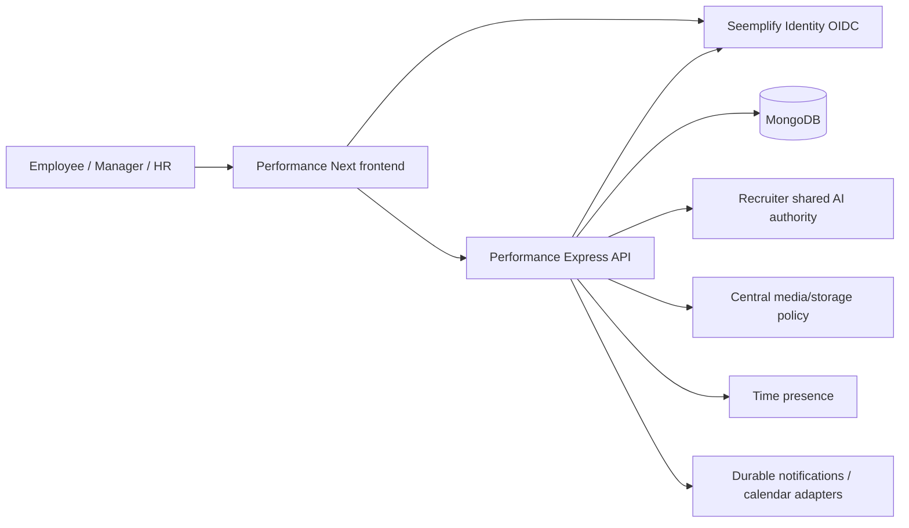

# Performance reliability: architecture and QA contract

Initial review 20 October 2026: source/test-plan baseline `f846ef5459dc170d1552ecd720c1aff9a7d7a92f` (PR #146, linked appraisal report recovery). Initial inspection alone established no execution result; the final verified release is recorded below.

Final implementation/release: tested source `069a20b01f21741400484639f257dd043aea3ea0` merged as PR #147 to main `da2e03c3c1c90c0297c7539abbc642d58a823264`. Both resolve to application tree `833cf30e15ec1d318a09adaf0f1047fca37ea8a7` (verified locally). [Hosted CI 39379560998](https://github.com/Dewinsight/seemplify/actions/runs/39379560998) passed 452 backend checks (134 legacy, 38 unit, 280 Jest / 25 suites), 709 HTTP/zero failures, 151 first-attempt UI cases with zero flaky/skipped, 31 real-API Chrome cases and build. [Fresh scan 39379559294](https://github.com/Dewinsight/seemplify/actions/runs/39379559294) passed. See [final acceptance receipt](ACCEPTANCE_RECEIPT.md) and [22-group/eight-role coverage](ROLE_COVERAGE.md); live all-role acceptance is not inferred from fixture roles.

## 1. Decision and scope

Retain the current Performance application and central Identity authority. Repair failed journeys and missing recovery controls in the existing flow. Each story must name an actor, permitted population, state transition, visible outcome, failure recovery and test evidence before implementation.

Organization-wide OKRs belong to organization owners, admins and HR managers under the default IdP role catalog. Managers and team leads can begin appraisals for their permitted staff; department heads are limited to their department. Actual permissions and people come from Identity. A role label alone must never override a centrally supplied permission set.

The reliability programme covers goals, appraisal setup/participation/history, feedback, recognition, check-ins, one-to-ones/calls, development, support plans, calibration, talent, competency assessments, reporting and their operational dependencies. It does not infer provider health from local substitutes.

## 2. Researched method

| Primary guidance | Application to this programme |
| --- | --- |
| [Azure Well-Architected: testing strategy](https://learn.microsoft.com/en-us/azure/well-architected/operational-excellence/testing) | Define acceptance and failure scenarios before release; maintain a dedicated environment representative of production. |
| [Azure Well-Architected: reliability tests](https://learn.microsoft.com/en-us/azure/well-architected/reliability/reliability-test) | Exercise recovery and dependencies outside production first; bound any production probe and preserve rollback. |
| [Playwright best practices](https://playwright.dev/docs/best-practices) | Assert visible outcomes, isolate tests and data, use semantic locators and web-first assertions. |
| [OWASP ASVS](https://owasp.org/projects/asvs) | Review server authorization, tenant separation, input handling and sensitive evidence against explicit security requirements. No ASVS certification is claimed. |

These sources inform the gates below. They are not substitutes for inspection of the actual Seemplify contracts.

## 3. Current architecture and ownership

| Contract | Current implementation anchor | Required invariant |
| --- | --- | --- |
| Identity and roles | `Identityprovider/src/config/accessControlCatalog.js`; `performance/backend/middleware/rbac.js` | OIDC is production authentication; signed active-organization permissions govern actions. No product-local production password path or invented identity authority. |
| Staff and reviewers | `Identityprovider/src/utils/performanceDirectory.js`; `performance/backend/services/performanceDirectoryService.js` | Directory uses the verified delegated token; same-organization members/reviewers only. Directory failure returns a recoverable 401/403/503 rather than silently extending scope. |
| Appraisal scope | `performance/backend/services/appraisalAccessService.js` | Resolve current organization, managed teams/department and permitted participants on the server. Keep employee participation separate from reviewer authority. |
| Goals | `performance/backend/services/goalPermissionService.js`; `performance/backend/routes/okrs.js` | Central action permission plus resource scope; organization goals have no parent. Period, lifecycle and acknowledgement rules survive refresh/replay. |
| Historical results | `performance/backend/routes/appraisals.js`; competency result/report services | Published snapshots remain readable to authorized participants; cancelled/finalized state does not reopen through stale evidence saves or legacy calibration. |
| AI and content sharing | `performance/backend/services/sharedAIAccountService.js`; `performance/backend/scripts/verifySharedAIHealth.js` | Signed app-scoped gateway, user/policy consent and global/cycle switches remain effective. A successful health probe is not content-generation acceptance. |
| Release | `.github/workflows/performance-ci.yml`; `.github/workflows/deploy-core-hostinger.yml` | Test the selected main SHA, deploy that SHA, verify live identity and signed-in behaviour, retain rollback. |

The directory adapter validates organization ID and member/team/reviewer response shapes, mirrors organization membership and team data, and fails closed in production when a delegated token is absent. This supersedes the older assumption that every eligible staff member must previously have logged into Performance.

## 4. Default role and boundary matrix

This table describes the default catalog. Deliberate custom Identity grants may change actions; same-tenant/resource checks still apply. Own work remains available to manager/HR roles as well.

| Actor | Organization OKR creation | Appraisal initiation | Assessment / report authority | Mandatory denial case |
| --- | --- | --- | --- | --- |
| Employee | No | No default launch grant | Own assessment, permitted evidence, own published results | Another employee's private review or manager action |
| Teamless employee | No | No | Own work and shared company references | No fabricated team audience or management scope |
| Team lead | No | Permitted staff in managed team scope | Assigned/scoped review work and allowed reports | Unmanaged team and unrelated reviewer work |
| Line manager | No | Direct reports/managed scope | Assigned/scoped review work and allowed reports | Another manager's unrelated staff |
| Department head | No default organization grant; department goals allowed | Department-authorized staff | Department scope plus explicit participant/reviewer rules | Another department or foreign organization |
| HR manager | Yes | Organization operational scope | Organization review administration, calibration and reports | Foreign organization; ownership/security policy reserved by Identity |
| Organization admin | Yes | Organization scope | Organization administration within granted app access | Foreign organization or missing app access |
| Organization owner | Yes | Organization scope | Organization administration within granted app access | Foreign organization or denied resource action |
| Selected reviewer | Depends on actual grants | No additional launch authority from selection alone | Only assigned actions/resources; test manual and call-first paths | Selection cannot grant unrestricted staff access |
| Anonymous / foreign actor | No | No | None without valid scoped authorization | 401 unauthenticated; 403 action denial; 404 hidden foreign resource where implemented |

Source-specific decisions are enforced by services, not menu visibility. For example, organization goal assignment checks `goal:assign:organization`; department assignment also checks headed department IDs; individual assignment checks self or direct-report scope. A central permission set prevents fallback to broad legacy `hr_admin` behaviour.

## 5. Evidence inventory

| Layer | Existing assets | What it establishes / excludes |
| --- | --- | --- |
| Backend unit and contract | `performance/backend/test/*.test.js`, explicit `test:unit` files | Pure contracts, guards, migrations and adapters. Does not prove browser flow or provider availability. |
| Mongo route/service integration | `performance/backend/tests/*.integration.test.js`; Jest in-band | Persistence, indexes, action/state/tenant denials, lifecycle and competency integrity. Review each fixture's substituted authentication/providers. |
| Full application HTTP | `tests/helpers/liveJourneyServer.js` + `runLiveJourneys.js` | Real app middleware, routes, sessions and production indexes; disposable replica set; canonical IdP catalog/directory builders. Identity HTTP, AI/presence and delivery are isolated substitutes. |
| Browser UI and route fixtures | `performance/frontend/e2e/` | Mixed suite: mocked responses plus `*.fullstack.spec.ts` route/Mongo fixtures. Includes draft refresh, metadata, lifecycle, native calls, people, learning, competency and linked-report recovery. Do not describe this entire folder as either fully mocked or full application E2E. |
| Full application browser | `performance/frontend/e2e-live/` | Real frontend/full backend. Role page smoke; recognition; goals/alignment; feedback; support plans; history/CSV; succession; launch/self-assessment; check-ins; development; calibration; role-only/competency journeys. |
| Release workflow | Performance CI; core deploy workflow | Repeatable execution and artifacts, followed by exact revision checks. A merged PR alone proves neither deployment nor live acceptance. |
| Live provider acceptance | Fresh controlled probes and authenticated browser | Actual OIDC, presence, signed AI connection, storage roundtrip and provider-specific behaviour. No current result is inferred from source or an old report. |

Recent merged source repairs include appraisal draft preservation (`d3cfe8d3`), role launch/reviewer/report controls (`e26c3d88`, PR #144), cycle AI-off/status (`a430b591`, PR #145), and linked-report loading/retry (`4f4ee4a3`, PR #146). The earlier recognition, department-head, calibration and navigation repairs are already in this baseline; they must not be reimplemented from the October 17 diff.

`performance/FEATURE_ACCEPTANCE_REVIEW.md` records an October 17 run (181 backend tests and 695 HTTP checks) and then-current provider limits. Those numbers and Azure failure are historical evidence, not fresh October 20 outcomes. Record new command results with source SHA, time, environment and artifact path before replacing that evidence.

## 6. Safe execution plan

At inspection no listener occupied ports 5014, 5015, 5016, 5004 or 5005. This is a point-in-time observation; recheck immediately before starting servers. Preserve the pre-existing modified `performance/frontend/e2e/embedded-report-recovery.spec.ts` until its owner explicitly includes it in the release.

1. Run backend `npm test` from `performance/backend`; Jest is already configured in-band. Run the Identity migration/colleague contracts listed in Performance CI, with installed Identity dependencies.
2. For HTTP journeys, start `node tests/helpers/liveJourneyServer.js`, wait for `http://127.0.0.1:5014/__test/health`, run `node tests/helpers/runLiveJourneys.js`, then terminate that owned fixture. Save `performance/backend/tmp/live-api-proof.json` and the server log.
3. Run `npm run test:e2e` from `performance/frontend`. This config starts a Next server at port 5015 with `NEXT_PUBLIC_API_URL=http://127.0.0.1:5015/__mock-api` unless a local server is reused.
4. Stop the owned mock-config Next process before the next suite. Do not let the real suite reuse this server: its compiled public API URL would be wrong.
5. Run `npm run test:e2e:live`; its config starts both the 5014 fixture and real-API frontend5015. For production-build acceptance set `PERFORMANCE_E2E_PRODUCTION=1` in the environment: the frontend is built with API5014 and served with `next start`. The suite still reuses an existing backend outside CI, so verify fixture ownership and reset data first.
6. Save the first suite's `test-results/` and report before running the second; Playwright replaces its output directory. Keep traces/screenshots on failure and selected success screenshots. Run TypeScript and the production build after browser servers stop. Do not run two Next development servers or a build/dev pair in the same checkout.

Additional prerequisites: Node and package versions matching CI; Chrome available to Playwright; disposable Mongo binary/replica-set support; native `ffmpeg` for recording conversion tests; backend and frontend dependencies plus Identity imports. Performance CI installs Chrome and ffmpeg and runs these suites sequentially.

Use process IDs returned by the commands for cleanup. Never kill every Node process. Keep synthetic logs and proof under ignored output folders, exclude tokens/private HR records, and stage only explicitly owned source/doc paths.

## 7. Per-story acceptance and release gates

| Gate | Evidence required | Reviewer |
| --- | --- | --- |
| Product ready | Actor, user story, criterion IDs, scope, current-screen problem and expected recovery | Retained PM |
| Architecture ready | Request/response/error contract; tenant/action scope; state/version/index impact; compatibility and rollback | Architect |
| UX ready | Existing screenshots, labelled flow/states, responsive/keyboard behaviour, generated concept where requested; PM/architect approval | UX + retained PM/architect |
| Implementation ready | Focused red/green regression; normal and denied paths; no unrelated dirty files; no new identity authority | Developer pair + architect |
| QA ready | Criterion-to-test mapping; full relevant backend/HTTP/browser suites; inspect screenshots and browser failures; current limitations recorded | QA architect; independent reviewer for code they authored |
| Release ready | CI and security checks pass; reviewed exact main SHA; data/migration plan; preserved rollback; authorized merge route | Release architect |
| Live verified | Exact backend/frontend revision, public assets/health, OIDC start/login, authenticated affected journey and dependency proof | Release architect + QA |

For each feature test: successful save; reload and history; empty/loading/error recovery; stale/replayed mutation; actor/resource/tenant denial; cancelled/finalized immutability; long content; keyboard/mobile; relevant light/dark states. Native media additionally requires explicit participant consent, join/leave/rejoin, recording conversion/playback and lease cleanup. A loopback TURN substitute proves no real relay connectivity.

Two developer pairs may work concurrently only with frozen interface contracts and disjoint file ownership. Keep a shared integration queue; one architect integrates after both packages pass QA. The coordinator counts all active workers and does not exceed the user ceiling or the tool's lower available concurrency limit. Existing `seemplify-competency-architecture` and `seemplify-competency-qa` skills cover the requested handoff and evidence discipline; their competency-specific scoring/evidence checks supplement, rather than replace, the ordinary appraisal/goal gates here. No skills were changed during this review.

## 8. Verification status and remaining limits

| Finding | Current status | Closure evidence |
| --- | --- | --- |
| Comprehensive final-source run | Completed hosted: 452 backend, 709 HTTP/zero, 151 first-attempt UI, 31 real-API Chrome and build. Dedicated worker isolates the private-storage fixture from earlier module caches; final run has zero flaky/skipped | Final acceptance receipt; supporting 12 Node/nine Mongo storage cases and five clean report executions are not additive totals |
| Dirty report-recovery spec | Present before review; not changed here and excluded from this package | Owner review; clean-source targeted report replay recorded separately |
| Production release | Coordinator verified targeted backend/frontend at exact main `da2e03c3`, health, 20 static assets, current retry bundle, no mock API and OIDC redirect. Existing-employee browser smoke passed History/Current navigation, My OKRs/period switching and recipient-only recognition modal/search; no send or real appraisal creation | Final receipt separates one employee's live smoke, synthetic all-role checks and actual adapter/provider proof |
| Managed attachment storage | Central Performance storage now Cloudinary revision 4; actual deployed adapter passed TXT/PDF/DOCX private upload, signed byte comparison, unsigned 401, expired denial and deletion at 06:42 UTC | Other defaults/keys unchanged; no existing files migrated; old Azure snapshots and competency private files preserved |
| AI content generation | Local substitutes and connection probes do not establish live generation or consent | Policy/consent verified plus authorized synthetic generation; otherwise state limitation |
| Presence/calendar/mail/TURN | Local fixtures do not establish actual provider delivery/connectivity | Scoped provider checks with cleanup; no invented recognition or messages to staff |
| Exhaustive quality claim | Existing automated journeys do not prove every role/data/device combination, load or recovery behaviour | Named coverage matrix, risk-driven additional cases and explicit remaining exclusions |

The initial architecture review made no product changes or operational mutations. The subsequently delegated storage implementation is recorded below; no deployment, commit or central-policy mutation was performed by this reviewer.

## 9. Authorized Cloudinary default switch: compatibility conditions

The user has now explicitly requested Cloudinary for Performance. Change the central Identity `storage-defaults` record's `performance` entry only, using the existing encrypted credentials. Snapshot and compare every other solution entry before/after. This is a provider preference change, not authorization to publish private HR documents.

Source review found two distinct storage contracts:

- At the initial review, ordinary appraisal attachments used `services/storageService.js`, persisted provider/key/container/resource-type/URL metadata in `AppraisalDocument`, and authorized `/:appraisalId/documents/:documentId/content` before a provider redirect. The old Cloudinary branch used default delivery type and recorded `secure_url`; the implementation follow-up below replaces that behavior for new private attachments.
- Competency imports, evidence and generated PDFs use `services/competency/fileSafetyService.js`: UUID files under `COMPETENCY_PRIVATE_STORAGE_ROOT`, private filesystem permissions, server-authorized buffer download, scan/retention/legal-hold rules. The central default switch does not affect these files and must not silently migrate them.

Required adapter contract for new Cloudinary appraisal documents:

1. Upload as `authenticated`; store provider, public ID, resource type, delivery type and format as necessary. Do not rely on an ordinary `secure_url` as proof of private access.
2. Reuse current same-tenant appraisal/document visibility checks before minting a short-lived signed download. Do not expose credentials or permanent signed links in list DTOs/logs. Keep no-store/no-referrer response headers.
3. Handle raw identifiers (which include extensions) separately from image/video format suffixes. Test PDF, DOCX and TXT, and verify exact original bytes.
4. Delete using the captured provider, resource type and delivery type. Leave Azure credentials and existing provider snapshots intact so historical reads/deletions continue to target their original provider.
5. Test unauthenticated direct delivery denial, unauthorized app content denial, successful authorized download, expired URL rejection and idempotent cleanup. A successful upload alone is insufficient acceptance.

Cloudinary documents that authenticated assets protect originals and derived assets, and that `private_download_url` supports time-limited signed access with explicit `resource_type`, `type` and `expires_at`. See [media access controls](https://cloudinary.com/documentation/control_access_to_media) and the [Upload API reference](https://cloudinary.com/documentation/image_upload_api_reference).

### Source notes and implemented handoff

The coordinator delegated the adapter change after the user authorized Cloudinary. Implemented in `storageService.js`, `AppraisalDocument.js` and `routes/appraisals.js`: authenticated raw upload with retained filename extension; validation of returned delivery/resource types; no persisted signed provider URL; five-minute download signing only after current document authorization; captured-type deletion; old Azure/public Cloudinary snapshots retained. Unexpected public/image responses are rejected and cleanup targets the actual returned delivery type. Provider error details are replaced with secret-safe failures.

Model JSON strips provider keys and links in upload and populated appraisal responses; internal `toObject()` snapshots remain available for cleanup. The dedicated document detail route strips the same provider fields explicitly. At `545803da`, parent appraisal, context and report-generation paths also filter documents by current visibility, matching parent and organization. Report saves preserve hidden document references rather than replacing them with the viewer's filtered subset. Competency private storage is unchanged.

| Verification command (backend directory) | Result on this storage change |
| --- | --- |
| `node --test test/private-appraisal-storage.test.js` | 12 passed; TXT/PDF/DOCX/long filename, complete 255-character public-ID limit, oversized-folder rejection, exact bytes, private snapshot, short expiry, captured deletion, public/image fallback rejection, legacy reads and secret-safe errors |
| `npx jest --runInBand tests/appraisalPrivateStorage.integration.test.js tests/appraisalAiPolicy.integration.test.js tests/appraisalLifecycle.integration.test.js` | Earlier checkpoint: 33 passed across three suites with five storage cases. The expanded storage suite subsequently passed nine cases, adding parent/context/report visibility checks. The refreshed complete backend then passed all 452 checks, including 280 Jest / 25 suites. |
| `node --check services/storageService.js`, `node --check routes/appraisals.js`, `node --check models/AppraisalDocument.js` | Passed |
| `git diff --check` | Passed |

The new route cases verify anonymous/foreign/unrelated denial before signing, fresh expiry on repeated authorized download, legacy redirects, private upload snapshot persistence and response redaction, authorized deletion, and authenticated cleanup when database save fails. Cloudinary transport is substituted in these local tests. The coordinator's earlier real-provider preflight was followed by **actual deployed application adapter proof at 2026-10-20T06:42:00Z**: synthetic TXT/PDF/DOCX authenticated raw uploads, signed exact-byte HTTP 200 downloads, unsigned 401, expired-link denial and deletion all passed. Central Performance provider revision 4 now selects Cloudinary; other solution defaults and keys are unchanged, with no existing-file migration. An existing employee's authenticated navigation/modal smoke subsequently passed; no new 5xx appeared in the inspected console since 06:42 UTC. No real appraisal or recognition was created. Neither that read-only smoke nor provider proof certifies every role's live authorization or a production UI attachment write.

The scoped deployment helper used deployment/build locks, migrations, rollback handling and signed shared-AI health. Core run 39381012731 was requested cancelled before deployment to release capacity and avoid a redundant all-app rollout; it is not recorded as a successful Core run. Targeted backend/frontend release proof verifies exact main `da2e03c3`. The earlier 150-clean/one-retry UI run exposed worker module-cache isolation; the dedicated-worker correction, three clean repeats/eight combined cases and final 151 first-attempt hosted run supersede it. Attachment same-file retry/input reset and stale-error recovery are included in tested source. External TURN transport, new provider recordings/transcription/calendar delivery, full restore and live all-role acceptance retain their explicit limits.
