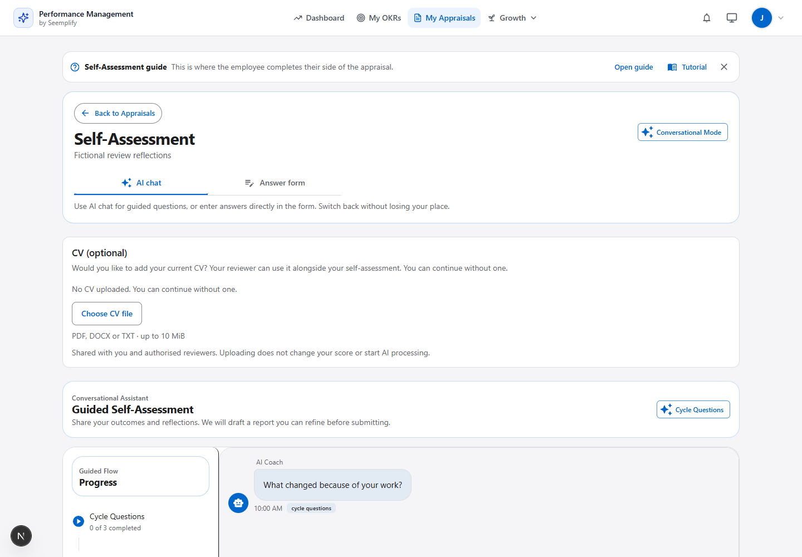

# Resume an unfinished self-assessment

## 1. What failed

The ChatGPT gate rechecked its connection whenever the browser regained focus. It temporarily removed the conversation from the page while checking, destroying its local composer and pending-request state. A replacement conversation could load the old question before an earlier answer finished saving. The server then correctly rejected another answer to the already-saved question, but the recovery message directed the employee to the manual form.

There was no inactivity expiry on the saved conversation. The failure was a race between focus checks, conversation restoration and an outstanding answer.

## 2. What changed

- Background connection checks preserve the open conversation, typed response and pending answer. Older connection-check responses cannot replace a newer result. A connection failure keeps the conversation mounted while the employee retries.
- Saved progress resumes after a long absence, including a tested 100-day interval. An unanswered question advances only through an accepted answer or explicit optional skip. Existing access, cycle-opening and submitted-appraisal restrictions remain in place.
- Resume reads avoid saving unchanged state. Competing writes return the latest question, saved answers and conversation state without overwriting the winning answer.
- An unsent conflicting response remains visible. The employee can continue with the current question or review and explicitly edit saved answers inside chat. An unsent response also remains visible in the report preview.
- Failed free-text sends retain the input for retry. A failed initial context load offers **Try again** instead of suggesting a new conversation.
- If another request submits or closes the assessment, the composer locks immediately and refreshes the appraisal status.

## 3. Switching views

**AI chat** and **Answer form** appear together as labelled, keyboard-accessible tabs. Both controls remain visible on mobile. The connection gate also retains its manual-form escape path.

Switching preserves the mounted chat and its unfinished text. The form's cycle answers save before returning to chat; chat then reloads the current saved question without rebuilding its composer. The page retains manual summary drafts. An unchanged form round trip preserves an edited report and self-rating; actual changes to saved answers invalidate an outdated report.

Saved configured-cycle answers are shared between the two views. Free-form chat reflections remain conversation evidence until a report is generated; this change does not claim to automatically copy every chat message into a manual summary field. Unsent text is retained while this page stays mounted; a full page reload restores saved server progress.



[Mobile view tabs](report-assets/conversation-resume-tabs-mobile-mocked.png) · [Preserved question draft](report-assets/conversation-resume-draft-mobile-mocked.png). These artifacts contain synthetic data and are not production assessment submissions.

## 4. Verification boundaries

The new Mongo/HTTP integration suite covers 10/100-day resume, pending AI replies with concurrent context/start requests, lost-response retry, competing answer saves, manual changes during an AI request, provider failure/retry, cross-tenant/actor denial and closed assessments.

The browser suite covers focus during a pending answer, reconnection, failed sends, initial-load retry, both view tabs, draft preservation, saved cycle-answer sharing, conflict recovery with explicit in-chat editing, final-question recovery through report preview, concurrent submission and edited-report/self-rating round trips. Provider responses and staff data are simulated in browser tests; backend persistence uses disposable Mongo data.

| Verification | Result |
| --- | --- |
| Backend | 150 checks across four integration suites, including 14 new resume/concurrency checks |
| Browser | 54 cases: 13 new resume cases, three existing conversation journeys, 38 existing CV cases; zero retries |
| Production build / TypeScript | Passed |
| Scoped lint | Passed; pre-existing `no-explicit-any` and unescaped-entity rules excluded for the older page files |
| Independent review | Approved after recovery, closed-state and report-draft findings were fixed |

```text
backend: node node_modules/jest/bin/jest.js --runInBand tests/appraisalConversationResume.integration.test.js tests/performanceJourney.integration.test.js tests/appraisalAiPolicy.integration.test.js tests/appraisalCv.integration.test.js
frontend: npx playwright test e2e/appraisal-conversation-resume.spec.ts --reporter=line
frontend: npx playwright test e2e/performance-journeys.spec.ts --grep "conversational self-assessment|frozen cycle questions inside" --reporter=line
frontend: npx playwright test e2e/appraisal-optional-cv.spec.ts e2e/competency-cv-evidence.spec.ts --reporter=line
frontend: npm run build
```

Production revision, health/OIDC checks and authenticated read-only UI acceptance are verified separately after publication. No real employee answers or employment outcomes are created for QA.
