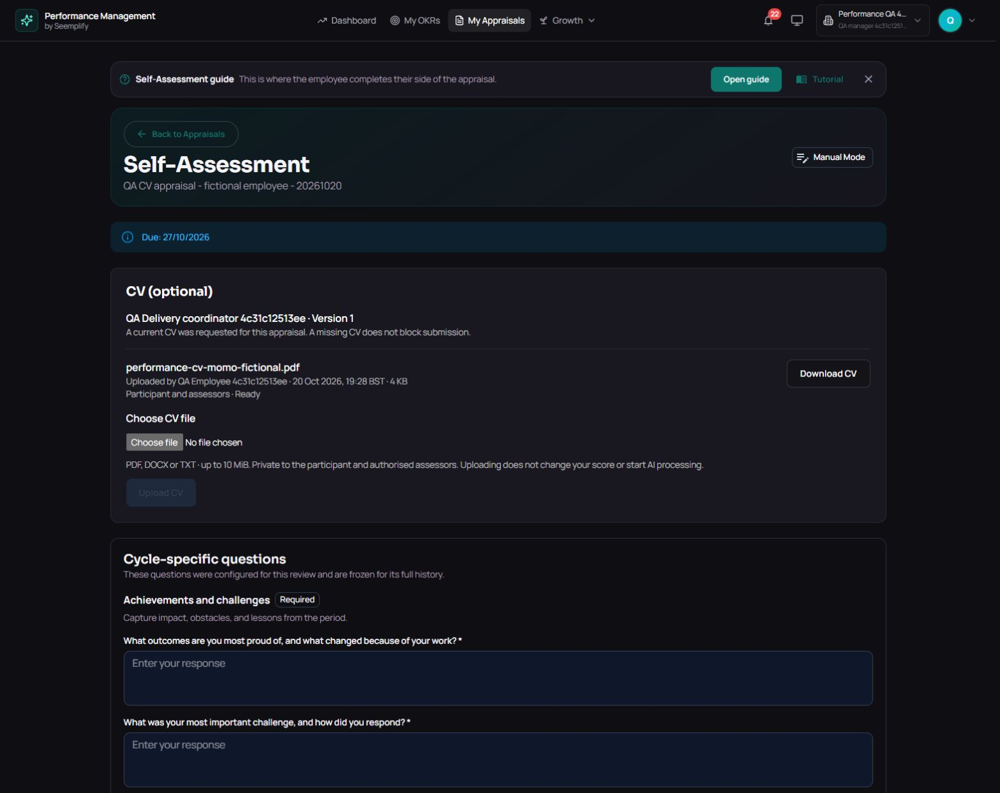
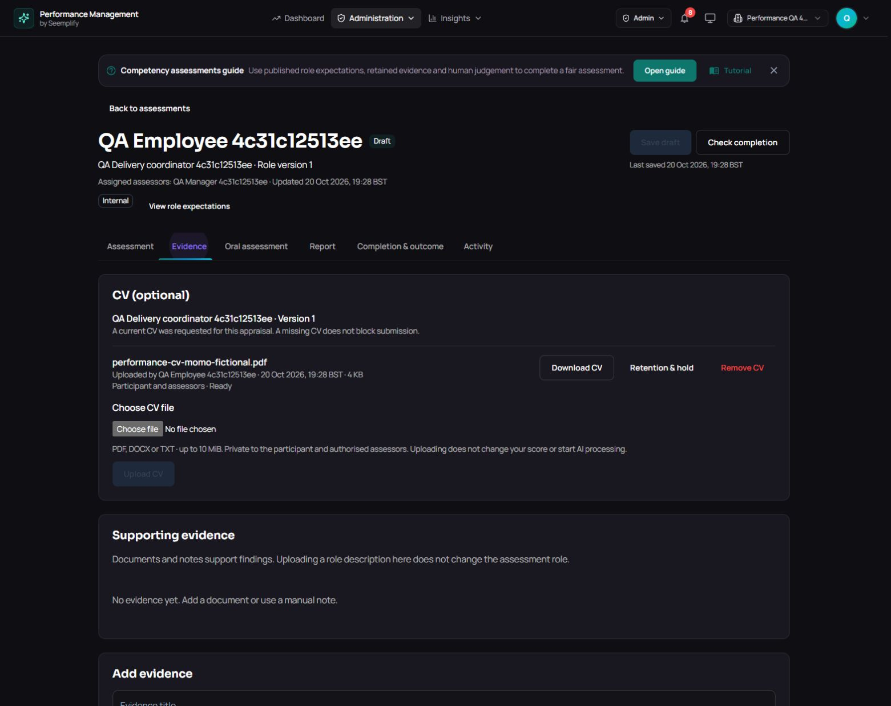

# Optional CV request and upload - acceptance plan

**Accepted request-to-evidence scope, 20 October 2026, 18:33 UTC.** The optional CV request/category is implemented and verified on deployed Performance 590e. A real manager request, employee PDF upload/reload, exact employee/manager downloads, nonassigned HR controls and four-role private-storage/denial proof passed. The new assessment remains Draft: no new human finding, result, automatic rating or AI draft was created. Broader provider/media limits remain open.

All required 590e verification steps passed: 659 backend, 709 HTTP with zero failures, 228 UI, 54 API/Mongo browser cases and build. The overall workflow was cancelled after verification during post-build artifact handling; it is not labelled a successful whole workflow. Current published main 9ac includes this work, while the audited runtime remains 590e. Existing Momo history retained exact raw hashes.

## Intended user flow

1. An authorized owner, admin, HR manager or manager starts an appraisal within their existing staff scope and selects an occupational role.
2. They may select **Request a CV for this appraisal**. The unchecked default and confirmation state make the request optional. It is not an organization-wide requirement, and without a linked role no request is sent.
3. The employee sees the target role/version and optional CV upload panel during self-assessment. A missing CV never blocks submission. The existing assessment Evidence view also offers a CV section without requiring a request.
4. The employee uploads a fictional PDF, DOCX or TXT. Existing private evidence storage, scanning, extraction, retention and authorized downloads apply. Manual notes cannot masquerade as a CV.
5. Authorized assessors can download/select the CV as evidence through existing controls. Upload does not attach evidence to findings, award points, call AI or make a suitability/employment decision.

## Frozen contracts

- `cvRequested` is optional per assignment/appraisal and defaults to false. Reject non-booleans. Freeze it in the assessment definition snapshot at launch; idempotent replay retains the original request and role.
- Reuse the existing evidence endpoint with `documentType: cv` or `supporting_evidence`; omitted type keeps existing supporting-evidence behavior. A CV requires a real file and participant audience. Invalid type, fileless CV and assessors-only CV audience return explicit validation errors.
- Omitted CV criterion IDs default to frozen assessment criteria, making the source selectable without assigning a finding or score. Supplied IDs retain ordinary validation.
- Reuse tenant/action authorization, mutation fences, private Cloudinary storage and server-authorized download. A retry cannot duplicate or reclassify an earlier source.
- Report evidence references retain CV metadata and source permissions. Existing assessments, files, published reports and human decisions remain unchanged; filenames never retroactively classify old evidence.

## Acceptance queue

| Case | Required evidence | Current state |
|---|---|---|
| Request on/off | Scoped launch, confirmation, frozen role/request and replay | Request-on browser/readback passed; off/default/replay source contracts passed |
| Staff and tenant boundaries | Preserve existing launch/evidence authority | Four ordinary live roles passed; nonactor 403. Foreign/launch denials have source coverage |
| Current assessor UI | Nonassigned HR controls; explicit denial overrides fallback | Actual HR controls/viewer proof and positive/denial regressions passed |
| Optional completion | Missing CV never blocks submission/finalization | Source contracts passed; live optional wording verified. No new final human result claimed |
| File handoff | Real upload/reload and exact authorized downloads | Employee and manager actual downloads matched 3,600 bytes and SHA-256 |
| Validation/recovery | Invalid type/file/audience, closed state and retry | Focused/full source contracts passed; real-file positive passed live |
| Report integrity | Typed references without automatic scoring/AI | Source report-reference contracts passed; live proof found no new finding/result/AI draft |
| Existing records | Preserve old flags/files/outcomes | Source compatibility passed; ten Momo assessments/two appraisals retained raw hashes |
| Release/live proof | Exact services, full verification, ordinary OIDC | Runtime 20/20; all 590e test/build stages passed; workflow cancelled afterward |

The consolidated private receipt is `performance-cv-final-acceptance-20261020T183314658049Z.json`. Earlier working notes below retain the source/failure chronology; they do not supersede this accepted-scope snapshot.

## Delivery order

D28's release and original failing AI replay passed. Prior d8cf/e9ff full CI and corrected learning receipts remain separate. E9ff's deploy stopped before apply when main advanced; cleanup completed without rollback. The separate 590e scoped release succeeded and independent runtime audit passed 20/20, including exact service revisions, retained Recruiter/rollback images, cleanup and source checks. Full 590e CI 39472900605 and actual CV/login acceptance remain pending.

Before deployment, review found a control gap for authorized organization-wide HR/admin assessors outside the frozen assigned-assessor list: the backend allowed the action, but the UI hid Remove CV. Published e9ff adds server-computed `viewerIsAssessor` to detail DTOs and honors explicit true/false, using legacy fallback only when absent. The ordinary allowed-action requirement remains. No server permission is widened. Focused HR-positive/explicit-denial and final e9ff exact-main gates passed; live acceptance remains pending. The prior d8cf full pass is not relabelled as e9ff proof.

Live acceptance uses fictional CV content and the original synthetic or Momo DEMO participants. Preserve approved ChatGPT connections and existing real staff records. No real person's CV is used as third-party test content.

The earlier Momo DEMO manager login/onboarding/history receipts remain historical positives at their timestamps. The user later separately removed 12 DEMO memberships and 14 team links. CV inventory detected that authority change before product writes; no identity or grant was recreated. Actual CV acceptance therefore uses the already authorized primary QA manager/employee workspace. The normal Start form shows the role switch and optional unchecked CV request. Launch/upload has not yet been claimed.

Before membership retirement, the Momo manager downloaded a real CSV containing a header plus two existing acknowledged DEMO results, both 4/5. These are historical exports, not new completions. Native read-only comparison after 590e deployment confirmed all ten original Momo assessments and two appraisals retained their exact raw hashes. The before/after audit artifact files have different metadata/timestamps; the stored record hashes match. Membership retirement is separate from unchanged human appraisal history.
