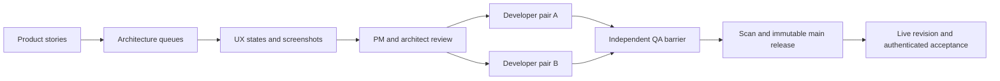

# Performance reliability: delivery and verification plan

20 October 2026. Scope: complete the existing Performance reliability audit and the explicitly requested Performance attachment switch to Cloudinary. This is an addendum to the existing product programme, not a replacement PRD.

## 1. Outcomes and current work

1. Organization-wide OKRs are created by authorized HR/admin/owner actors; managers initiate staff appraisals within their granted scope.
2. Employees can complete current work, resume safely, and find historical results and downloadable reports.
3. Every supported role has observable positive, denied, empty and recoverable-error paths.
4. New Performance appraisal attachments use the existing centrally managed Cloudinary credentials, private assets, authorized short-lived downloads and correct cleanup. Existing Azure snapshots remain readable through their original provider.
5. Release evidence identifies the tested commit, actual deployed commit, commands, failures/replays and limits. A healthy process alone does not establish feature acceptance.

The refreshed starting revision is `f846ef5459dc170d1552ecd720c1aff9a7d7a92f` on `main`. Earlier October 17 counts and Azure failure reports are historical. The initial fresh baseline passed 431 backend tests and 31 production-mode real-API Chrome journeys. Additional changes require focused regression and a new release receipt.

Tested source `069a20b01f21741400484639f257dd043aea3ea0` merged in [PR #147](https://github.com/Dewinsight/seemplify/pull/147) as main `da2e03c3c1c90c0297c7539abbc642d58a823264`; both have application tree `833cf30e15ec1d318a09adaf0f1047fca37ea8a7`. [Hosted CI 39379560998](https://github.com/Dewinsight/seemplify/actions/runs/39379560998) passed 452 backend checks (134 legacy, 38 unit, 280 Jest / 25 suites), 709 HTTP/zero failures, 151 first-attempt UI cases/zero flaky or skipped, 31 real-API Chrome cases and production build. [Fresh scan 39379559294](https://github.com/Dewinsight/seemplify/actions/runs/39379559294) passed. Earlier supporting repeats are not additive coverage. The 151-case clean run follows a dedicated-worker isolation fix after an earlier 150-clean/one-retry module-cache failure, plus same-file attachment retry and stale-error recovery.

Actual targeted backend/frontend deployment succeeded at exact main `da2e03c3`. Health, 20 static assets, current retry bundle, no mock API and OIDC redirect passed. Performance-only central storage changed Azure→Cloudinary revision 4; other solution defaults and keys are unchanged, with no existing files migrated. At 2026-10-20T06:42:00Z, the **deployed application storage adapter** passed synthetic TXT/PDF/DOCX authenticated raw upload, signed exact-byte 200 download, unsigned 401, expired-link denial and deletion. Existing-employee production browser smoke passed History/Current switching, My OKRs/Past/Current periods and recipient-only recognition modal with safe successful empty search. No send or real appraisal creation occurred; no new 5xx appeared in the inspected console since 06:42 UTC. The scoped release used locks, migrations, rollback and signed shared-AI health; redundant Core run 39381012731 was requested cancelled before its deployment, not counted as a successful all-app rollout. See [final acceptance receipt](ACCEPTANCE_RECEIPT.md) and [22-feature-group/eight-role coverage](ROLE_COVERAGE.md).

## 2. Team and work queues

The requested operating model has two product managers, two architects and two designers during discovery, then retains one product manager and one architect for verification. Development uses two pairs on independent packages; the retained architect doubles as QA. Never exceed six workers, and reduce this to the session's actual tool capacity.

This session supports four active agents including the coordinator. It therefore uses staged roles: coordinator/release QA, product reviewer, architect/developer and designer/developer. It does not claim six simultaneous workers. A completed reviewer can be reassigned when a slot is free.

| Stage | Owner and input | Concrete output | Exit condition |
| --- | --- | --- | --- |
| Discover | PM pair; existing PRD, current source, reported failures | User stories, role/scope rules and observable acceptance | Each story has success, denial and recovery criteria |
| Architect | Two architecture queues, one story at a time | Requirements, data/API contracts, migrations, provider and rollback decisions | PM accepts intent; interfaces and file ownership are explicit |
| Design | Design queue; accepted story and contracts | Existing-screen audit, state/interaction specs, keyboard/mobile criteria and synthetic screenshots | PM and architect review the package |
| Implement | Two developer pairs on independent packages | Scoped changes and meaningful regression tests | Pair review passes; no overlapping file ownership |
| Verify | Retained architect/QA plus independent reviewer for its own code | Script/API/browser results, security/tenant denials and issue dispositions | Required checks pass; limits remain visible |
| Release | Architect/release owner | Exact-path commit, scanned PR, immutable main release and live proof | Live revision, OIDC and authenticated behavior match the tested release |

Stories move individually. A PM starts the next story once its current handoff is accepted; architecture/design do not wait for the entire backlog. Blocked work stays in its queue while independent packages continue. Both developer pairs reach the verification barrier before integration; neither overwrites the other's unfinished work.

## 3. Review packages

- [Product stories](PRODUCT_STORIES.md): prioritized story backlog, including accepted Cloudinary requirement REL-13.
- [Architecture and QA](ARCHITECTURE_QA.md): authoritative identity, data/privacy contracts, test layers and release gates.
- [Design review](DESIGN_REVIEW.md): current interaction audit, recovery fixes and screenshot checklist.
- [Acceptance receipt](ACCEPTANCE_RECEIPT.md): populated with final commands and live results; a failed or unperformed check is never counted as passing.

Current independent work packages:

| Package | Implementation owner | Files owned | Independent reviewer |
| --- | --- | --- | --- |
| Private Cloudinary attachments | Architect/developer | Storage service, appraisal document schema/routes and dedicated backend tests | Coordinator/release QA |
| Search and calibration recovery | Designer/developer | Recognition/calibration pages and dedicated recovery browser tests | Coordinator, then architect review |
| Provider selection and live roundtrip | Coordinator | Private operational scripts and Performance-only central policy | Architect reviews contracts and safe receipt |
| Stories and illustrated handoff | Product reviewer/coordinator | New reliability documents and PDF | Product/design/QA reviewers |

The pre-existing dirty `embedded-report-recovery.spec.ts` belongs to other work. Preserve it and exclude it from this change's commit.

## 4. Per-story handoff contract

Each package records story ID, user/role/organization scope, current failure, intended behavior, acceptance criteria, exclusions, API/schema ownership, UI states, tests, source revision and evidence locations. Use `draft -> architecture-ready -> design-ready -> implementation-ready -> QA -> release-ready -> live-verified`. A failed gate sends only that package back to its owner.

UI concepts are useful for a new design direction. The existing programme already contains approved concepts and synthetic examples. This repair retains the current MUI design and focuses on operational states; generated mockups cannot substitute for screenshots of the implemented result. Any future generated concept must be marked as a concept and use fictional content.

## 5. Verification and release sequence

1. Refresh filesystem identity, branch, HEAD and working-tree status. Preserve unrelated edits. Fetch refs and verify relevant task branches have no unmerged work.
2. Reproduce each failure and add a regression that exercises the actual boundary: real picker shape, real session/authorization, production model indexes, or provider response.
3. Run backend unit and Mongo integration suites; real HTTP journeys across all fixture roles; UI/fullstack browser regression; production-mode real-API browser journeys; type checking and production build. Run Next servers sequentially per checkout.
4. For Cloudinary, prove TXT/PDF/DOCX private upload, exact-byte authorized download, unsigned denial, expired-link denial and cleanup. Test app authorization before signing. Preserve historical Azure/public snapshots and separate competency-private storage.
5. Review the diff independently, stage only this package's paths, commit on checked-out main, and promote through the required PR path. The user authorized architect-led admin merges; retain branch protections and required malware scanning. Do not bypass a failing check.
6. Deploy the exact tested main revision. Change only Identity's Performance storage default using existing managed credentials; compare all other solution defaults before/after. No credential rotation is part of this change.
7. Verify live image revisions, health/static assets, OIDC start, authenticated browser behavior and the actual managed storage service roundtrip. Clean synthetic artifacts on success and failure. Preserve application volumes and rollback resources.
8. Publish the concise numbered PDF with screenshots/diagrams, changes, commands/results and open limitations. Keep real-account screenshots, secrets and signed links out of the public repository.

## 6. Role skills and researched guidance

Existing local role skills cover product, architecture, design, development and QA for Seemplify's competency programme. Their domain-specific assessment/scoring rules apply only to that programme. For this reliability addendum, use the role handoffs above, the UI/UX quality gate, browser tooling and PDF skill; do not install an unreviewed external skill merely to match a job title.

Reusable skill bundles are ordinary `SKILL.md` instructions with optional references/scripts. The existing catalogue already supplies the required mechanisms; new skills should add a maintained workflow rather than duplicate generic job descriptions. [Official OpenAI skills guidance](https://developers.openai.com/plugins/concepts/skills).

Independent subagents suit separate investigations and reviews; dependent decisions and overlapping edits require coordination. The four-worker execution here follows that boundary. [Official OpenAI multi-agent guidance](https://developers.openai.com/api/docs/guides/agents-api/multi-agent).

Role research and primary sources are linked directly in the product, architecture and design documents. The PDF reports implemented and verified work, not general role theory.
