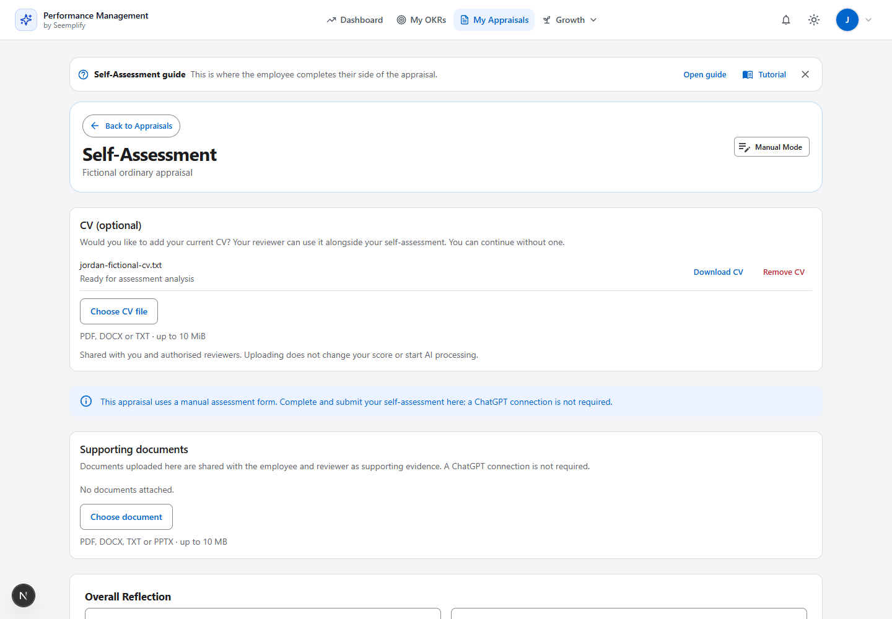
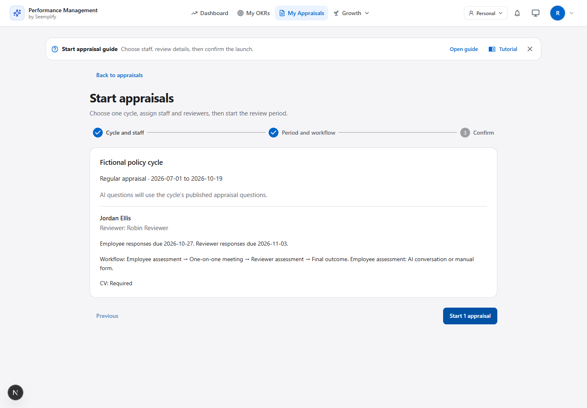

# CV during every self-assessment

## 1. Employee experience

An employee completing an ordinary appraisal can upload a CV above either the conversational or manual assessment. No occupational role, competency feature or ChatGPT connection is required. PDF, DOCX and TXT files up to 10 MiB are supported.

In **Start appraisals**, the manager chooses **CV requirement → Optional / Required**. The default is **Optional**. Confirmation displays the chosen policy, which is frozen separately for each appraisal. When optional, an employee can submit without a CV. When required, both assessment modes show **CV (required)** and explain that a file must be uploaded before submission; saving a draft remains available.

Both submission endpoints enforce the saved policy on the server. An active shared CV in the appraisal or a retained, shared CV in its linked role assessment satisfies the requirement. Another supporting document, private/deleted/expired evidence or a forged client flag cannot satisfy it. A valid CV file can satisfy upload requirements even if text extraction fails; readability remains a separate condition for AI evidence. Existing appraisals with no saved policy remain optional.

Linked role assessments retain their existing CV flow. Optional role discovery has a five-second deadline; an unavailable or slow competency endpoint falls back to the ordinary uploader. Late responses cannot replace a selected file. Previously uploaded ordinary CVs remain accessible if a role is subsequently linked.



[Mobile light](report-assets/ordinary-cv-mobile-light-mocked.png) · [Mobile dark](report-assets/ordinary-cv-mobile-dark-mocked.png). These are implementation screenshots with synthetic data, not production upload receipts.



[Required CV employee prompt](report-assets/required-cv-missing-mocked.png).

## 2. Evidence and access

Ordinary CVs use the existing private appraisal document store with `category=cv`. The server validates content/type and enforces employee/reviewer visibility, tenant scope, employee or scoped reviewer access, and existing closed-appraisal restrictions. Uploading does not invoke AI or change a rating. Legacy launch APIs also validate and freeze the CV requirement; employee submissions cannot change it.

Successful extraction makes the document available as CV evidence to current and final appraisal analysis. Empty, failed, inaccessible or deleted content is excluded; processing gaps are explicit. The same file is not also counted as a generic document. Reviewers can download CVs from both their embedded and dedicated review workspace; the final report retains its existing download controls.

## 3. Recovery

Failed uploads retain the selected file. A successful upload followed by a failed list refresh shows the saved file and a list-refresh action instead of another upload action. Explicit fetching before updating the appraisal cache fixes an issue found during browser QA: revalidation alone could silently retain stale data. Existing review text remains governed by the draft-preserving hydration mechanism.

## 4. Verification

| Layer | Result |
| --- | --- |
| Backend | 207 checks passed across eight integration suites; real disposable Mongo/HTTP/extraction and synthetic storage transport |
| Browser | 38 cases passed, zero retries; mocked API responses and fictional files |
| Build | Production Next.js build and TypeScript passed |
| Lint | Changed CV components passed; existing `no-explicit-any` and unescaped-entity baseline rules excluded for older assessment/reviewer files; existing unused-import/hook warnings remain |
| Peer review | Backend access/evidence and frontend recovery reviewed independently; findings fixed |

Browser coverage includes both assessment modes, competency disabled, stalled discovery and late replies, upload/reload/download/removal, retry, failed refresh without duplicate upload, unreadable content, mobile themes, reviewer visibility and closed records. Backend checks cover cross-tenant and wrong-resource denial, closed states, invalid content/audiences, no AI invocation, and current/final CV evidence classification.

Required-policy checks additionally cover default Optional, regular/combined launch selection and confirmation, frozen/replayed launch behavior, nonboolean policy rejection, both employee submission paths, continued draft saves, ordinary and linked CV fulfillment, and unreadable but valid uploads.

Commands:

```text
backend: node node_modules/jest/bin/jest.js --runInBand tests/appraisalCv.integration.test.js tests/appraisalCurrentAssessment.integration.test.js tests/appraisalPrivateStorage.integration.test.js tests/appraisalAiPolicy.integration.test.js tests/documentExtraction.integration.test.js tests/unifiedAppraisalCycles.integration.test.js tests/competencyAppraisalAtomic.integration.test.js tests/competencyCv.integration.test.js
frontend: npx playwright test e2e/appraisal-optional-cv.spec.ts e2e/competency-cv-evidence.spec.ts --reporter=line
frontend: npm run build
```

Deployment and authenticated live evidence are recorded separately after publication. Existing completed appraisals are not reopened by this feature.
