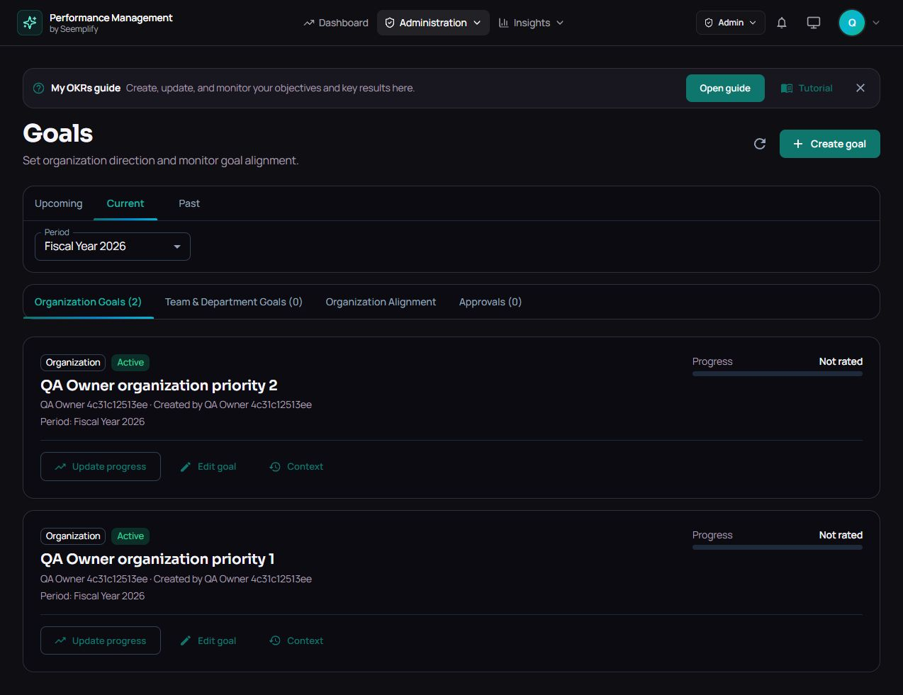
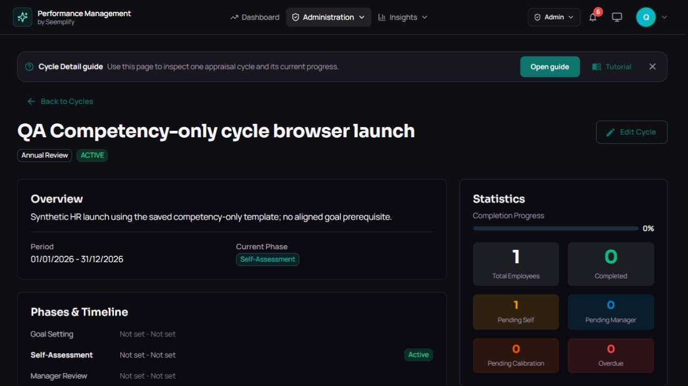
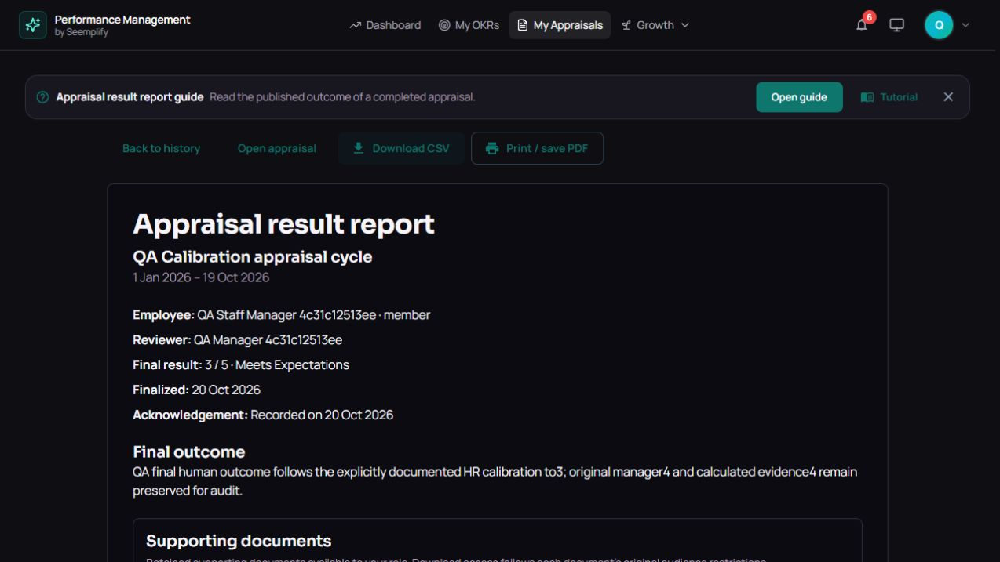
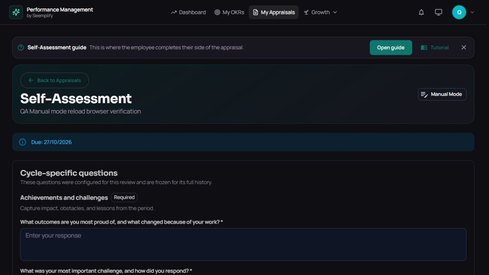
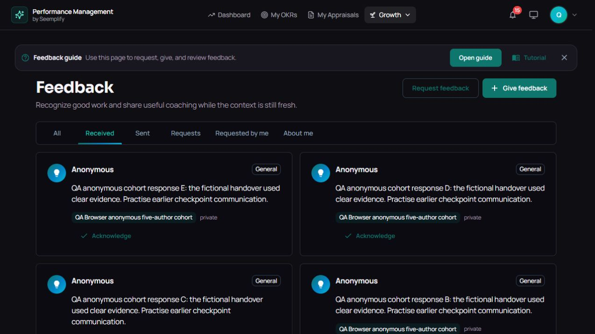
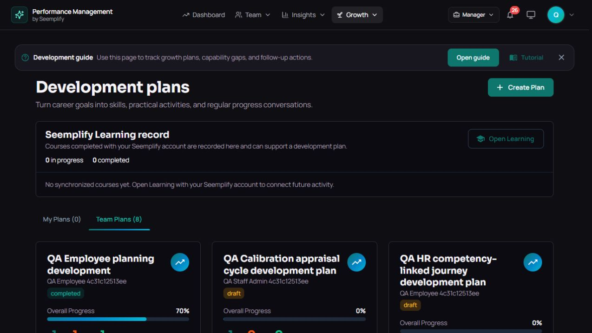
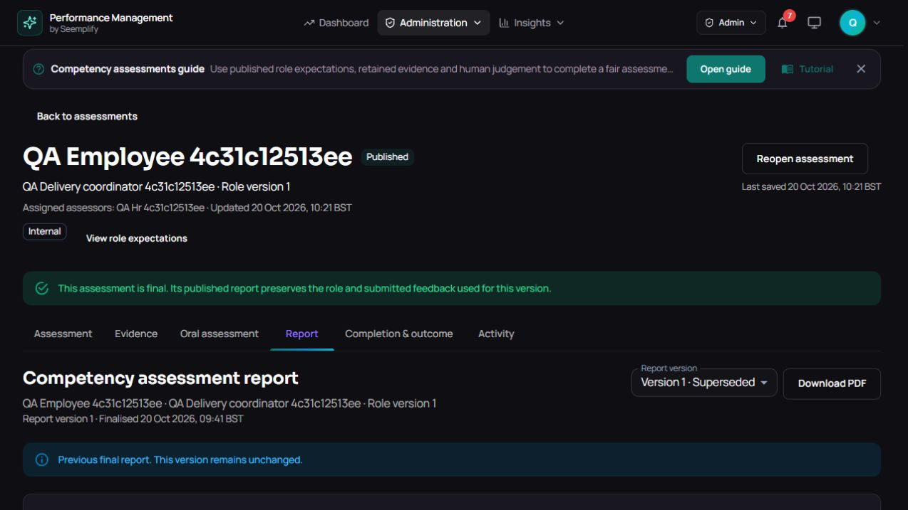
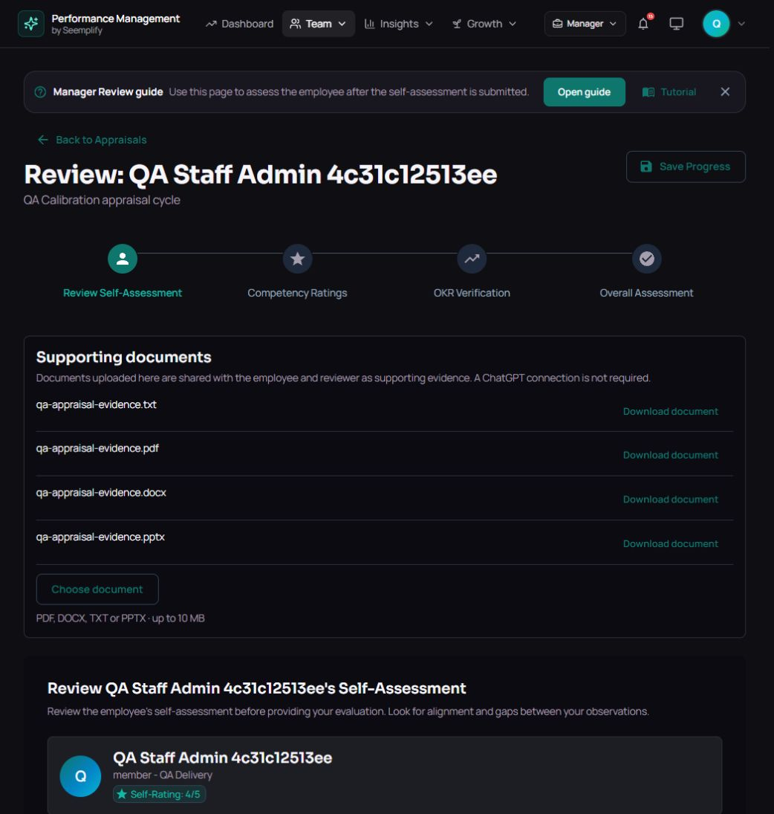

# Performance Manager - verified work and evidence limits

**CV request/upload is live and verified on release 590e.** A manager requested an optional CV during a role appraisal; the employee uploaded a fictional PDF, and employee/manager browser downloads matched all 3,600 original bytes. Nonassigned HR controls and independent role/private-storage checks passed. D29 central logout/sign-in recovery passed. All required 590e verification steps succeeded: 659 backend, 709 HTTP with zero failures, 228 UI, 54 API/Mongo browser cases and build. The overall workflow was cancelled after verification during post-build artifact handling. Runtime audit passed 20/20 and all ten original Momo assessments/two appraisals retained exact raw hashes. Published main is now 9ac; verified runtime remains 590e. Broader connected-course, external-delivery, device-media, recording and native-print evidence limits remain open.

## 1. Organization goals and authority

**LIVE PRODUCTION**

**Who sets organization-wide OKRs?.** Authorized owner, admin and HR manager. Department heads and team leads use their granted department/team scope; employees manage their own goals.

**Goals and authority were exercised.** Organization, department, team and individual goals saved/reloaded. Approvals, revision reasons, progress, alignment, scoped pickers and forbidden reads were tested.

**Ten acknowledged appraisal results.** Ten of twelve original QA appraisals reached human final publication, employee acknowledgement and own results/history. Two intentionally unfinished cases verify pending work and unrated draft recovery. Later Momo results are counted separately.

The baseline covers sixteen genuine OIDC identities in two QA organizations; later Momo journeys are separate. Full API run: 1,236/1,237 original expectations matched. The remaining response correctly denied access with 403; its source-aligned follow-up passed 10/10. Both receipts are retained.

## 2. Starting and completing appraisals

**LIVE BROWSER + API VERIFIED**

**Managers can begin reviews for their staff.** Owner, admin, HR, line manager, department head and team lead each launched within authorized scope. Selected reviewers, configured steps and discussion actions led to completed human decisions.

**Cycle setup follows the visible design.** HR launched a saved competency-only template with goals disabled and weights of 0% goals / 100% competencies. Editing, saving and reloading the existing draft preserved the design. Live cycle and frozen appraisal settings matched.

**Completion is visible.** Ten appraisals reached acknowledgement and personal report/history exports. The linked discussion and required-document cases both finished at 4. The calibrated case retained original manager rating 4 and human final rating 3.

The two unfinished appraisals are deliberate fixtures: one self-assessment pending and one saved unrated manual draft. Retained cycle drafts are separate from appraisal totals.

## 3. Historical results and downloadable reports

**LIVE BROWSER + API VERIFIED**

**Results and history are easy to reach.** Current/History selection, search, year filters, clear filters and employee scope passed. Reversible removal/restoration retained the result and acknowledgement. Fresh Momo owner reads also showed two existing completed reviews and a final-4 acknowledged report; six independent role-access checks passed.

**Reports keep the actual human decision.** Individual and history CSVs downloaded for the completed synthetic journeys. Calibration reports retain readable employee IDs and original/calibrated ratings. The Momo DEMO manager also downloaded the team-history CSV: one header and the exact two existing acknowledged DEMO results.

**Historical evidence stays downloadable.** Completed reports expose only permitted, read-only files. The canonical report retained five files and safe filenames/acknowledgement date in its 5,776-byte CSV. The calibrated case's TXT download matched all 157 original bytes. Unauthorized reads were denied.

Momo reads/CSV preceded the user's later DEMO-membership removal; they are historical receipts, not new completions. After 590e deployment all ten existing Momo assessments and two appraisals retained exact raw hashes. Native Print/save PDF remains unverified.

## 4. Saved work and unfinished-review privacy

**LIVE BROWSER + API VERIFIED**

**Save partial work without inventing a rating.** The AI-enabled manual draft retained exact achievements after the main-save confirmation and reload. Communication was cleared and both it and the overall rating stayed unrated; the draft remained unsubmitted.

**Manual choice survives navigation.** Choosing Use manual retains the form choice in the URL. Reload opens the manual form without a required ChatGPT gate. A human rating is still required on submission.

**Own work and draft privacy are preserved.** The existing check-in used Edit draft, save, reload and submit on the same record. Legacy viewers retained the employee's own work while hiding unfinished manager and peer material. Independent scope denials passed.

D29 passed in the real browser: central logout, private History opening sign-in, canonical Identity form and normal HR login back to the dashboard. No empty private workspace remained. Return to the original deep link was not asserted.

## 5. Feedback, recognition and chosen evidence

**LIVE BROWSER + API VERIFIED**

**Feedback handoffs complete.** Personal feedback/recognition, private and organization audiences, project request/accept/respond/acknowledge and a declined invitation all persisted. Chosen appraisal feedback retained its reviewer snapshot without automatic rating changes.

**Five distinct authors control anonymous release.** Five signed-in synthetic reviewers accepted and responded in the browser. Checkpoints 1-4 withheld content; the fifth released five anonymous responses. Independent 118/118 checks covered summaries, content, known IDs, scope and notifications.

**Privacy follows the actual viewer.** Requester and subject see cohort-safe progress and one generic cohort notification. Other authors' identity, request links and timing stay hidden. Each author can read their own metadata, including HR; HR has no wider anonymity exception.

Ambiguous-send retry uses one immutable payload/key and has real-service regression coverage. In-app delivery is verified; external email/chat delivery requires connected prerequisites.

## 6. Development, support and succession completion

**LIVE BROWSER + API VERIFIED**

**Development can be finished.** The employee saved goal progress 60% and skill progress 40%; the manager updated them to 65% and 45%. Notes, completed activity and check-in survived. Explicit completion retained actual progress of 70%. Independent read/scope checks passed 14/14.

**Succession remains a human decision.** HR read saved evidence, confirmed/removed the candidate, edited criticality/review date and closed/reopened/closed the slate. Decision audit and rationale remain; closed talent is readonly with frozen final 3.

**Support completion protects its evidence.** Employee and manager notes remain separate. A prospective extension retained its 20 December review date through completion, including the prior decision, reason and actor in history. Both completed plans reject later milestone edits without changing stored evidence.

D26 passed in the browser and independent API checks on revision 86d2. The earlier already-lost date was not reconstructed. The subsequent D27 calibration read-only UI also passed its separate deployed replay on cd86.

## 7. Competency, talent and calibration

**LIVE BROWSER + API VERIFIED**

**Competency definitions and assessment are usable.** Published strategy and role versions, a reviewed import and manual assessment reached a human Suitable decision. HR saved, reloaded and submitted manual oral evidence, then published report version 3.

**History and audiences survive new versions.** Version 3 is Current; versions 1 and 2 are Superseded with unchanged stored findings and rationale. The employee report excludes assessor-only oral material. Individual and two-page cohort PDFs exported; filtering Draft returned zero and clearing returned one.

**Calibration and talent preserve evidence.** Human calibration changed 4 to 3 with a recorded reason and retained original manager rating 4. Closed talent is read-only. Deployed D27 also passed: completed fields are read-only, saved rating/reason remain and Save/Submit are absent. Sixteen fresh OIDC actors, 96 authority checks and 12 invalid probes retained both complete appraisal records unchanged.

Historical PDFs retain content while reflecting Current/Superseded status. The optional CV feature and nonassigned-HR controls are verified separately on page 9. Human decisions and existing Momo history remained unchanged.

## 8. Storage, calls and external providers

**BOUNDED EVIDENCE**

**Cloudinary files retain their original bytes.** Appraisal files use authenticated Cloudinary storage. TXT, PDF, DOCX and PPTX uploads survived reload and downloaded with exact original hashes for employee and reviewer. A new valid PDF extracted one page with AI skipped; historical files remained retained.

**Generated audio and video crossed TURN.** Both scripted peers connected through relay-to-relay TURN in 11.64 seconds. Each received 42 RTP packets with decoded changing video and simultaneous audio. Sixteen authentication/HTTP checks passed. Both left with recording off; no device media was used.

**Live providers have separate transaction receipts.** Canonical SMTP reached the Gmail inbox with SPF, DKIM and DMARC passing. Genuine OIDC OKR AI returned three valid fictional objectives without saving. Momo calendar create/cancel passed. After D28's tested two-backend release, the original support-plan AI form generated six editable fields; no employee was chosen or plan saved.

Momo Learning SSO passed; course completion/Performance sync was not tested. Calendar cancellation retained a provider tombstone. Browser-created external delivery, two-browser device media, recording/transcription and native print remain unverified.

## 9. Optional CV requests and private evidence

**LIVE BROWSER + INDEPENDENT API VERIFIED**

**Request a CV for this role appraisal.** The manager launched the role-based appraisal through the normal form with CV requested. The checkbox started unchecked; confirmation included the request. The selected role/version and request were frozen for this appraisal. Missing CV remains optional and does not block submission.

**Employee upload and assessor handoff.** The employee selected a fictional PDF, uploaded it, reloaded and downloaded the exact 3,600 original bytes. The manager downloaded the same SHA-256 hash. The ready file retained its author, name, role/version and participant/assessor audience.

**Permissions and human outcomes remain intact.** Four ordinary OIDC roles passed independent private Cloudinary, scanner/hash, no-store and scope checks; a nonactor received 403. Nonassigned HR had permitted controls, while the employee did not gain assessor/delete powers. Upload created no finding, result, AI draft or automatic rating.

This is a completed request-to-evidence handoff, not a newly finalized appraisal. Optional/default/off/retry/invalid/closed/report-reference contracts also passed source tests. All required 590e verification steps passed; the workflow was cancelled afterward during artifact handling.

## 10. Role coverage and evidence boundaries

| Role | Completed transactions | Evidence boundary / remaining |
|---|---|---|
| Owner | Created organization OKRs; launched and completed a scoped staff review with human final rating 4, employee acknowledgement, reports and history; sent feedback and recognition. | Organization authority remains within the current tenant. |
| Admin | Created organization OKRs; completed a separate scoped staff journey through acknowledged rating 4, report and history; saved personal feedback, recognition and check-in. | Organization authority remains within the current tenant. |
| HR manager | Published competency report v3 with private oral evidence and retained history; calibrated a rating to 3; closed talent and succession work; launched cycles and read historical files. | Human decisions and file audiences remain explicit. |
| Line manager | Completed development at 70%; approved a revised goal; replied to a managed lead; completed support extension/history, project feedback, 360 responses and staff appraisals. | Staff scope and legal support transitions are enforced. |
| Department head | Saved department goals; completed a scoped staff appraisal at acknowledged rating 4; read the correct child-lead check-in and gave private and anonymous feedback. | Department scope excludes unrelated staff. |
| Team lead | Saved and edited team goals; completed a staff appraisal at acknowledged rating 4; read the manager reply and scoped picker; gave private and anonymous feedback. | Team scope excludes unrelated staff. |
| Main employee | Acknowledged final rating 4; revised and resubmitted a goal; saved development and support progress; received anonymous 360 results; read competency v3 with private oral material hidden. | Own records remain separate from assessor-only evidence. |
| Teamless employee | Completed an acknowledged rating-4 case and history; retained an intentionally unrated manual draft; submitted the fifth anonymous 360 response. | Personal access does not grant manager actions. |
| Six assigned staff | Completed all six original appraisals through acknowledgement and reports. Additional cases retained calibrated rating 3 and five historical supporting files. | Each employee sees their own permitted results and files. |
| Boundary controls | Verified same-organization and foreign denials, permitted foreign HR authority in its own organization, and the outsider's own pending appraisal. | Foreign authority never grants access across tenants. |

## Evidence appendix

CI counts cover controlled UI tests and a disposable API/Mongo browser suite. They are separate from the production browser journeys and ordinary OIDC production proofs named on these pages.

[Optional CV request/upload](CV_FEATURE_ACCEPTANCE.md) has its own accepted request-to-evidence scope; its source, real browser and independent authorization receipts are distinct from the original feature audit.

[Surface coverage](PRODUCTION_COVERAGE_MATRIX.md) maps 23 feature groups and 68 existing routes. [Release gates](POST_DEPLOYMENT_REPLAY.md) distinguish the current release from earlier receipts. Original failures and corrected harness assumptions remain in [the receipt appendix](PRODUCTION_ROLE_RECEIPT.md) and immutable private evidence.

Verified: canonical SMTP transport/inbox, genuine OKR/support/talent AI calls, Momo calendar create/cancel, Learning SSO and live CV handoff. Unverified: connected-course completion/Performance sync, browser-created external email/chat delivery, two-browser device media, recording/transcription and native print. Calendar cancellation retained a provider tombstone. Reviewed shared-AI residuals and test fixtures are retained; no total erasure is claimed.
